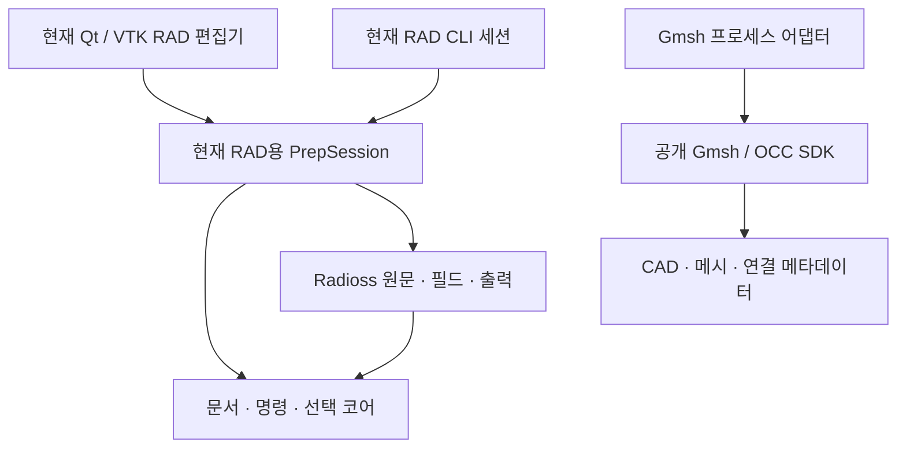

# 공용 CAE 기반과 첫 구현의 구조

이 저장소는 여러 CAE 프로그램에서 재사용할 개발 자산과 기반을 만든다. OpenRadioss/OpenCourant는 첫 적용 대상이며, 현재 RAD 편집기는 공용 기반을 실제 작업에 연결한 첫 사용처다. 이 문서는 공용 자산의 경계와 현재 구현의 파일 계약을 구분해 설명한다. 목표와 후보 비교는 [DESIGN](DESIGN.md), 후속 모듈·계약·코드 이행과 작업 단위는 [상세 실행 계획](docs/shared-cae-foundation-plan.md)에 둔다. 상세 계획의 경로와 인터페이스를 현재 구현으로 해석하지 않는다.

## 공용 자산의 경계와 현재 상태

다중 파트·배치·혼합 자유도·케이스·대용량 자료의 목표 소유 구조와 완료 범위는 [모델·데이터 설계](docs/cae-model-data-design.md)에 둔다. 실제 구현 단계·종료 판단은 [작업서](docs/execution-stages.md), 외부 소비자의 소유·의존·파일 전달 경계는 [Workbench 재사용 계획](docs/workbench-reuse-plan.md)을 따른다. 아래 현재 코드가 그 목표를 이미 구현했다는 뜻은 아니다.

공용 산출물에는 디자인·아이콘·공학 위젯·앱 셸과 실행 가능한 네이티브 갤러리뿐 아니라 문서·명령·선택·저장, 형상/메시/조건의 관계, 외부 도구 어댑터와 자동화 API가 포함된다. 이 자산의 개발은 두 번째 제품이 생긴 뒤에만 시작하는 후속 작업이 아니다. 실제 사용 앱과 갤러리는 공용 자산을 소비하며, 공용 코어가 RAD 편집기나 갤러리에 의존하지 않게 한다. 기존 공용 GUI 저장소의 자산·갤러리와 소유 범위를 맞춰 중복 구현을 피한다.

`cae_core`는 솔버와 GUI를 모르는 문서·명령·선택 기반이다. `application.contracts`의 PropertyHost/DocumentSession·ObjectRef·PropertySpec·SetProperties는 Qt/RAD/VTK 없이 로드된다. `RadProvider`가 기존 PrepSession을 이 계약에 연결하고 `CurveSession`은 중립 재료/곡선 문서를 제공한다. 공용 위젯과 갤러리는 RAD와 VTK 없이 로드되며 기존 `ui.MainWindow`와 `application.PrepSession` export는 지연 로딩으로 호환한다. 기존 PrepSession 자체는 RAD/INCLUDE·원문·출력을 소유하는 솔버별 구현으로 남는다.

`ui/design`은 자체 SVG·토큰·상태 스타일, `ui/widgets`는 model/view 트리·그룹 속성·숫자/단위·벡터·곡선 표/plot을 소유한다. `ui/actions`와 `ui/shell`은 동일 Action·도킹·renderer frame·비동기 FileTask를 제공하며 실제 전처리기와 갤러리가 공유한다. 위젯은 초안만 소유하고 provider/session이 확정 값·검증·Undo를 소유한다. 묶음 A의 실제 Windows 입력·배율·도킹 확인은 [검증 기록](docs/native-windows-validation.md)에 환경·입력 방법·화면과 함께 남겼다.

## 이번 구현의 결정

첫 사용 앱은 사용자 Radioss 원문을 편집하는 독립 앱이다. 전체 CAE를 포크하기 전에 공개 VTK·Qt와 Gmsh SDK를 교체 가능한 경계로 연결하고, 문서·명령·선택·저장 코어를 실제 코드로 분리했다. 이 결정은 미지원 카드도 보존해야 하는 첫 작업에 대한 선택이며, 저장소 전체를 Radioss 전용 제품으로 한정하거나 SMTK/FEBioStudio/SALOME보다 모든 기능에서 우월하다고 선정한 결과가 아니다.

Gmsh는 CAD/메시 엔진이고 문서의 정본이 아니다. OCP/OCAF와 Gmsh OCC를 동시에 정본으로 두지 않는다. 현재 Gmsh 산출물은 독립 후보 자산이며 GUI의 Radioss 문서에 자동 합쳐지지 않는다.

계획상 첫 CAD/메시 C는 최소 자원·배열·채택 명령(P6a)만 선행하고 P7a에서 연결한다. 완전한 다중 파트·대용량 B를 선행 조건으로 삼지 않는다. 후보 생성과 문서 변경을 구분하고, 품질 확인 뒤 채택/교체를 하나의 명령으로 적용한다. 외피 facet과 물리 shell 요소, Gmsh tag와 지속 객체 참조를 구분한다. 신규 RAD 출력에는 현재 원문 patch와 별도의 생성 provider/ID 할당이 필요하며, 현재 코드에 구현된 것으로 간주하지 않는다.

Workbench는 현재 자체 PySide6 앱이며 FreeCAD를 외부 프로그램으로 사용한다. 공용 위젯에는 Workbench 서비스 adapter를 주입하고 프로젝트/연구의 소유권을 유지한다. 독립 Prep 문서와 Workbench 프로젝트는 파일 역할·개정으로 연결하며, 두 명령 이력이나 문서 정본을 겹치지 않는다. 현재 Workbench의 INP용 실행 입력 복사 경로와 RAD 실행 연결은 별도 후속 구현 대상이다.

## 계층과 의존 방향

| 코드 | 실제 소유 책임 |
|---|---|
| `cae_core` | solver/Qt/VTK를 모르는 Document·Resource·CommandDispatcher·ChangeSet·SelectionRef·SaveState |
| `radioss` | 원문과 지원 필드 patch, 카드 schema/단위 문맥, 미지원 부분 보존, 표시용 메시 투영 |
| `application.session` | 현재 RAD용 PrepSession. RAD 자원 조합, 조회·편집·Undo·INCLUDE·저장·내보내기 API, 호출 직렬화. 공용 세션 계약 전체가 완성된 상태는 아님 |
| `application.contracts` / `rad_provider` / `neutral` | 최소 host 계약, 기존 RAD adapter, 독립 재료/곡선 provider와 codec. 범용 FE 스키마를 강제하지 않음 |
| `application.storage` | codec과 독립인 atomic ZIP writer와 bounded reader. RAD v1 manifest·원문과 중립 codec의 의미는 각각 유지 |
| `ui/design`, `ui/widgets`, `ui/actions`, `ui/shell` | 공용 디자인·입력 초안·트리·표/plot·Action·도킹·renderer frame·실제 FileTask 상태/오류/산출물 |
| `ui/main_window`, `ui/gallery` | 앱별 조립과 초안/선택/파일 작업 조정. 모델 값의 정본은 주입한 provider/session |
| `cli` | 현재 RAD 세션 API를 호출하는 명시적인 독립 프로세스 진입점 |
| `adapters.gmsh_backend` / `gmsh_worker` | 별도 SDK 프로세스, 시간 제한·취소, 입력 CAD에서 독립 후보 자산 생성 |

MCP 서버·열린 GUI에 접속하는 IPC는 아직 구현하지 않았다. CLI가 같은 클래스를 사용한다는 사실은 이미 열린 GUI 문서를 공유한다는 뜻이 아니다. 추후 MCP/IPC는 앱이 소유한 같은 문서·명령/API로 연결하며 별도 모델 사본을 몰래 수정하지 않는다. 현재 RAD 사용처에서는 그 경로가 PrepSession이며, 이 솔버별 구현을 공용 API의 전부로 고정하지 않는다.

## 문서와 명령

문서 ID와 resource ID는 렌더링 배열 인덱스·Gmsh tag와 구분한다. 명령 성공과 Undo/Redo는 revision을 증가시키고 저장 기준점과 현재 자원 상태로 dirty를 판단한다. `expected_revision`이 맞지 않거나 필드 검사가 실패하면 모델을 부분 변경하지 않는다. ChangeSet과 구조화 오류로 실제 변경을 전달한다.

현재 Undo는 기존 한 resource의 필드 상태 변경을 다룬다. 자원 생성·삭제와 여러 resource에 걸친 트랜잭션은 아직 없다. 같은 PrepSession의 변경 알림은 호출 스레드에서 발생하고 GUI는 Qt 신호로 UI 스레드에 전달한다. 별도 CLI 프로세스에는 이 구독이 공유되지 않는다.

Radioss는 원문 바이트가 정본이다. 편집 가능한 필드 위치만 patch하며 미편집 필드·주석·카드 순서·개행을 다시 정규화하지 않는다. VTK 메시 투영은 반환된 복사본이며 편집 원본이 아니다. 원 절점·요소 ID와 pick 인덱스는 별도로 매핑한다. `/TRANSFORM` 등 표시에서 해석하지 않은 조건은 진단으로 남긴다.

필드는 입력 덱 단위와 카드별 `unit_ID` 문맥을 유지한다. 값을 임의로 Pa/MPa로 변환하지 않는다. 기존 곡선·물리 조건을 보존한다는 것과 그 조건의 편집·3D 표시를 지원한다는 것은 다르다.

## 작업 파일과 native 덱

`.caeprep`은 버전 있는 ZIP 문서다. `manifest.json`에 문서 ID·revision·논리 경로·자원 ID·지원 필드 patch를 기록하고 `raw/<resource-id>.rad`에 원문을 동봉한다. 외부 원본 경로만 저장하는 형식이나 pickle이 아니다. 임시 파일을 작성한 뒤 원자적으로 교체한다. 재시작 후 Undo 기록을 복원하는 기능은 현재 범위가 아니다.

이는 현재 RAD 사용 앱의 저장 계약이다. 다른 솔버의 모델을 RAD 원문이나 하나의 공통 FE 스키마로 강제하는 공용 저장 규격이 이미 완성됐다는 뜻은 아니다.

중립 재료/곡선은 같은 원자 저장 절차를 쓰되 manifest `format=caelab-material-curves`, `version=2`와 `material-curves.json` payload를 사용한다. 이전 중립 v1도 읽는다. v2는 재료의 기존 곡선 참조를 저장하며 provider는 표시명/typed ObjectRef 후보를 제공하고 실제 명령이 문서·자원·종류·존재를 검증한다. 이 codec은 RAD를 import하지 않는다. `gallery [path]`로 열고 저장하며 RAD `.caeprep` v1은 그대로 유지한다. 양쪽 모두 파일 작업 실패 시 기존 파일과 dirty 상태를 보존한다. 비동기 FileTask는 running/succeeded/failed·구조화 오류·실제 산출물 경로를 반환하고 저장/열기는 취소 불가능으로 표시한다. 지원하지 않는 Cancel 동작을 제공하지 않는다.

`SelectionProvider.select/active_object`는 두 provider/window의 활성 객체를 연결한다. 첫 RAD 관계는 기존 PART와 투영의 part_id가 연결된 요소이며 중복 native ID는 거부한다. 영속 ObjectRef ID는 재열기 뒤에도 유지하지만 renderer pick은 설치마다 바뀌는 document_epoch, 문서 revision, resource state token, projection_revision을 함께 검사한다. 스칼라 수정 뒤 표시 형상을 재생성하지 않고 pick stamp를 갱신한다. 둘 이상의 승인된 요소는 모든 resource/local-ID 쌍을 강조한다.

`ActionRegistry`는 두 창에서 identity·capability·문맥·상태를 QAction에 연결한다. `FileEditCoordinator`는 초안/dirty 질문과 명시 폐기·저장/실패/닫기 절차를 공유한다. RAD 자동 적용과 중립 수동 적용은 각 host에 남긴다. `ui/catalogue.py`의 부품 장면은 실제 provider 편집과 상태를 확인하고, 원래 재료/곡선 작업 화면은 조합 사용 예로 구분한다. `design/tokens.py`가 QSS·SVG·공용 위젯 수치의 원본이다.

`#include`는 지시문으로 식별한다. 이번 구현은 처음 입력 덱의 작업 폴더를 기준으로 안전하게 해석 가능한 상대 파일들을 묶는다. 절대 경로·상위 경로·누락·순환 등 처리하지 못한 참조는 보존하고 부분 읽기 진단을 반환한다. 해결되지 않은 INCLUDE가 있는 문서는 독립 native 출력 묶음으로 내보내지 않는다. 이 제한은 사용자의 원본 덱 실행 가능성을 판정하는 솔버 허용 목록이 아니다.

내보내기는 작업 문서 저장과 별개다. 원본 입력 파일을 덮어쓰지 않으며 root 덱과 해결된 INCLUDE를 전달한다. Engine 파일을 새로 생성·변경하거나 계산을 실행하지 않는다.

## CAD/메시 후보 자산

공개 Gmsh 4.15.2 SDK를 별도 worker에서 사용한다. 호출 프로세스에 Gmsh를 import해 전역 모델을 공유하지 않는다. 후보의 CAD XAO, 메시 MSH, 연결 메타데이터를 함께 보관한다. Gmsh backend tag는 작업 중 주소이고 UUID·자원 개정과 구분한다. 외부 STEP/BREP를 새로 가져오면 새 형상 자원이다.

실제 시험에서 MSH만 재열면 CAD는 discrete entity가 되었고 BREP만으로는 physical group이 보존되지 않았다. XAO의 named group과 별도 메시 자산을 함께 다루는 정책이 필요하다. 또한 재메시 전후 같은 node ID의 좌표가 달라질 수 있었다. 따라서 explicit node/element 선택을 새 메시로 자동 전용하지 않는다. GUI 문서로 후보를 채택하는 명령·하중 재연결은 아직 구현하지 않았다.

## 재사용과 남은 범위

현재 첫 적용 대상은 OpenRadioss/OpenCourant이고, 실행 가능한 사용 앱은 RAD 원문 편집기다. 공용 자산과 네이티브 갤러리는 이 저장소의 정식 개발 산출물이며 실제 편집 흐름과 함께 개발한다. 서로 다른 사용처에서 같은 코어·위젯을 사용하는 확인은 재사용 품질을 판단하는 기준이고, 공용 자산 개발을 시작하기 위한 전제 조건이 아니다.

첫 공용 위젯·셸 부품·갤러리·최소 세션 계약을 실제 RAD와 중립 재료/곡선 문서에 연결했고, 관련 자동 검사와 범위를 고정한 Windows 실제 창 검증을 수행했다. 기존 RAD 사용처의 새 카드 생성, CAD 메시와 Radioss 조건의 GUI 통합, 고급 메시/중립면/접촉 생성, MCP/IPC, 솔버 실행·후처리, 설치형 배포는 후속이다. 이 목록이 모든 솔버 기능을 동시에 구현하거나 상용 CAE 전체를 재현하라는 범위는 아니다.

