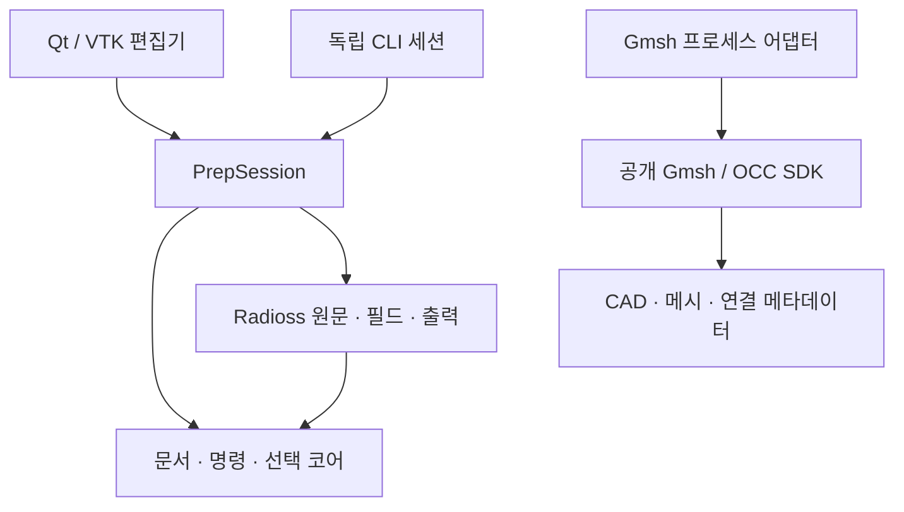

# 실행 기반의 구조

이 문서는 현재 코드의 소유 경계와 파일 계약을 설명한다. 제품 목표와 후보 비교는 [DESIGN](DESIGN.md)에 둔다.

## 이번 구현의 결정

첫 실행 기반은 사용자 Radioss 원문을 편집하는 독립 앱이다. 전체 CAE를 포크하기 전에 공개 VTK·Qt와 Gmsh SDK를 교체 가능한 경계로 연결하고, 문서·명령·선택·저장 코어를 실제 코드로 분리한다. 이 결정은 미지원 카드도 보존해야 하는 첫 작업에 대한 선택이며, SMTK/FEBioStudio/SALOME보다 모든 기능에서 우월하다는 선정 결과가 아니다.

Gmsh는 CAD/메시 엔진이고 문서의 정본이 아니다. OCP/OCAF와 Gmsh OCC를 동시에 정본으로 두지 않는다. 현재 Gmsh 산출물은 독립 후보 자산이며 GUI의 Radioss 문서에 자동 합쳐지지 않는다.

## 계층과 의존 방향

| 코드 | 실제 소유 책임 |
|---|---|
| `cae_core` | solver/Qt/VTK를 모르는 Document·Resource·CommandDispatcher·ChangeSet·SelectionRef·SaveState |
| `radioss` | 원문과 지원 필드 patch, 카드 schema/단위 문맥, 미지원 부분 보존, 표시용 메시 투영 |
| `application.session` | 한 문서의 자원 조합, 조회·편집·Undo·저장·내보내기 API, 호출 직렬화 |
| `ui` | 메뉴/툴바 Action, 트리·속성·3D·선택 피드백. 모델 값의 정본은 세션 |
| `cli` | 동일 세션 API를 호출하는 명시적인 독립 프로세스 진입점 |
| `adapters.gmsh_backend` / `gmsh_worker` | 별도 SDK 프로세스, 시간 제한·취소, 입력 CAD에서 독립 후보 자산 생성 |

MCP 서버·열린 GUI에 접속하는 IPC는 아직 구현하지 않았다. CLI가 같은 클래스를 사용한다는 사실은 이미 열린 GUI 문서를 공유한다는 뜻이 아니다. 추후 MCP/IPC는 PrepSession의 명령/API로 연결하며 별도 모델 사본을 몰래 수정하지 않는다.

## 문서와 명령

문서 ID와 resource ID는 렌더링 배열 인덱스·Gmsh tag와 구분한다. 명령 성공과 Undo/Redo는 revision을 증가시키고 저장 기준점과 현재 자원 상태로 dirty를 판단한다. `expected_revision`이 맞지 않거나 필드 검사가 실패하면 모델을 부분 변경하지 않는다. ChangeSet과 구조화 오류로 실제 변경을 전달한다.

현재 Undo는 기존 한 resource의 필드 상태 변경을 다룬다. 자원 생성·삭제와 여러 resource에 걸친 트랜잭션은 아직 없다. 같은 PrepSession의 변경 알림은 호출 스레드에서 발생하고 GUI는 Qt 신호로 UI 스레드에 전달한다. 별도 CLI 프로세스에는 이 구독이 공유되지 않는다.

Radioss는 원문 바이트가 정본이다. 편집 가능한 필드 위치만 patch하며 미편집 필드·주석·카드 순서·개행을 다시 정규화하지 않는다. VTK 메시 투영은 반환된 복사본이며 편집 원본이 아니다. 원 절점·요소 ID와 pick 인덱스는 별도로 매핑한다. `/TRANSFORM` 등 표시에서 해석하지 않은 조건은 진단으로 남긴다.

필드는 입력 덱 단위와 카드별 `unit_ID` 문맥을 유지한다. 값을 임의로 Pa/MPa로 변환하지 않는다. 기존 곡선·물리 조건을 보존한다는 것과 그 조건의 편집·3D 표시를 지원한다는 것은 다르다.

## 작업 파일과 native 덱

`.caeprep`은 버전 있는 ZIP 문서다. `manifest.json`에 문서 ID·revision·논리 경로·자원 ID·지원 필드 patch를 기록하고 `raw/<resource-id>.rad`에 원문을 동봉한다. 외부 원본 경로만 저장하는 형식이나 pickle이 아니다. 임시 파일을 작성한 뒤 원자적으로 교체한다. 재시작 후 Undo 기록을 복원하는 기능은 현재 범위가 아니다.

`#include`는 지시문으로 식별한다. 이번 구현은 처음 입력 덱의 작업 폴더를 기준으로 안전하게 해석 가능한 상대 파일들을 묶는다. 절대 경로·상위 경로·누락·순환 등 처리하지 못한 참조는 보존하고 부분 읽기 진단을 반환한다. 해결되지 않은 INCLUDE가 있는 문서는 독립 native 출력 묶음으로 내보내지 않는다. 이 제한은 사용자의 원본 덱 실행 가능성을 판정하는 솔버 허용 목록이 아니다.

내보내기는 작업 문서 저장과 별개다. 원본 입력 파일을 덮어쓰지 않으며 root 덱과 해결된 INCLUDE를 전달한다. Engine 파일을 새로 생성·변경하거나 계산을 실행하지 않는다.

## CAD/메시 후보 자산

공개 Gmsh 4.15.2 SDK를 별도 worker에서 사용한다. 호출 프로세스에 Gmsh를 import해 전역 모델을 공유하지 않는다. 후보의 CAD XAO, 메시 MSH, 연결 메타데이터를 함께 보관한다. Gmsh backend tag는 작업 중 주소이고 UUID·자원 개정과 구분한다. 외부 STEP/BREP를 새로 가져오면 새 형상 자원이다.

실제 시험에서 MSH만 재열면 CAD는 discrete entity가 되었고 BREP만으로는 physical group이 보존되지 않았다. XAO의 named group과 별도 메시 자산을 함께 다루는 정책이 필요하다. 또한 재메시 전후 같은 node ID의 좌표가 달라질 수 있었다. 따라서 explicit node/element 선택을 새 메시로 자동 전용하지 않는다. GUI 문서로 후보를 채택하는 명령·하중 재연결은 아직 구현하지 않았다.

## 재사용과 남은 범위

현재 첫 사용처는 Radioss다. 두 번째 제품이 공통 코어를 사용하는지 확인하기 전에는 범용성이 검증됐다고 하지 않는다. 상용 CAE 전체 재현, 새 카드 생성, CAD 메시와 Radioss 조건의 GUI 통합, 고급 메시/중립면/접촉 생성, MCP/IPC, 솔버 실행·후처리, 설치형 배포는 후속 구현 범위다.
