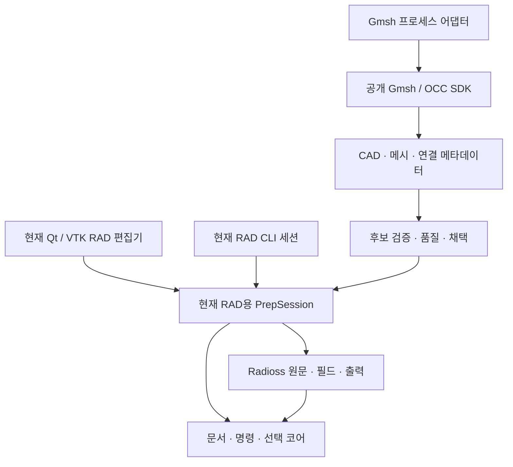

# 공용 CAE 기반과 첫 구현의 구조

이 저장소는 여러 CAE 프로그램에서 재사용할 개발 자산과 기반을 만든다. OpenRadioss/OpenCourant는 첫 적용 대상이며, 현재 RAD 모델 작성·편집 앱은 공용 기반을 실제 작업에 연결한 첫 사용처다. 이 문서는 공용 자산의 경계와 현재 구현의 파일 계약을 구분해 설명한다. 목표와 후보 비교는 [DESIGN](DESIGN.md), 후속 모듈·계약·코드 이행과 작업 단위는 [상세 실행 계획](docs/shared-cae-foundation-plan.md)에 둔다. 상세 계획의 경로와 인터페이스를 현재 구현으로 해석하지 않는다.

2026-11-02의 현재 납품 기준은 [DESIGN의 R1–R4/T1–T6/G0–G4](DESIGN.md#delivery-goals)를 따른다. 병합 기준은 Prep main `531e023`(PR #17/#18/#21/#22)와 Workbench main `865ee15`이며, 아래 설명은 PR #21에서 병합한 N19/N20 구현을 포함한다. Workbench PR #55 최종 `a328253`은 실제 두 입력과 필수 CI를 통과해 병합했으며 전체 납품 완료가 아니다. 아래 출발점 표는 `f4d12d0` 진단 기준이며 현재 구현은 이어지는 PR #15 변경 설명과 [남은 작업표](docs/execution-stages.md#remaining-work)를 따른다. 원제품 충실도와 Windows 검증은 구현 자체와 별도로 남는다.

| 보존할 구현 | 실제 한계 | 현재 목표를 위해 필요한 보완 |
|---|---|---|
| `Document/CommandDispatcher`, typed ref, 초안·Undo·저장 | 기존 단일 resource 상태 변경 중심 | G1의 객체 생성/삭제·파트 참조 할당과 다중 자원 원자 변경, 실패 시 전체 복원 |
| `RadProvider`, 원문 patch·INCLUDE·native 출력 | 일부 기존 필드 편집, PART 관계는 읽기 전용 | G1/G2의 새 native 객체·ID/참조 생성, G3의 Starter/Engine 출력; 원문 보존 경로 유지 |
| `CurveSession`, 공용 속성·표·곡선 위젯 | 재료 하나와 곡선 목록의 제한 host | sample은 개발용 유지; 제품의 다중 재료·단면·조건 모델과 실제 곡선 참조는 domain provider가 소유 |
| `reference_components`의 composition과 8 adapter | 공통 Edit 중심 명령, 배치·일부 확정 방식 차이 | T1–T6 과업별 명령 진입·선택·확정/취소·오류 복구; 공용 명령/문서는 공유, host별 모델 사본 금지 |
| `gmsh_backend`의 별도 worker | 독립 후보 생성이며 GUI 문서와 단절 | G3 품질·채택/교체·관계 영향·Undo·저장 연결 |

G1에서는 `radioss/modeling.py`의 명시된 writer와 `PrepSession` 생성·복사·삭제·할당 명령을 추가했다. `DeckResource`는 원본 raw와 기존 카드 UUID를 유지하고 versioned 구조 상태에 추가·삭제 block과 필드 patch를 기록한다. 단일 자원 내 카드 생성/삭제·PART 참조 변경은 기존 dispatcher의 한 Undo다. PART/PLY·집합·하중·구속·초기속도·접촉의 지원 참조를 검사하고, 참조 의미가 미확인인 카드가 있으면 삭제를 거절한다. 전역 native ID 해석의 범위를 벗어나는 SUBMODEL offset을 지원한다고 가정하지 않는다.

`OperationSpec/OperationRequest`는 solver/Qt가 없는 공통 입력 계약이다. `RadProvider`가 필드·typed 후보와 native 명령을 연결하고 `ui/modeling.py`의 같은 입력 부품을 각 adapter의 inspector 또는 dialog에 배치한다. CLI `model`도 같은 provider를 호출한다. `OperationRequest.units`와 provider의 확인된 차원·단위 배율로 표시값을 native 값에 환산한다. force/moment처럼 차원이 바뀌면 UI는 두 초안을 분리하고 새 값 입력을 요구한다. FUNCT 축과 미해석 카드별 unit override의 차원은 추정하지 않는다. 화면별 native writer·ID 생성·명령 이력은 없다.

표현 adapter는 초안과 작업 흐름을 조합하고 공용 명령/API는 객체·관계·값·검증·Undo·저장을 소유한다. 제품 이름별로 생성/할당 알고리즘을 복제하지 않는다. 실제 Workbench host는 기존 서비스와 파일/연구 소유권을 유지한다. 대용량·배열 저장 및 복합 transaction 상세는 기존 모델 데이터 설계를 따르되 최소 G1 관계 구현에 필요한 부분부터 연결한다.

## 공용 자산의 경계와 현재 상태

다중 파트·배치·혼합 자유도·케이스·대용량 자료의 목표 소유 구조와 완료 범위는 [모델·데이터 설계](docs/cae-model-data-design.md)에 둔다. 실제 구현 단계·종료 판단은 [작업서](docs/execution-stages.md), 외부 소비자의 소유·의존·파일 전달 경계는 [Workbench 재사용 계획](docs/workbench-reuse-plan.md)을 따른다. 아래 현재 코드가 그 목표를 이미 구현했다는 뜻은 아니다.

공용 산출물에는 디자인·아이콘·공학 위젯·앱 셸과 실행 가능한 네이티브 갤러리뿐 아니라 문서·명령·선택·저장, 형상/메시/조건의 관계, 외부 도구 어댑터와 자동화 API가 포함된다. 이 자산의 개발은 두 번째 제품이 생긴 뒤에만 시작하는 후속 작업이 아니다. 실제 사용 앱과 갤러리는 공용 자산을 소비하며, 공용 코어가 RAD 편집기나 갤러리에 의존하지 않게 한다. 기존 공용 GUI 저장소의 자산·갤러리와 소유 범위를 맞춰 중복 구현을 피한다.

`cae_core`는 솔버와 GUI를 모르는 문서·명령·선택 기반이다. `application.contracts`의 PropertyHost/DocumentSession·ObjectRef·PropertySpec·SetProperties는 Qt/RAD/VTK 없이 로드된다. `RadProvider`가 기존 PrepSession을 이 계약에 연결하고 `CurveSession`은 중립 재료/곡선 문서를 제공한다. 공용 위젯과 갤러리는 RAD와 VTK 없이 로드되며 기존 `ui.MainWindow`와 `application.PrepSession` export는 지연 로딩으로 호환한다. 기존 PrepSession 자체는 RAD/INCLUDE·원문·출력을 소유하는 솔버별 구현으로 남는다.

`ui/design`은 자체 SVG·토큰·상태 스타일, `ui/widgets`는 model/view 트리·그룹 속성·숫자/단위·벡터·곡선 표/plot을 소유한다. `ui/actions`와 `ui/shell`은 동일 Action·도킹·renderer frame·비동기 FileTask를 제공하며 실제 전처리기와 갤러리가 공유한다. 위젯은 초안만 소유하고 provider/session이 확정 값·검증·Undo를 소유한다. [Windows 검증 기록](docs/native-windows-validation.md)은 PR #12 시기의 재구현 전 묶음 A에 한정된다. 현재 8방식 UI/G 목표의 Windows 합격 증거가 아니다.

## 이번 구현의 결정

첫 사용 앱은 사용자 Radioss 원문 편집과 새 문서의 지원 모델 작성을 제공하는 독립 앱이다. 전체 CAE를 포크하기 전에 공개 VTK·Qt와 Gmsh SDK를 교체 가능한 경계로 연결하고, 문서·명령·선택·저장 코어를 실제 코드로 분리했다. 이 결정은 미지원 카드도 보존해야 하는 첫 작업에 대한 선택이며, 저장소 전체를 Radioss 전용 제품으로 한정하거나 SMTK/FEBioStudio/SALOME보다 모든 기능에서 우월하다고 선정한 결과가 아니다.

Gmsh는 CAD/메시 엔진이고 문서의 정본이 아니다. OCP/OCAF와 Gmsh OCC를 동시에 정본으로 두지 않는다. Gmsh 산출물은 독립 후보 자산이다. 품질·원자산 해시·배열·단위·참조를 검증한 뒤 명시적 채택 명령으로만 Radioss 문서에 반영한다.

계획상 첫 CAD/메시 C는 최소 자원·배열·채택 명령(P6a)만 선행하고 P7a에서 연결한다. 완전한 다중 파트·대용량 B를 선행 조건으로 삼지 않는다. 후보 생성과 문서 변경을 구분하고, 품질 확인 뒤 채택/교체를 하나의 명령으로 적용한다. 외피 facet과 물리 shell 요소, Gmsh tag와 지속 객체 참조를 구분한다. `radioss/modeling.py`가 신규 native writer를 소유한다. tri3는 SH3N/SHELL 단면, tet4는 TETRA4/SOLID 단면에 연결하며 외피 facet을 별도 shell로 중복 채택하지 않는다. 일반 재메시의 조건 자동 재연결은 구현하지 않았고 참조가 있으면 교체를 거부한다.

Workbench는 현재 자체 PySide6 앱이며 FreeCAD를 외부 프로그램으로 사용한다. 공용 위젯에는 Workbench 서비스 adapter를 주입하고 프로젝트/연구의 소유권을 유지한다. 독립 Prep 문서와 Workbench 프로젝트는 파일 역할·개정으로 연결하며, 두 명령 이력이나 문서 정본을 겹치지 않는다. Workbench W1의 NumericEdit 소비와 W2의 RAD/작업문서 독립 Prep 열기는 구현됐다. 현재 INP용 실행 입력 복사 규칙을 RAD의 Starter/Engine/INCLUDE snapshot과 두 단계 실행에 적용하는 W3는 Workbench PR #55에서 solver별 snapshot·기존 JobManager의 Starter→Engine 단계로 구현해 CI에서 두 실제 입력을 검증 중이다. Prep에 실행 관리자를 추가하지 않는다.

## 계층과 의존 방향

| 코드 | 실제 소유 책임 |
|---|---|
| `cae_core` | solver/Qt/VTK를 모르는 Document·Resource·CommandDispatcher·ChangeSet·SelectionRef·SaveState |
| `radioss` | 원문과 지원 필드 patch, 카드 schema/단위 문맥, 미지원 부분 보존, 표시용 메시 투영 |
| `application.session` | 현재 RAD용 PrepSession. RAD 자원 조합, 조회·편집·Undo·INCLUDE·저장·내보내기 API, 호출 직렬화. 공용 세션 계약 전체가 완성된 상태는 아님 |
| `application.contracts` / `rad_provider` / `neutral` | 최소 host 계약, 기존 RAD adapter, 독립 재료/곡선 provider와 codec. 범용 FE 스키마를 강제하지 않음 |
| `application.mesh_candidates` / `ui.mesh_workflow` | SDK inventory·해시·tri/tet 품질과 후보 검토 UI. 채택은 PrepSession의 원자 명령이며 다른 문서 사본을 만들지 않음 |
| `application.storage` | codec과 독립인 atomic ZIP writer와 bounded reader. RAD v3 manifest·원문/구조 편집·케이스(v1/v2 읽기 호환)과 중립 codec의 의미는 각각 유지 |
| `ui/design`, `ui/widgets`, `ui/actions`, `ui/shell` | 공용 디자인·입력 초안·트리·표/plot·Action·도킹·renderer frame·실제 FileTask 상태/오류/산출물 |
| `ui/main_window`, `ui/gallery` | 앱별 조립과 초안/선택/파일 작업 조정. 모델 값의 정본은 주입한 provider/session |
| `cli` | 현재 RAD 세션 API를 호출하는 명시적인 독립 프로세스 진입점 |
| `adapters.gmsh_backend` / `gmsh_worker` | 별도 SDK 프로세스, 시간 제한·취소, 입력 CAD에서 독립 후보 자산 생성 |

N19의 `application/live_transport.py`는 명시적으로 켠 loopback TCP endpoint와 private descriptor를 제공한다. `ui/live_control.py`가 Qt 주 스레드 queue에서 실제 소유 Session/provider 명령을 호출하며 doc/epoch/revision·초안/busy·request ID replay를 검사한다. GUI 후속 Generate/Open/Adopt도 같은 workflow의 세대·상태·취소 권한에 연결한다. N20의 `application/mcp_server.py`는 이 검증된 명령을 stdio MCP로 노출하며 Qt나 새 Session을 생성하지 않는다. 독립 파일 CLI, 열린 GUI IPC, 실제 MCP 클라이언트 상호운용은 각각 검증한다. [live 계약](docs/live-control.md)과 [MCP 근거·미확인 사항](docs/mcp-client.md)을 따른다.

## 문서와 명령

문서 ID와 resource ID는 렌더링 배열 인덱스·Gmsh tag와 구분한다. 명령 성공과 Undo/Redo는 revision을 증가시키고 저장 기준점과 현재 자원 상태로 dirty를 판단한다. `expected_revision`이 맞지 않거나 필드 검사가 실패하면 모델을 부분 변경하지 않는다. ChangeSet과 구조화 오류로 실제 변경을 전달한다.

현재 Undo는 한 resource의 필드 및 카드 구조 상태 변경을 다룬다. 카드 생성/삭제를 resource 생성/삭제와 혼동하지 않는다. 여러 resource에 걸친 트랜잭션은 아직 없다. 같은 PrepSession의 변경 알림은 호출 스레드에서 발생하고 GUI는 Qt 신호로 UI 스레드에 전달한다. 파일 기반 CLI에는 이 구독이 공유되지 않는다. live IPC는 열린 GUI owner의 이벤트를 sequence로 조회하며 transport 스레드가 직접 Qt나 문서를 수정하지 않는다.

Radioss는 원문 바이트가 정본이다. 편집 가능한 필드 위치만 patch하며 미편집 필드·주석·카드 순서·개행을 다시 정규화하지 않는다. VTK 메시 투영은 반환된 복사본이며 편집 원본이 아니다. 원 절점·요소 ID와 pick 인덱스는 별도로 매핑한다. `/TRANSFORM` 등 표시에서 해석하지 않은 조건은 진단으로 남긴다.

필드는 입력 덱 단위와 카드별 `unit_ID` 문맥을 유지한다. 확인한 전역 단위의 E/밀도/길이/속도/힘·모멘트만 표시 단위를 선택·환산할 수 있다. 표시 전환 자체는 문서 명령이 아니며 Apply가 같은 dispatcher를 통과한다. 알려지지 않은 단위를 임의로 Pa/MPa로 해석하지 않는다. 기존 곡선·물리 조건을 보존한다는 것과 그 조건의 편집·3D 표시를 지원한다는 것은 다르다.

## 작업 파일과 native 덱

`.caeprep`은 버전 있는 ZIP 문서다. RAD writer는 manifest version 3을 쓰고 v1/v2도 읽는다. `AnalysisCasesResource`가 영속 UUID·조건 UUID 집합·단위 있는 종료/출력 설정과 활성 케이스를 별도 소유하고 같은 dispatcher로 편집한다. manifest의 `analysis_cases`에 이 상태를 보존하며 이전 파일은 빈 케이스 상태로 읽는다. `manifest.json`에 문서 ID·revision·논리 경로·자원 ID·필드 patch와 stable ID를 가진 추가/삭제 카드 구조 상태를 기록하고 `raw/<resource-id>.rad`에 원문을 동봉한다. 외부 원본 경로만 저장하는 형식이나 pickle이 아니다. 임시 파일을 작성한 뒤 원자적으로 교체한다. 재시작 후 Undo 기록을 복원하는 기능은 현재 범위가 아니다.

이는 현재 RAD 사용 앱의 저장 계약이다. 다른 솔버의 모델을 RAD 원문이나 하나의 공통 FE 스키마로 강제하는 공용 저장 규격이 이미 완성됐다는 뜻은 아니다.

중립 재료/곡선은 같은 원자 저장 절차를 쓰되 manifest `format=caelab-material-curves`, `version=2`와 `material-curves.json` payload를 사용한다. 이전 중립 v1도 읽는다. v2는 재료의 기존 곡선 참조를 저장하며 provider는 표시명/typed ObjectRef 후보를 제공하고 실제 명령이 문서·자원·종류·존재를 검증한다. 이 codec은 RAD를 import하지 않는다. `gallery [path]`로 열고 저장하며 RAD 문서는 v3로 저장하고 이전 v1/v2는 읽기 호환한다. 이전 앱이 새 구조 편집 문서를 v1으로 오해하도록 버전을 숨기지 않는다. 양쪽 모두 파일 작업 실패 시 기존 파일과 dirty 상태를 보존한다. 비동기 FileTask는 running/succeeded/failed·구조화 오류·실제 산출물 경로를 반환하고 저장/열기는 취소 불가능으로 표시한다. 지원하지 않는 Cancel 동작을 제공하지 않는다.

`SelectionProvider.select/active_object`는 두 provider/window의 활성 객체를 연결한다. 첫 RAD 관계는 기존 PART와 투영의 part_id가 연결된 요소이며 중복 native ID는 거부한다. 영속 ObjectRef ID는 재열기 뒤에도 유지하지만 renderer pick은 설치마다 바뀌는 document_epoch, 문서 revision, resource state token, projection_revision을 함께 검사한다. 스칼라 수정 뒤 표시 형상을 재생성하지 않고 pick stamp를 갱신한다. 둘 이상의 승인된 요소는 모든 resource/local-ID 쌍을 강조한다.

`ActionRegistry`는 두 창에서 identity·capability·문맥·상태를 QAction에 연결한다. `FileEditCoordinator`는 초안/dirty 질문과 명시 폐기·저장/실패/닫기 절차를 공유한다. RAD 자동 적용과 중립 수동 적용은 각 host에 남긴다. `ui/catalogue.py`의 부품 장면은 실제 provider 편집과 상태를 확인하고, 원래 재료/곡선 작업 화면은 조합 사용 예로 구분한다. `design/tokens.py`가 QSS·SVG·공용 위젯 수치의 원본이다.

`#include`는 지시문으로 식별한다. 이번 구현은 처음 입력 덱의 작업 폴더를 기준으로 안전하게 해석 가능한 상대 파일들을 묶는다. 절대 경로·상위 경로·누락·순환 등 처리하지 못한 참조는 보존하고 부분 읽기 진단을 반환한다. 해결되지 않은 INCLUDE가 있는 문서는 독립 native 출력 묶음으로 내보내지 않는다. 이 제한은 사용자의 원본 덱 실행 가능성을 판정하는 솔버 허용 목록이 아니다.

내보내기는 작업 문서 저장과 별개다. 원본 입력 파일을 덮어쓰지 않으며 root 덱과 해결된 INCLUDE를 전달한다. `export_rad`는 기존 native 출력만 만들며 `export_solver_inputs`는 명시된 종료 시간·출력 간격으로 새 Engine을 함께 만든다. 원본 Engine을 수정하거나 계산을 실행하지 않는다. 기존 호출 인자 출력 외에 `export_analysis_case`가 저장된 케이스의 단위·조건 활성 집합을 native 출력 사본에 적용한다. 미지원 물리 조건/오래된 문서 ID·revision은 거부하며 소스 문서는 변형하지 않는다. 현재 케이스 활성 family는 BCS/CLOAD/INIVEL/TRA/INTER/TYPE7이다.

## CAD/메시 후보 자산

공개 Gmsh 4.15.2 SDK를 별도 worker에서 사용한다. `gmsh_backend`의 import 대상은 CAD이며 `mesh_candidates`는 자체 CAD/XAO/MSH/metadata 후보 묶음을 검증한다. N02는 `application/external_mesh.py`와 `adapters/msh_worker.py`에서 독립 MSH 출처를 별도로 검증한다. CAD identity는 `None`, `source_kind=standalone_msh`이며 실제 MSH+manifest만 요구한다. 엄격한 원본 preflight→기존 SDK `_inspect_msh`→전체 node/element/group 대조 후 공통 `NativeMesh`와 품질·채택 경로를 사용한다. 기존 CAD 네 자산 validator는 느슨하게 풀지 않는다. 호출 프로세스에 Gmsh를 import해 전역 모델을 공유하지 않는다. 후보의 CAD XAO, 메시 MSH, 연결 메타데이터를 함께 보관한다. Gmsh backend tag는 작업 중 주소이고 UUID·자원 개정과 구분한다. 외부 STEP/BREP를 새로 가져오면 새 형상 자원이다.

실제 시험에서 MSH만 재열면 CAD는 discrete entity가 되었고 BREP만으로는 physical group이 보존되지 않았다. XAO의 named group과 별도 메시 자산을 함께 다루는 정책이 필요하다. 또한 재메시 전후 같은 node ID의 좌표가 달라질 수 있었다. 따라서 explicit node/element 선택을 새 메시로 자동 전용하지 않는다. `application/mesh_candidates.py`는 공식 SDK로 MSH 전체 inventory를 읽어 metadata와 대조하고 품질을 계산한다. Qt의 `mesh_workflow`는 후보와 문서의 identity를 분리해 표시하고, 비동기 생성·취소·검토·채택을 연결한다. 소유 메시의 안전 교체는 조건/집합 참조가 없을 때만 가능하며 공유 노드는 보존한다. 새 문서는 모든 작업 단위를 명시해야 한다. 채택한 메시의 최종 native ID·PART 출처 UUID·자산 해시는 `.caeprep`의 native 자원에 보존한다. 원본→native 절점/요소 ID 대응은 채택 명령의 반환값이며 작업문서에 별도 매핑으로 저장하지 않는다. 원 CAD/XAO/MSH 번들은 별도 후보 폴더를 유지해야 재메시할 수 있다.

## 재사용과 남은 범위

현재 첫 적용 대상은 OpenRadioss/OpenCourant이고, 실행 가능한 사용 앱은 RAD 원문 편집과 지원 모델 생성 앱이다. 공용 자산과 네이티브 갤러리는 이 저장소의 정식 개발 산출물이며 실제 편집 흐름과 함께 개발한다. 서로 다른 사용처에서 같은 코어·위젯을 사용하는 확인은 재사용 품질을 판단하는 기준이고, 공용 자산 개발을 시작하기 위한 전제 조건이 아니다.

첫 공용 위젯·셸 부품·갤러리·최소 세션 계약을 실제 RAD와 중립 재료/곡선 문서에 연결했다. 과거 Windows 검증은 위에 한정한 구버전 자료이며 현재 UI는 별도 확인이 필요하다. G1 생성/할당과 G2 곡선·조건·집합, G3 후보 채택·Starter/Engine을 같은 native 문서에 연결했다. G4는 Workbench의 기존 MDO 서비스가 Prep NumericEdit를 실제 사용하고, 기존 연결/JobManager가 독립 Prep 프로세스와 문서·출력 파일을 전달한다. 두 앱의 이력·모델은 합치지 않는다. 현재 기능·UI·원제품 비교·플랫폼의 통과 범위는 실행 기록에 따르며 Windows 납품은 후속이다. PR #17의 `application/curve_csv.py`는 RAD/VTK 없는 실제 CSV reader/writer이며 두 host가 같은 `CurveTableEditor/CurvePlot`과 provider 명령을 사용한다. drag preview는 초안이며 release 한 번이 한 Undo, Escape/오래된 대상/잘못된 x 순서는 취소한다. CSV의 두 숫자 열은 단위·참조를 담지 않으므로 표시 단위 정책을 확인하고 작업문서는 단위·참조를 보존한다. 과거 쉼표 텍스트 붙여넣기를 CSV 파일 왕복이라고 했던 주장은 당시 과장이며 새 구현의 근거로 소급하지 않는다. MCP/IPC는 P8c(N19–N20), 다중 자원·대용량·일반 재메시는 N16–N18, 조건부 메시/중립면은 N22–N26으로 유지한다. 솔버 실행·후처리의 Workbench 소유는 바꾸지 않는다.
