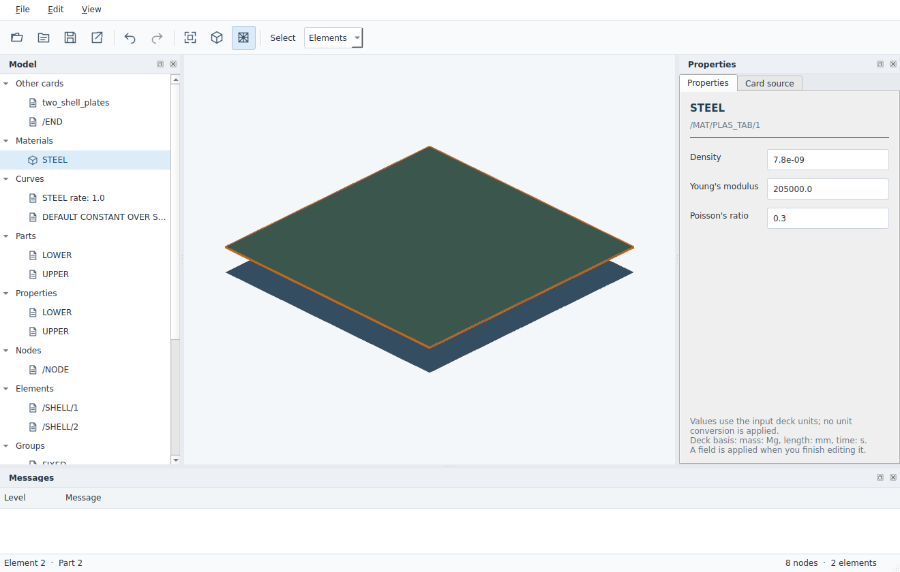

# CAELab Prep

OpenRadioss / OpenCourant용 독립 데스크톱 GUI 전처리기를 개발합니다. 사용자가 형상·메시를 불러와 재료·단면·접촉·하중·구속·초기조건과 해석 제어를 편집하고, 네이티브 Starter/Engine 파일을 작성하는 프로그램이 목표입니다.

**현재 상태: 실행 가능한 첫 네이티브 RAD 편집기와 문서·명령·선택·저장 코어를 구현했습니다.** 기존 RAD의 지원 필드를 편집하고 Undo/Redo, 작업 문서 저장·재열기, RAD 출력을 수행합니다. CAD에서 새 해석 모델 전체를 구성하는 프로그램은 아직 아닙니다.



소형 RAD를 실제 Linux Qt/VTK 창에서 열어 편집·Undo/Redo·저장·재열기·출력과 마우스 절점/요소 선택을 확인한 화면입니다. 별도 입력의 재료·구속 편집 출력은 OpenCourant Starter에서도 값이 유지됐습니다. Windows GUI·설치형 배포와 대용량 성능은 아직 확인하지 않았습니다.

## 실행

Python 3.11 이상에서 저장소를 설치합니다. GUI에는 Qt/VTK와 정상적인 데스크톱 OpenGL 환경이 필요합니다.

```sh
python -m venv .venv
# Windows: .venv\Scripts\activate
# Linux/macOS: source .venv/bin/activate
python -m pip install -e ".[gui]"
caelab-prep gui
caelab-prep gui path/to/model_0000.rad
```

앱에서 RAD를 열고 트리의 지원 카드를 선택해 값을 바꿉니다. Enter로 적용하며 Undo/Redo를 사용할 수 있습니다. **저장**은 원문과 편집을 포함하는 `.caeprep` 작업 문서를 만들고, **RAD 내보내기**는 솔버용 덱을 별도로 작성합니다. 새 세션에서 `.caeprep`을 열어 계속 편집할 수 있습니다. 원본 RAD는 덮어쓰지 않습니다.

| 현재 기능 | 범위 |
|---|---|
| 문서·3D | RAD/작업 문서 열기, 모델 트리, 지원 요소의 메시 표시·절점/요소 선택, 원문 조회 |
| 필드 편집 | LAW1/ELAST·LAW36/PLAS_TAB의 밀도/E/ν, BCS 6자유도, TYPE24 마찰, 기존 FUNCT 좌표, INIVEL/TRA 속도, PROP/SHELL 두께 |
| 저장·출력 | 변경 명령·Undo/Redo·dirty/revision, 원문과 patch를 동봉한 `.caeprep`, 안전하게 해결한 INCLUDE를 포함한 RAD 출력 |
| CAD/메시 | 선택 설치한 Gmsh SDK를 별도 프로세스로 사용해 STEP/IGES/BREP/XAO에서 XAO·MSH·연결 메타데이터 생성. 현재 CLI/API의 독립 후보 자산 |

미지원 카드는 원문으로 보존합니다. 모든 Radioss 카드의 의미·표시·편집을 지원하는 것은 아닙니다. 새 카드/조건 생성, CAD 메시를 GUI 해석 문서로 채택하기, Engine 생성, 솔버 실행·후처리, MCP/열린 GUI 접속, Windows 설치형 배포는 남은 범위입니다. 상대 INCLUDE 지원 범위와 저장 구조는 [ARCHITECTURE.md](ARCHITECTURE.md)를 참고하세요.

GUI 없이 같은 세션 API를 사용하는 독립 CLI도 제공합니다. 실행 간 문서를 전달하려면 작업 파일을 저장해야 합니다.

```sh
caelab-prep inspect model_0000.rad
caelab-prep fields model_0000.rad
caelab-prep fields model_0000.rad --card /MAT/LAW1/1
caelab-prep edit model_0000.rad --card /MAT/LAW1/1 --field young_modulus --value 205000 --output edited.caeprep
caelab-prep export edited.caeprep --output output/edited_0000.rad
python -m pip install -e ".[cad]"
caelab-prep mesh part.step --output mesh-assets --size 2.0
```

`--card`는 해당 파일의 실제 고유 헤더 또는 작업 문서의 카드 ID를 받습니다. 값은 덱의 단위계를 따릅니다. Gmsh는 시스템에 맞는 공유 라이브러리도 필요할 수 있습니다.

개발 검사는 CI와 같이 환경을 나눕니다. 코어/CLI는 `.[dev]`, Qt 문서 검사는 `.[gui,dev]`, CAD worker 검사는 별도 가상환경에 `.[cad,dev]`와 `cadquery-ocp==7.8.1.1.post1`을 설치합니다. 해당 OCP는 테스트 입력 생성용이며 VTK 9.3.1을 요구하므로 GUI 환경의 VTK 9.4 이상과 분리합니다. OCP는 제품 의존성이 아닙니다. CI의 Qt 검사는 실제 폼·문서 연결을 확인하며 3D 렌더링이나 Windows GUI 검증을 대신하지 않습니다.

## 저장소의 역할

| 저장소 | 책임 |
|---|---|
| 이 저장소 | 독립 전처리기, 3D 선택·편집, 문서와 네이티브 덱 입출력 |
| [caelab-workbench](https://github.com/pikachu444/caelab-workbench) | CAE·수치해석 연구, 반복 실행·MDO/PDE·결과 비교·LLM 근거 토론과 도구·프로젝트·실행 관리 |

FreeCAD는 CAD 원본을 담당합니다. CAELab Prep은 전문 전처리기를 맡고, 워크벤치에서 시작한 계산은 워크벤치의 기존 실행 관리자가 담당합니다. CAELab Prep은 워크벤치 없이도 파일을 열고 편집·저장할 수 있어야 합니다.

## 개발 출발점

- 첫 제품 단위는 사용자 RAD 열기 → 3D/모델 트리 확인 → 실제 재료·구속·접촉 편집 → Undo → 저장 → 재시작·재열기입니다.
- Action, 선택 상태, 속성 입력, 문서, 아이콘·스타일을 내부 공용 모듈로 분리합니다. 실제 편집 기능에 필요한 부품부터 재사용하며 공용 프레임워크 제작만을 별도 목표로 삼지 않습니다.
- 공용 자산에는 모델링 데이터·작업 문서·형상/메시/조건의 관계, 저장·입출력과 GUI·Python·MCP가 공유하는 API도 포함합니다.
- 공개 소스의 재사용, 공개 규격과 정상 실행 동작을 바탕으로 한 독립 구현을 우선합니다. 외부 프로그램의 분석·재배포는 해당 허가 조건을 확인합니다.

제품 목표·후보 비교·개발 순서는 [DESIGN.md](DESIGN.md), 현재 실행 코드의 경계와 결정은 [ARCHITECTURE.md](ARCHITECTURE.md), 공개 SDK 사용은 [THIRD_PARTY.md](THIRD_PARTY.md)에 둡니다. 이번 Qt/VTK·자체 문서 코어·Gmsh 조합은 첫 원문 편집 흐름에 대한 구현 결정입니다. SMTK/CMB·FEBioStudio·SALOME와 전체 CAD→조건→솔버 흐름을 빌드·실행 비교해 최선이라고 선정한 결과는 아닙니다.

## 확보한 개발 자산

[BeidPrep 1.0.1 시험 기록](docs/beidprep-evaluation.md)에 실제 수행·미수행 범위와 저장 오류를 기록했습니다. 소형 입력·저장본, Windows GUI 시험 스크립트, 수동 실행 전용 GitHub Actions를 함께 보관합니다. 실행 파일과 솔버 배포본은 Git에 포함하지 않습니다.
