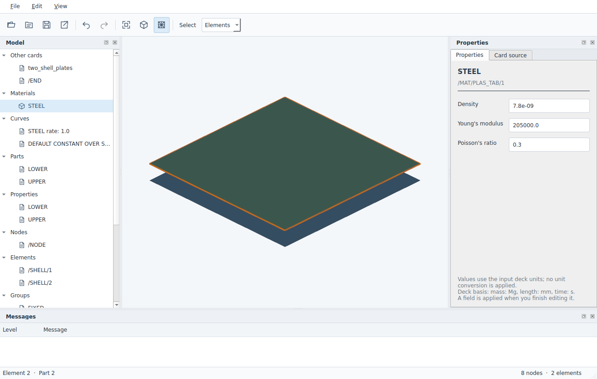
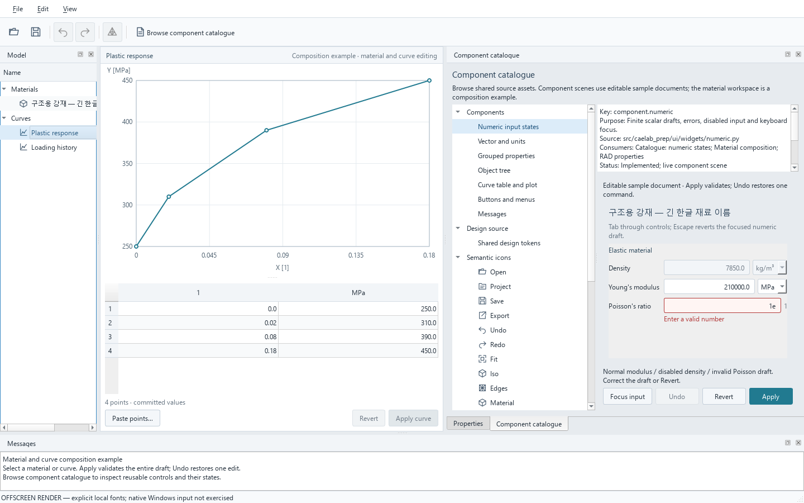
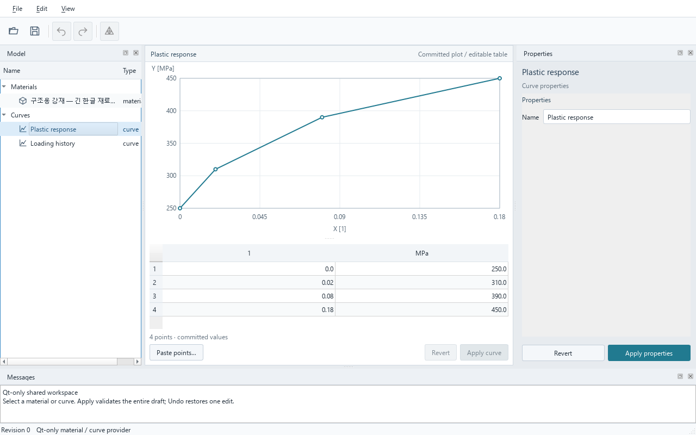
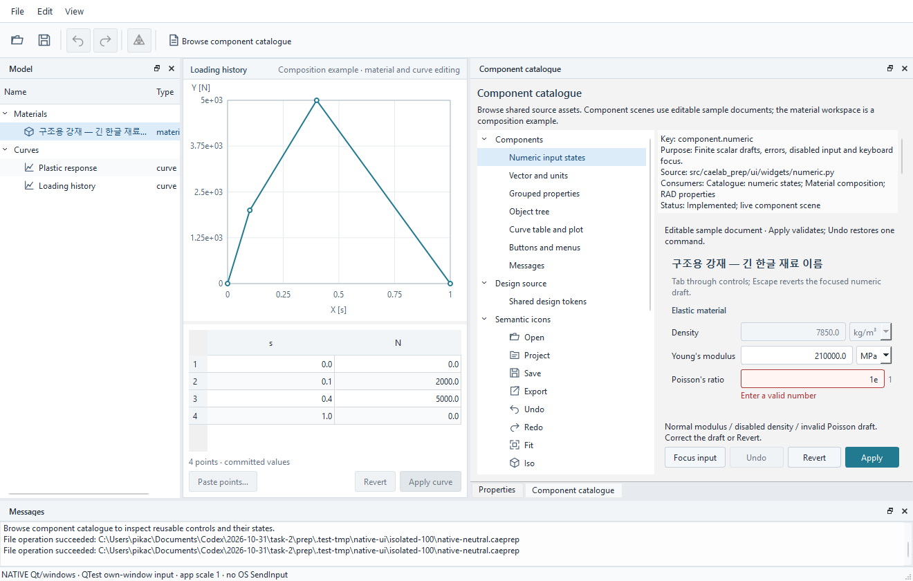

# CAELab Prep

여러 CAE 프로그램에서 재사용할 **공용 개발 자산과 공용 기반**을 구축합니다. GUI의 아이콘·테마·공학용 위젯·앱 셸부터 모델링 데이터·문서·명령·선택·저장·외부 도구 연결·자동화 API까지 이 저장소에서 축적하고 관리합니다.

**OpenRadioss / OpenCourant는 첫 번째 적용 대상입니다.** 공용 기반을 사용하는 첫 응용 프로그램으로 독립 데스크톱 전처리기를 개발합니다. 이 앱에서는 형상·메시를 불러와 재료·단면·접촉·하중·구속·초기조건과 해석 제어를 편집하고 Starter/Engine 파일을 작성하는 흐름을 목표로 합니다. 다른 CAE 프로그램의 재사용은 공용 기반의 설계 범위에 포함되며, 현재 여러 솔버를 지원한다는 뜻은 아닙니다.

**현재 구현:** 사용자 RAD의 재료·단면·파트 관계를 편집하고, 새 문서에서 CAD 메시 후보를 검토·채택해 조건과 Starter/Engine을 작성할 수 있습니다. 같은 문서·명령·편집 부품을 8개 프로그램별 표현에서 사용합니다. 재료/단면 2쌍의 생성·할당, 곡선·집합·구속·하중·초기속도·접촉, 단위 표시 변환, Undo/Redo·저장·재열기를 연결했습니다. 실제 Workbench는 공용 숫자 입력 부품과 독립 Prep 문서 열기를 사용합니다.

**새 세션의 시작점:** [전체 26개 작업의 상태와 완료 기준](docs/execution-stages.md#remaining-work)을 확인하세요. 현재 목표 15개, 보존한 기존 구현 요구 6개, 실증이 선행되는 조건부 5개입니다. 작업 크기가 같은 26개나 완료율을 뜻하지 않습니다. **PR #17은 N01 케이스·영속 해석 설정, N02 독립 MSH 가져오기, N15 두 앱의 CSV 파일·plot drag를 구현하고 최종 `323954f`의 CI 통과 후 병합했습니다.** 현재 main `3ceaf44`에는 PR #18의 작업표 정정, PR #21의 실제 GUI IPC/MCP 제어, PR #22의 대형 선택 입력 수정과 PR #25의 64,308 요소 대표 모델 native 재현이 포함됩니다. 다음 구현은 N16 다중 자원 관계→N18이며 N17 대용량 개선을 병행합니다. Workbench N21/W3는 PR #55 최종 `a328253`의 실제 솔버·전체 CI 통과 후 `865ee15`에 병합했습니다. 전체 26개 중 구현 범위를 병합한 행은 6개이며 20개 행이 미완료입니다. 나머지 행의 미완료 기능과 외부 검증은 유지합니다.

[달성 목표](DESIGN.md#delivery-goals)와 [구현·검증 근거](docs/execution-stages.md#current-progress)를 구분합니다. 원제품 8종과의 동일 과업 실행 비교는 미확인이고 Windows 실제 창·IME·DPI·배포 검증은 사용자 지시에 따라 후속 일괄 검사로 남깁니다. 이 구현을 상용 CAE 전체 기능·품질과 동등하다고 주장하지 않습니다.

공용 부품은 `ui/design`, `ui/widgets`, `ui/actions.py`, `ui/shell.py`에 있고 갤러리와 실제 전처리기가 같은 코드를 사용합니다. 솔버별 카드 의미·단위·원문·출력은 RAD adapter/session에 남습니다. 모든 솔버의 FE 스키마나 전체 CAE 기반이 완성됐다는 뜻은 아닙니다.

아래 이미지는 재구현 전의 실행 기록이며 새 UI의 납품 화면이 아닙니다.



소형 RAD를 실제 Linux Qt/VTK 창에서 열어 편집·Undo/Redo·저장·재열기·출력과 마우스 절점/요소 선택을 확인한 기존 화면입니다. 별도 입력의 재료·구속 편집 출력은 OpenCourant Starter에서도 값이 유지됐습니다. 2026-10-31 구버전 Windows 실행의 범위와 화면은 [Windows 검증 기록](docs/native-windows-validation.md)에 있습니다. 설치형 배포와 대용량 성능은 후속입니다.

## 첫 적용 앱 실행

Python 3.11 이상에서 저장소를 설치합니다. GUI에는 Qt/VTK와 정상적인 데스크톱 OpenGL 환경이 필요합니다. Linux에서는 Qt XCB 런타임과 한글 글꼴도 필요합니다. Ubuntu 기준 의존성은 CI `native-render`의 설치 목록을 따르며 `fonts-noto-cjk`를 포함합니다.

```sh
python -m venv .venv
# Windows: .venv\Scripts\activate
# Linux/macOS: source .venv/bin/activate
python -m pip install -e ".[gui,cad]"
caelab-prep gui
caelab-prep gui path/to/model_0000.rad
```

앱에서 RAD를 열고 트리의 지원 카드를 선택해 값을 바꿉니다. Enter로 적용하며 Undo/Redo를 사용할 수 있습니다. **저장**은 원문과 편집을 포함하는 `.caeprep` 작업 문서를 만들고, **RAD 내보내기**는 솔버용 덱을 별도로 작성합니다. 새 세션에서 `.caeprep`을 열어 계속 편집할 수 있습니다. 원본 RAD는 덮어쓰지 않습니다.

CAD에서 시작할 때는 **File → New model**에서 이름과 질량·길이·시간 단위를 명시하고 재료와 shell/solid 단면을 만듭니다. **Mesh → CAD / mesh candidate**에서 CAD·후보 저장 폴더·요소 크기를 선택해 생성합니다. 후보의 품질과 문제 요소를 검토하고 재료/단면을 지정한 뒤 **Adopt candidate**로 한 번에 채택합니다. 3D의 요소를 선택하면 해당 면/체적의 국부 크기를 설정할 수 있으며, 경계면 보기에서는 면을 선택합니다. 조건을 작성한 뒤 **File → Export Starter and Engine**에서 종료 시간·출력 간격과 새 `*_0000.rad` 경로를 지정합니다. 내보내기는 계산 실행과 별도입니다.

PART를 선택하면 원래 파트 ID·표시 요소 수·현재 재료/단면 참조와 연결된 요소 강조가 같은 active object를 따릅니다. Material / Section / Assignment의 생성·할당 작업은 Create 또는 Apply로 한 번에 확정하며 Cancel은 문서를 변경하지 않습니다. 미확정 생성/삭제 작업은 저장·방식 전환으로 암묵 실행하지 않습니다. 렌더러 pick은 문서 세대·문서/자원/투영 개정을 검사해, 같은 파일을 다시 연 뒤 도착한 이전 pick도 거부합니다. 잘못된 초안을 남긴 채 닫으면 Save/Discard/Cancel을 먼저 선택하며 Discard는 검증 없이 명시적으로 폐기합니다.

| 현재 기능 | 범위 |
|---|---|
| 탐색·표시 | 트리/3D 선택, 파트 다중 선택·검색·필터·숨김/격리·fit, 조건 대상의 역할별 강조 |
| 모델 작성 | LAW1 재료, SHELL/TYPE1 및 SOLID/TYPE14 단면, 생성·복사·안전 삭제·PART 할당·교체 |
| 조건 | FUNCT 행/텍스트 붙여넣기/CSV 파일/plot drag, 절점·요소 집합 생성/멤버 편집·shell 파트 표면, BCS, 절점별 CLOAD, INIVEL/TRA, 검증한 TYPE7 프로파일 생성과 참조 편집 |
| 단위 | 명시된 덱 단위의 탄성계수·밀도·길이·속도·힘/모멘트 표시 변환. 미해석 카드별 단위와 FUNCT 축의 물리 차원은 추정하지 않음 |
| CAD/메시 | 별도 Gmsh worker의 tri3/tet4 후보, 품질 문턱·공유 경계·국부 크기, 후보 취소·채택·참조 없는 소유 메시의 안전 교체 |
| 케이스 | 영속 UUID·조건 참조/활성 집합·단위 있는 시간/출력 설정, 생성·복사·선택·삭제·한 Undo, 선택 케이스 native 출력 |
| 문서·출력 | 원문/구조 편집·Undo/Redo·revision, `.caeprep` v3와 v1/v2 읽기, INCLUDE 묶음과 새 Starter/Engine 출력 |
| 실제 공통화 | 8 native 표현의 같은 provider/명령/위젯, 중립 문서, Workbench의 NumericEdit 소비와 독립 프로세스 파일 전달 |

**Mesh → Import mesh**는 CAD 없이 MSH 2.2/4.1 ASCII를 가져옵니다. `[cad]`의 Gmsh 4.15.2와 공유 라이브러리가 필요하며 소스 길이 단위 mm/cm/m를 직접 지정해야 합니다. 문서와 단위가 다르면 거부하고 좌표를 자동 환산하지 않습니다. 원본 해시와 SDK 전체 요소 목록을 대조하고 tri3/tet4의 품질·그룹·파트를 검토한 뒤 채택합니다. 중첩 physical group은 집합으로 유지하고 멤버 조합별 파트로 나눠 요소 중복을 피합니다. 무그룹 요소는 명시적 파트가 됩니다. 하위 차원 경계는 별도 shell/beam이 아닌 node 집합이며, 지원하지 않는 family가 있으면 전체 채택을 막습니다. binary/partition/periodic/data/parametric MSH는 아직 지원하지 않습니다. CAD 후보의 실제 source/metadata/msh/xao 검증은 별도 경로에서 그대로 유지합니다.

**Conditions → Analysis cases**에서 이름·활성 조건·시간 단위·종료 시간·출력 간격을 저장합니다. 지원 활성 조건은 BCS/CLOAD/INIVEL/TRA/INTER/TYPE7이며 해석하지 못한 물리 조건이 있으면 선택 케이스 출력을 막습니다. Export 창은 저장된 활성 케이스를 기본으로 선택하며 수동 설정 출력도 구분합니다. 원본 Engine을 편집하거나 Prep에서 솔버를 실행하지 않습니다.

미지원 카드는 원문으로 보존합니다. 알 수 없는 참조가 있는 삭제·교체는 차단하며 전체 Radioss 카드, 일반 재메시의 조건 자동 재연결, 모든 요소·재료법칙을 지원하지 않습니다. 채택한 native 메시와 출처 해시는 작업문서에 남지만 재메시에 필요한 CAD/XAO/MSH 원자산은 별도로 보관한 후보 폴더를 유지해야 합니다. 임의 all-hex·중립면·대용량·Windows 설치형 배포는 별도 남은 범위입니다. live GUI IPC/MCP의 현재 구현 후보와 확인 범위는 아래 자동화 안내를 따릅니다. 솔버 실행·후처리의 Workbench 소유권은 유지합니다.

GUI 없이 같은 세션 API를 사용하는 독립 CLI도 제공합니다. 실행 간 문서를 전달하려면 작업 파일을 저장해야 합니다.

```sh
caelab-prep inspect model_0000.rad
caelab-prep fields model_0000.rad
caelab-prep fields model_0000.rad --card /MAT/LAW1/1
caelab-prep edit model_0000.rad --card /MAT/LAW1/1 --field young_modulus --value 205000 --output edited.caeprep
caelab-prep export edited.caeprep --output output/edited_0000.rad
```

생성·할당 CLI도 GUI와 같은 provider 명령을 사용합니다. `--describe`로 현재 작업의 입력 항목을 조회할 수 있습니다. 기본값은 입력 덱 단위이며 지원 필드는 `--unit FIELD=UNIT`로 표시 단위를 명시합니다. ID `0`은 자동 배정입니다.

```sh
caelab-prep model model_0000.rad material.create --describe
caelab-prep model model_0000.rad material.create --set "name=Steel" --set density=7.85e-9 --set young_modulus=210000 --set poisson_ratio=0.3 --output material.caeprep
caelab-prep model material.caeprep section.create --set "name=Sheet" --set thickness=2 --output section.caeprep
```

위 수치는 Mg/mm/s 입력의 예시입니다. 다른 단위를 선택하려면 선언된 덱 단위와 지원되는 표시 단위를 확인합니다. `mesh` 출력의 실제 metadata 경로와 `fields`에 표시된 실제 카드 ID를 `adopt`에 전달합니다. 새 ID/참조는 출력과 `fields`에서 조회합니다. `part.assign --target /PART/… --set material=/MAT/LAW1/… --set property=/PROP/SHELL/… --output assigned.caeprep`는 두 관계를 한 명령으로 바꿉니다. native ID가 모호하거나 참조/요소 타입이 맞지 않으면 적용하지 않습니다. 이 지원표가 모든 재료법칙·property·SUBMODEL offset의 호환성을 뜻하지 않습니다.

닫힌 solid CAD에서 새 모델을 만드는 순서는 다음과 같습니다. `part.step`은 사용자 CAD이고, `gmsh-ID`는 `mesh`가 출력한 실제 후보 디렉터리 이름으로 바꿉니다. 이 예시는 메시와 재료를 연결해 입력을 생성합니다. 구속·하중·초기조건과 해석 목적에 맞는 설정은 별도로 작성합니다.

```sh
python -m pip install -e ".[cad]"
caelab-prep new --name "User model" --mass Mg --length mm --time s --output model.caeprep
caelab-prep model model.caeprep material.create --set name=Steel --set native_id=41 --set density=7.85e-9 --set young_modulus=210000 --set poisson_ratio=0.3 --output material.caeprep
caelab-prep model material.caeprep solid_section.create --set name=Solid --set native_id=207 --output section.caeprep
caelab-prep mesh part.step --output mesh-assets --size 2.0 --interface-policy conformal
caelab-prep adopt section.caeprep --candidate mesh-assets/gmsh-ID/metadata.json --material /MAT/LAW1/41 --property /PROP/SOLID/207 --output meshed.caeprep
caelab-prep export meshed.caeprep --engine --end-time 0.001 --output-interval 0.0001 --output run/model_0000.rad
```

외부 MSH와 영속 케이스도 같은 API를 호출합니다. 아래 `--no-conditions`는 의도적으로 조건을 하나도 활성화하지 않습니다. 실제 해석에는 `case list`와 조건 목록에서 확인한 UUID를 `--condition`으로 지정합니다.

```sh
caelab-prep import-mesh section.caeprep input.msh --assets mesh-assets --length-unit mm --material /MAT/LAW1/41 --property /PROP/SOLID/207 --output meshed.caeprep
caelab-prep case meshed.caeprep create --name Free-flight --no-conditions --end-time 1 --output-interval 0.1 --time-unit ms --output case.caeprep
caelab-prep case case.caeprep list
caelab-prep case case.caeprep export --output run/case_0000.rad
```

`--card`는 해당 파일의 실제 고유 헤더 또는 작업 문서의 카드 ID를 받습니다. 값은 덱의 단위계를 따릅니다. Gmsh는 시스템에 맞는 공유 라이브러리도 필요할 수 있습니다.

개발 검사는 CI와 같이 환경을 나눕니다. 코어/CLI는 `.[dev]`, Qt 문서 검사는 `.[gui,dev]`, CAD worker 검사는 별도 가상환경에 `.[cad,dev]`와 `cadquery-ocp==7.8.1.1.post1`을 설치합니다. 해당 OCP는 테스트 입력 생성용이며 VTK 9.3.1을 요구하므로 GUI 환경의 VTK 9.4 이상과 분리합니다. OCP는 제품 의존성이 아닙니다. Qt offscreen 검사는 폼·문서 연결을, 별도 `native-render` CI는 Xvfb/X11에서 실제 Qt+VTK 화면·마우스 선택을 검사합니다. `solver-smoke`는 고정된 공식 OpenCourant로 새 tri/tet 입력의 질량·운동량·에너지를 검사합니다. CI의 wheel 산출물은 새 가상환경에 설치해 CLI를 확인하며 Windows GUI 납품과 구분합니다. 각 실행의 성공 여부는 해당 커밋의 CI 결과와 작업서 기록을 따릅니다.

## 열린 GUI의 live 제어와 MCP

PR #21에서 병합한 N19/N20은 **Automation → Start live control…** 또는 `gui --ipc /absolute/private/connection.json`으로 실행 중인 창의 같은 Session에 연결합니다. `live` CLI와 선택 설치 `.[mcp]`의 stdio MCP adapter는 별도 문서 사본을 열지 않습니다. 조회·지원 숫자/boolean 편집·선택·Undo/Redo·저장·이벤트·실제 CAD 후보 작업의 상태/생성자 취소를 제공합니다. 오래된 document/epoch/revision, 미확정 초안과 busy 충돌은 변경 없이 거부합니다.

[연결 방법과 제한](docs/live-control.md), [실제 공개 MCP 클라이언트의 사용·검증](docs/mcp-client.md)을 따르세요. 공개 FastMCP CLI로 실제 Linux Qt 창의 값·파일·취소를 확인했지만 자연어 LLM 실행·다른 MCP host·Windows 및 상용 제품 비교의 완료를 뜻하지 않습니다. 연결 파일은 인증 정보이므로 공유하거나 저장소에 추가하지 않습니다. 정확한 게시 SHA의 CI 판정은 중앙 N 작업표에 기록합니다.

## 공용 부품과 갤러리 실행

프로그램별 방식의 실제 편집 비교는 `caelab-prep compare`로 엽니다.
같은 문서·선택·값·참조·Undo를 유지하며 8개 표현을 전환합니다.
RAD는 `caelab-prep compare --rad model_0000.rad`로 엽니다.
[프로그램별 근거·구현·차이](docs/ui-reference-variants.md)를 먼저 확인하세요.
원본 화면이 확보되지 않은 상세는 충실 재현 합격으로 표시하지 않으며,
offscreen 비교는 실제 Windows/GPU 입력 확인을 대신하지 않습니다.

Qt 부품과 재료/곡선 갤러리는 VTK 없이 실행합니다.

```sh
python -m pip install -e ".[widgets]"
caelab-prep gallery
caelab-prep gallery path/to/material-curves.caeprep
caelab-prep catalogue
```

기본 화면은 실제 중립 문서를 편집하는 **재료/곡선 작업 공간**입니다. 재료 또는 곡선을 선택하고 해당 **Apply**로 확정합니다. 잘못된 숫자·표는 초안으로 유지되며 Revert 또는 Escape로 취소합니다. 단위 선택은 알려진 단위 사이에서 표시값을 변환합니다. 표 붙여넣기와 **Import CSV**는 전체 검증 후 미리보기로 남고 Apply 한 번이 Undo 한 번입니다. CSV는 UTF-8/BOM, 두 수치 열과 선택적 `x,y` 헤더를 받으며 단위·객체 ID·참조를 포함하지 않습니다. 표시 축 단위 정책을 확인하고 가져오거나 내보냅니다. **Export CSV**는 실제 파일을 원자적으로 쓰며 기존 파일 덮어쓰기는 확인합니다. plot의 점을 끌면 preview만 바뀌고 release가 한 명령/Undo이며 Escape는 취소합니다. 단위·참조는 `.caeprep` 작업문서에 보존됩니다. 재료의 **Associated curve**에서는 실제 곡선 참조를 선택·Undo·저장·재열기할 수 있습니다. 이는 중립 문서의 연결이며 솔버 구성 법칙을 새로 정의하지 않습니다.

개발자 보조 도구는 `caelab-prep catalogue`로 별도 실행합니다. 재료/곡선 창에서는 **Developer → Browse component catalogue**, **View**의 도크 토글 또는 **Ctrl+Shift+G**로 열 수 있습니다. 부품·디자인 토큰·의미별 아이콘을 선택하면 의미 키, 용도, 소스 위치, 실제 사용 장면, 구현 상태와 출처/허용 조건이 나옵니다. 숫자 오류/비활성/포커스, 단위/벡터, 그룹 속성/참조, 트리, 표/곡선, 메뉴/버튼, 메시지를 해당 부품으로 직접 조작합니다. 지원하지 않는 모델링 기능이 아이콘 미리보기에서 실행되지는 않습니다. 현재 생성·편집 지원표는 아래 첫 적용 앱의 범위를 따릅니다. 카탈로그 자체를 실제 모델링 과업의 완료로 세지 않습니다.





위 두 그림은 설치된 Windows 글꼴을 QA 프로세스에 로드한 **2026-10-31 Qt offscreen 렌더**입니다. 아래는 같은 날짜의 실제 Windows QPA 창에서 입력 검증한 갤러리의 자체 위젯 캡처입니다. 현재 G 구현의 Windows 검증 화면은 아닙니다. 전체 데스크톱 캡처는 아니며, VTK는 별도 실제 OpenGL framebuffer로 확인했습니다. OS 모니터 DPI 설정은 바꾸지 않았습니다. 배율·작은 창·실행 방법은 [Windows 검증 기록](docs/native-windows-validation.md)에 구분합니다.



## 저장소의 역할

| 저장소 | 책임 |
|---|---|
| 이 저장소 | 공용 GUI·CAE 개발 자산과 기반, 실행형 갤러리, 첫 적용 앱 및 솔버별 어댑터 |
| [caelab-workbench](https://github.com/pikachu444/caelab-workbench) | CAE·수치해석 연구, 반복 실행·MDO/PDE·결과 비교·LLM 근거 토론과 도구·프로젝트·실행 관리 |

첫 적용 흐름에서는 FreeCAD가 CAD 원본을 담당하고, 이 저장소의 전처리 앱이 모델 편집과 네이티브 덱 입출력을 담당합니다. 워크벤치에서 시작한 계산은 워크벤치의 기존 실행 관리자가 담당합니다. 첫 적용 앱과 갤러리는 워크벤치 없이도 독립 실행할 수 있어야 합니다.

## 공용 자산과 개발 방향

- 공용 자산·기반 구축 자체가 저장소의 목적입니다. Action, 선택 상태, 속성 입력, 문서, 아이콘·스타일을 재사용 가능한 모듈로 개발하며 두 번째 앱의 등장을 시작 조건으로 두지 않습니다.
- 공용 자산에는 모델링 데이터·작업 문서·형상/메시/조건의 관계, 저장·입출력과 GUI·Python·MCP가 공유하는 API도 포함합니다.
- 실행형 갤러리는 공용 컴포넌트와 기본·선택·비활성·오류·포커스 상태, 배율별 외관과 입력 동작을 확인하는 정식 산출물입니다. 갤러리와 적용 앱은 같은 공용 코드를 사용합니다.
- G1의 목표 작업은 사용자 메시/RAD 열기 → 파트 선택 → 재료·단면 생성/할당 → 수정·Undo → 저장·새 프로세스 재열기·native 관계 확인입니다. 현재 연결한 곡선·구속·접촉 생성의 지원 범위는 위 표를 따르며 Radioss 고유 형식·규칙은 해당 모듈에 둡니다.
- 공용 자산은 이 저장소에서 관리합니다. 기존 외부 자산은 소유 위치·의존 관계·라이선스를 확인해 연결하고, 같은 부품을 갤러리와 앱에서 따로 구현하지 않습니다. 별도 패키지 배포 여부는 재사용 방식에 맞춰 결정합니다.
- 공개 소스의 재사용, 공개 규격과 정상 실행 동작을 바탕으로 한 독립 구현을 우선합니다. 외부 프로그램의 분석·재배포는 해당 허가 조건을 확인합니다.

제품 목표·첫 납품·완료 기준은 [DESIGN.md](DESIGN.md#delivery-goals), 자산·계약·코드 이행·갤러리의 기술 상세는 [공용 CAE 자산·기반 실행 계획](docs/shared-cae-foundation-plan.md), 실행 순서·현재 진도는 [단계별 작업서](docs/execution-stages.md#current-progress)에 둡니다. 새 세션은 작업서의 같은 N 행을 근거와 함께 갱신하고, 구현·검증·PR 병합 결과 및 그룹별 남은 개수를 보고합니다. 현재 실행 코드와 목표 구조의 경계는 [ARCHITECTURE.md](ARCHITECTURE.md), 공개 SDK 사용은 [THIRD_PARTY.md](THIRD_PARTY.md)를 따릅니다. 현재 Qt/VTK·자체 문서 코어·Gmsh 조합은 첫 원문 편집 흐름에 대한 구현 결정입니다. SMTK/CMB·FEBioStudio·SALOME와 전체 CAD→조건→솔버 흐름을 빌드·실행 비교해 최선이라고 선정한 결과는 아닙니다.

## 확보한 개발 자산

[7개 솔버의 입력 생성 자료](docs/solver-input-assets/2026-10-30/README.md)에 Radioss/OpenCourant·LS-DYNA·Abaqus·CalculiX·Code_Aster·OptiStruct·MSC Nastran의 실제 입력 매뉴얼·필드 정의·writer 코드·해석 예제와 활용 범위를 정리했습니다. 기존 RAD field patch 메타데이터·회귀 입력은 새 모델의 전수 생성 명세가 아닙니다. 목록/원문 취득·관련 절 독해·전수 field schema·생성기 구현·실제 solver 실행을 구분하며, 이번 자료 수집으로 제품의 지원 범위가 늘어난 것은 아닙니다.

후속 확보에서는 [RAD 실제 writer·필드 규칙·MIT 완전 모델](docs/solver-input-assets/2026-10-30/followup/rad/GUIDE.md), [Gmsh RAD 출력 소스](docs/solver-input-assets/2026-10-30/followup/gmsh/README.md), [MSC 공식 완전 입력 예제와 생성 API](docs/solver-input-assets/2026-10-30/followup/msc/README.md)를 추가했습니다. 허용된 참고 소스·예제는 저장소에 직접 보존하고, 상용 원본은 공식 다운로드 경로로 연결합니다.

[상용 CAE GUI 상세 벤치마크 자료](docs/benchmarks/2026-10-30/README.md)에 7제품의 메뉴·선택·입력·결과·실패/취소·저장 근거와 화면 locator를 연결했습니다. 대표 화면 모음과 동작 재현 근거를 구분하고, 이번에 직접 실행하지 않은 제품을 실행 검증으로 표시하지 않습니다.

계획의 기술적인 상세는 [공용 기반 설계](docs/shared-cae-foundation-plan.md), [단계별 작업·종료 조건](docs/execution-stages.md), [Workbench 재사용 계획](docs/workbench-reuse-plan.md), [참조 제품 비교](docs/gui-reference-matrix.md), [다중 파트·자유도·데이터 설계](docs/cae-model-data-design.md)에 둡니다. 현재 제품 목표는 DESIGN의 G0–G4를 따르며 과거 A/B/C의 제한된 통과를 8제품별 실무 작업 완료로 바꾸지 않습니다. 기능/파일·UI·원제품 비교·재사용·플랫폼을 분리해 보고하고 계획한 기능을 현재 지원 기능으로 표시하지 않습니다.

[메셔 구현 가능성·도입 로드맵](docs/mesher-feasibility-roadmap.md)은 공개 kernel과 wrapper/유료 SDK·연구 코드를 구분하고, 알고리즘/상용 매뉴얼 조사·제한된 실제 SDK 실험·기능별 실증과 중지 조건을 기록합니다. 복잡 자동 중립면·범용 all-hex·robust hybrid를 모델의 능력만으로 구현 가능하다고 확정하지 않습니다.

[BeidPrep 1.0.1 시험 기록](docs/beidprep-evaluation.md)에 실제 수행·미수행 범위와 저장 오류를 기록했습니다. 소형 입력·저장본, Windows GUI 시험 스크립트, 수동 실행 전용 GitHub Actions를 함께 보관합니다. 실행 파일과 솔버 배포본은 Git에 포함하지 않습니다.


