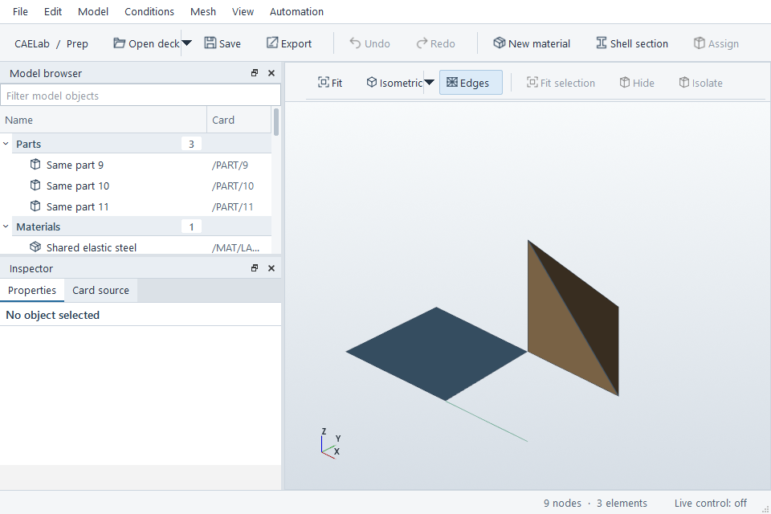

# CAELab Prep

여러 CAE 프로그램에서 재사용할 **공용 개발 자산과 기반**을 개발합니다. 문서·명령·선택·Undo·저장, 단위 입력과 공학 위젯, 디자인 자산·앱 셸·실행형 갤러리를 함께 관리합니다.

첫 적용 앱은 **OpenRadioss / OpenCourant용 독립 데스크톱 전처리기**입니다. RAD를 열어 모델과 조건을 편집하고 `.caeprep` 작업문서를 저장하거나 Starter/Engine 입력을 내보냅니다. CAD 원본은 FreeCAD 같은 CAD 도구가 소유하며, Workbench에서 시작한 솔버 실행과 결과 관리는 [CAELab Workbench](https://github.com/pikachu444/caelab-workbench)가 담당합니다.



2026-11-02 게시 코드 `adc9161`에서 저장된 절점 이동 모델을 다시 연 실제 Windows Qt/VTK 앱의 클라이언트 영역입니다. 합성 이미지가 아니며, 제한된 입력 열기·좌표 이동·저장/재열기 흐름의 [화면과 확인 범위](docs/usage.md#node-move-images)를 구분해 안내합니다.

## 현재 사용할 수 있는 기능

| 작업 | 지원 범위 |
|---|---|
| RAD 편집 | INCLUDE 원문 보존, LAW1 재료·shell/solid 단면·PART 관계의 지원 필드 생성·수정 |
| 조건과 케이스 | 곡선, 집합, BCS, CLOAD, INIVEL/TRA, 제한된 INTER/TYPE7, 영속 해석 케이스와 시간·출력 설정 |
| CAD·메시 | Gmsh tri3/tet4와 명시 planar quad/sweep hex8 recipe의 공통 후보 검토·채택·Undo·저장, quad/hex 분할 수·sweep layers 및 [단일 patch의 새 형상 recipe](docs/usage.md#recipe-geometry-fork) 편집과 [채택 recipe 동봉·새 후보 재생성](docs/usage.md#project-recipes), MSH 2.2/4.1 ASCII 가져오기와 [준비된 straight Tet10 opt-in](docs/usage.md#prepared-tet10), 지원 조건 안의 [CAD 후보 검토 교체](docs/usage.md#cad-replacement)·준비된 메시 교체·대상 재연결 |
| 메시 수정 | 닫힌 native 범위의 절점 이동·[명시 merge](docs/usage.md#node-merge)·[셸 반전](docs/usage.md#shell-normal-flip)·[요소 삭제/새 고립 절점 처리](docs/usage.md#element-deletion)·[요소 PART 소유 이동](docs/usage.md#element-part-ownership), stale 집합의 검토와 [명시 Drop](docs/usage.md#mesh-target-drop). 실제 OS/VTK·물리 응답 확인 범위는 현재 상태에서 구분 |
| 기하 검토 | [제한된 원통 홀 후보](docs/usage.md#geometry-features)의 독립 검사, 관통/막힌 홀 후보 표와 읽기 전용 wireframe 선택. 지원 형상군과 실제 3D 확인 범위는 사용법·현재 상태에서 구분 |
| 문서 | Undo/Redo, `.caeprep` 저장·재열기, RAD 및 Starter/Engine 내보내기 |
| 공용 GUI | 같은 문서·명령을 사용하는 8개 프로그램별 표현, 단위 숫자·벡터·표·곡선 입력, 재료/곡선 갤러리와 부품 카탈로그 |
| 자동화 | 독립 CLI, 열린 GUI에 접속하는 live 제어와 선택 설치 MCP adapter |

Python API에는 [meshing criteria JSON과 최소-edge 감사](docs/usage.md#meshing-criteria)가 있습니다. 독립 minimum을 SDK에 전달하고 실제 출력의 지원 선형 edge를 검사합니다. 일반 형상의 특징 인식·washer ring·fillet 억제·batch/자동 cleanup은 후속입니다.

main에는 **절대좌표 절점 이동의 첫 구현**도 있습니다. 요소 품질과 영향 대상을 미리 검토하고 한 Undo로 적용합니다. 영향 집합을 명시적으로 재검토하기 전에는 native 출력을 막습니다. 다중 자원별 검토 의존성을 보존하며, 하중 시간함수와 작용점 모멘트의 실제 평가는 별도로 확인해야 합니다. 일반 메시 편집 전체의 완료본은 아닙니다.

집합 편집의 선택적 **Preview change…**는 명시 절점·요소 멤버의 출처와 변경 전후 조건 대상을 검토한 뒤 한 Undo로 적용합니다. 지원 native 참조 범위에서 하중 계수·접촉의 두 역할·초기속도 중복 대상을 표시합니다. 물리 응답이나 유효 초기상태를 계산하지 않으며, 전체 part 재배정 기능의 완료를 뜻하지 않습니다. 기존 직접 Apply와 새 검토 경로의 [사용 범위](docs/usage.md#group-member-review)를 구분합니다.

**Mesh → Merge nodes with tolerance…**는 제거할 절점과 keeper를 출처별로 직접 고르고 허용 오차·경계 허용·품질·조건 영향을 검토해 한 Undo로 적용합니다. keeper 좌표를 유지하며 영향받은 집합과 그 조건은 명시 재연결 전까지 stale로 남겨 native 출력을 막습니다. 근접 절점의 자동 용접이나 물리 보존을 보장하지 않습니다. 중복 집합 축약 등 [첫 지원 범위와 제한](docs/usage.md#node-merge)을 확인하세요.

재연결에서 같은 현재 절점으로 모이는 링크는 **Allow repeated node targets to form one set → Preview final mapping**으로 원 링크·최종 집합과 조건 계수를 검토한 후보만 적용합니다. 다른 stale 그룹은 자동 승인하지 않습니다.

전체 Radioss 카드, 모든 요소·재료법칙, 일반 재메시의 자동 조건 복구, 임의 all-hex·중립면 생성과 Windows 설치형 배포는 지원 완료 범위가 아닙니다. 8개 표현의 존재는 원제품 전체 기능·품질과의 동등성 검증을 뜻하지 않습니다. 선택적 SolidCraft 준비 adapter는 외부 CAD를 실행하지 않으며 실제 design→STEP 생성 관계는 미확인입니다.

## Windows에서 시작하기

Python 3.11 이상과 Git을 설치한 뒤 저장소를 엽니다. PowerShell에서 실행합니다. 기존 가상환경이 있다면 새로 만들지 말고 [설치 가이드](docs/usage.md#install-windows)에 따라 환경을 선택하세요.

```powershell
git clone https://github.com/pikachu444/caelab-prep.git
cd caelab-prep
python -m venv .venv
.\.venv\Scripts\python.exe -m pip install -e ".[gui,cad]"
.\.venv\Scripts\caelab-prep.exe gui
```

처음에는 **File → Open Radioss deck…**으로 RAD를 열거나 **File → New model…**에서 명시적인 단위를 선택합니다. **Save project**는 편집 원본 `.caeprep`를 저장합니다. 솔버 입력은 별도의 **Export Radioss deck…** 또는 **Export Starter and Engine…**으로 작성합니다. Prep 설치에 솔버 EXE는 포함되지 않으며 덱을 열거나 편집하는 데 솔버 설치는 필요하지 않습니다.

## 사용 안내

- [설치·Windows 실행·MODEL/FORM/TEXT 편집·저장·CLI](docs/usage.md)
- [열린 GUI의 live 제어](docs/live-control.md), [MCP 클라이언트 연결](docs/mcp-client.md)
- [8개 프로그램별 표현의 근거와 차이](docs/ui-reference-variants.md)
- [Windows 확인 범위와 실행 기록](docs/native-windows-validation.md)
- [외부 라이브러리와 배포 조건](THIRD_PARTY.md)

## 개발 자료

[제품 목표](DESIGN.md#delivery-goals), [현재 코드 구조](ARCHITECTURE.md), [남은 작업과 완료 기준](CURRENT_STATE.md#remaining-work), [Workbench 소비자 경계](docs/workbench-reuse-plan.md)를 따릅니다. 공용 자산과 갤러리는 정식 개발 산출물이며 다른 제품이 생길 때까지 개발을 미루지 않습니다.

[공용 기반 실행 계획](docs/shared-cae-foundation-plan.md), [GUI 비교 자료](docs/benchmarks/2026-10-30/README.md), [솔버 입력 자산](docs/solver-input-assets/2026-10-30/README.md), [메셔 실증 범위](docs/mesher-feasibility-roadmap.md)는 개발 근거입니다. 사용자 설치·실행 절차는 위 사용 가이드를 이용하세요.
