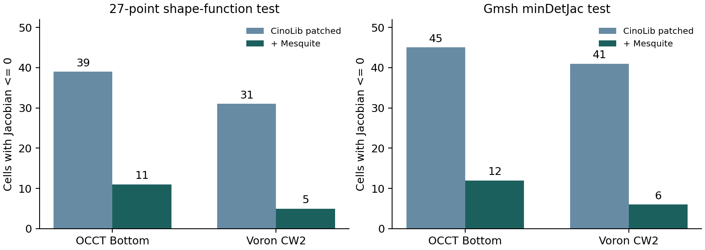
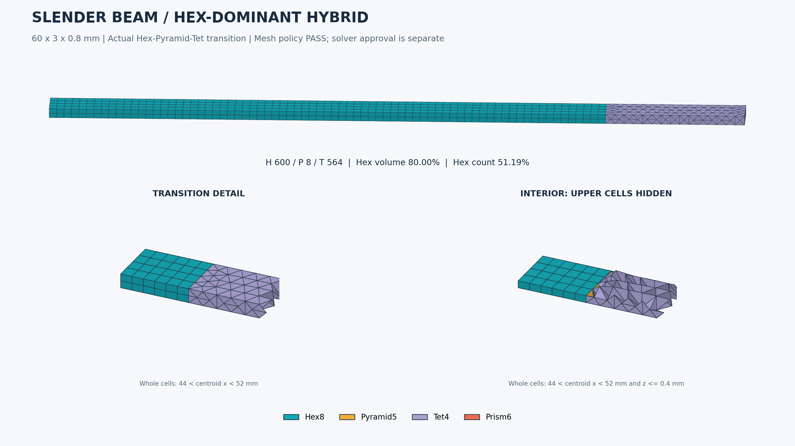
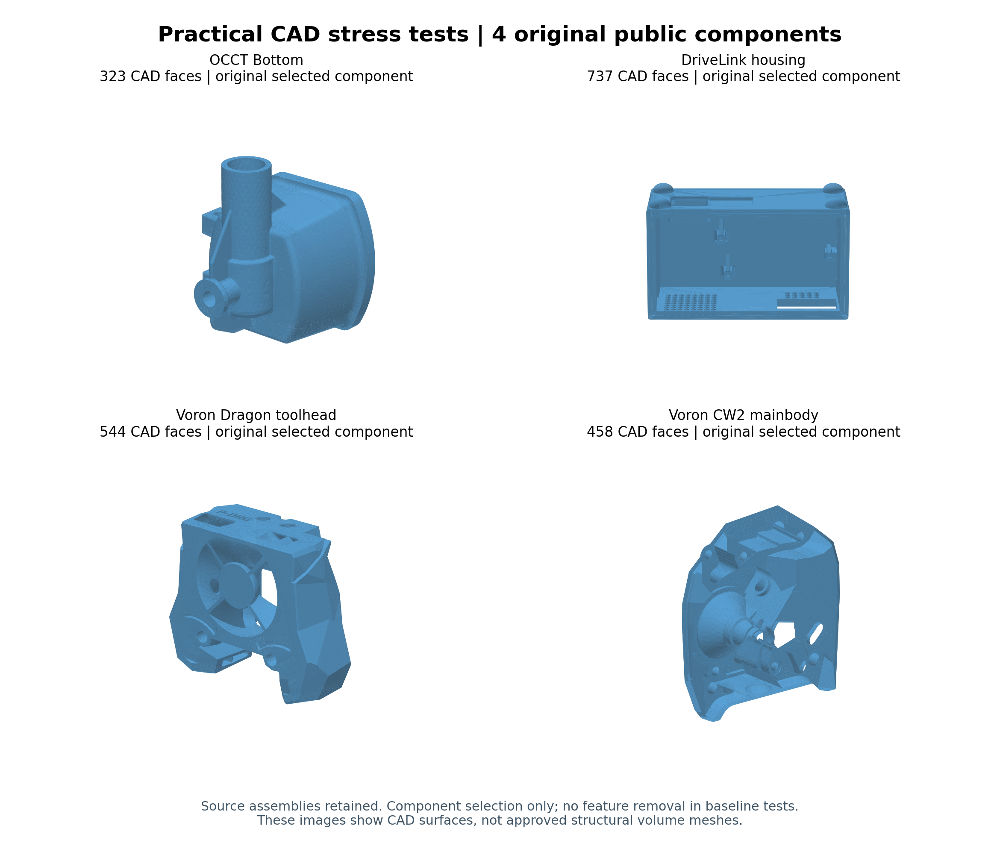
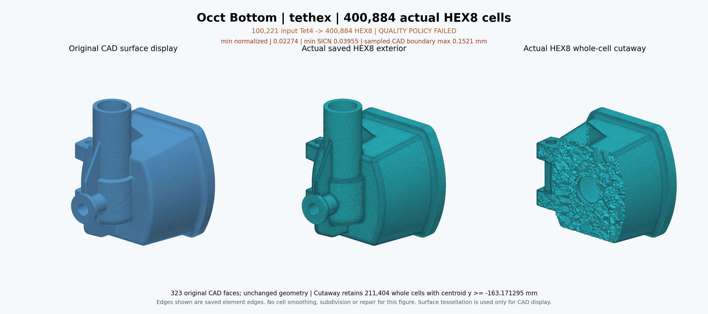

# Hex·혼합 메시 조사 통합본 - Round5 추가 검증 반영

2026-11-04 갱신. 현재 판단은 제1부와 CANDIDATE_CATALOG의68개 검토 항목을 따릅니다. 생성기·구성 요소·후처리·wrapper·제외 대상을 구분하며68개 독립 무료 메셔라는 뜻이 아닙니다.

제1부는 이번 추가 조사와 native 실행입니다. 제2부는 이전 통합 본문을 당시 상태로 보존한 기록입니다. 제2부의50항목/문서검토/새 실행 없음 등의 문장은 이전 통합 작업의 범위이며 이번 Round5를 설명하는 문장이 아닙니다. 이전 Windows 실증과 새 Linux 실증도 구분합니다.

## 제1부. 추가 조사와 직접 실행

2026-11-04 · 메시어검토 · caelab-prep 개발 에이전트 인계용

## 1. 판정

**기존 조사에서 빠진 무료 후보가 더 있습니다. 누락됐다는 이유로 열등하다고 판단할 수 없습니다.** 기존50개 검토 항목을 보존하고18개 항목을 보완했습니다. 합계68은 독립 무료 생성기의 수가 아닙니다. 생성기·후처리·사용자 블록 도구·패키징·기존 backend의 미검토 경로를 구분했습니다. 전 세계의 모든 구현을 빠짐없이 확인했다는 주장은 하지 않습니다.

이번에는 문서 확인에서 멈추지 않고 FieldCraft, meshio++, CinoLib, HexGen, C4HexMeshing, Mesquite, SMESH Cartesian3D의7개 도구 계열을 실제 실행했습니다. **추가 시험에서 복잡 원본 CAD의 모든 품질·형상·피처 기준을 통과한 새 자동 범용 엔진은 확보하지 못했습니다.** 이는 이 입력·버전·설정에서의 결과이며, 미시험 도구 전체의 열등함이나 모든 설정에서의 불가능을 뜻하지 않습니다.

실제 개선 효과도 확인했습니다. Mesquite 후처리는 CinoLib 메시의27점 nonpositive 요소 수를 Bottom39→11, CW2 31→5로 줄였습니다. C4는 유료 최적화 프로그램 없이 빌드해 최소 매핑 입력에서64Hex 기본 유효성 검사를 통과했습니다. 이 두 사실을 복잡 CAD 전체 합격으로 확대하지 않습니다.

## 2. 추가 후보와 역할

| 후보 | 무료·공개 근거 | 역할과 이번 판단 |
|---|---|---|
| [FieldCraft](https://github.com/tangency-labs/fieldcraft) | MIT OR Apache-2.0 | 공식 Linux v0.7.0 실행. 관통공 판 23,772 Hex; 독립 검사 불합격. 원본 CAD3종은 확대 한도에서도 격자/깊이 제한. 새 자동 all-Hex 후보. 직접 STEP 입력 대신 태그 3MF/자체 CAD. 문서의 any part 표현을 보편 성공 보장으로 해석하지 않음. |
| [meshio++ octree_mesh](https://loumalouomega.github.io/meshioplusplus/octree_mesh.html) | Source MIT; base wheel MIT AND MPL-2.0; optional add-ons separately licensed | 공식18.1.0 wheel 실행. Bottom/CW2 Hex 출력 및 독립 감사. VTU writer 충돌은 native 배열의 표준 VTK 직렬화로 우회. 범용 IO만 제공하는 도구로 제외하면 누락. 새 all-Hex 경로 존재. 현재 시험의 뒤집힘/피처 실패는 불합격; 전체 라이브러리 열등 판정 아님. |
| [Medial-HexMeshing](https://github.com/Shane-Bambu/Medial-HexMeshing) | No root LICENSE at pinned commit; free reuse permission unconfirmed | 원 소스 확보. 루트 빌드 파일 없음; example.cpp는 GUI this를 쓰는 단편. native 실행 미완료. 2024 논문의 고품질/요소 절감 후보. 성능 주장은 저자 근거이며 동일 CAD 독립 성능이 아님. 무상 사용 권한을 확정하지 않음. |
| [Mesquite](https://www.sandia.gov/ccr/project/mesquite/) | LGPL-2.1-or-later (2.3.0 source headers and lgpl.txt) | 2.3.0 native 빌드 및 CinoLib2종 개선. 27점 nonpositive39→11,31→5. 여전히 종합 불합격. Hex/Pyramid/Wedge 후처리. 생성기와 분리. 경계 고정으로 경계 형상 문제를 해결하지 않음. |
| [IA-FEMesh](https://ctpr.github.io/IA-FEMesh/) | MIMX BSD-like source/binary redistribution terms; modified versions must be marked | 공식 기능/라이선스 검토. 이번 native 실행 없음. 해부학 분야의 multiblock Hex 도구. 사용자 블록 설계가 필요하며 오래된 ITK/VTK/KWWidgets 기반. |
| [LaGriT](https://lagrit.lanl.gov/) | LANL BSD-3-Clause variant | 공식 지원/라이선스 확인. 이번 native 실행 없음. 구조/비구조 quad/hex 지원. 공식 설명은 주요 알고리즘이 triangle/tet임을 명시; 임의 STEP 자동 Hex 성능 미확인. |
| [GRIDDER](https://meshing.lanl.gov/gridder/index.shtml) | BSD-3-Clause | 공식 기능/라이선스 확인. 이번 native 실행 없음. 직교 quad/hex와 단순 형상에 적합. LaGriT와 별도이지만 복잡 CAD 자동화 대체제로 제시하지 않음. |
| [Neper](https://neper.info/meshing.html) | GPL-3.0 | 공식 hex 옵션/분야/라이선스 검토. 이번 native 실행 없음. 다결정/미세구조용 raster hex. 특정 분야에 유용; 임의 산업 STEP 자동 all-Hex와 구분. |
| [TexGen](https://texgen.sourceforge.io/index.php/Main_Page) | GPL-2.0 (official repository) | 공식 기능/라이선스 검토. 이번 native 실행 없음. 직물/섬유 복합재의 voxel Hex 경로. 섬유 경계 해상도와 solver mesh 역할 별도 확인 필요. |
| [MyMesh](https://github.com/BU-SMBL/mymesh) | MIT | 원 소스 확보. VoxelMesh/Extrude/Revolve 등 실제 함수 확인; 이번 native 실행 없음. 2026 JOSS 도구. implicit/image/voxel 및 sweep 기능을 일반 STEP 자동Hex로 확대하지 않음. |
| [Dual Sheet Meshing](https://kenshi84.github.io/) | Survey reports BSD-3; current Bitbucket license bytes not independently retrieved | 저자 페이지→Bitbucket 코드 링크 및 원 논문 확인. native 실행 없음. 사용자가 dual sheet를 설계하는 독립 계열. 3D 자동 sheet 설계를 해결한 도구로 해석하면 안 됨. |
| [GIBBON](https://www.gibboncode.org/) | AGPL-3.0 (current root LICENSE); external tools have separate licenses | 공식 코드/혼합 demo 확인. 이번 MATLAB/Octave native 실행 없음. 현재 demo는 regularHex+TetGen과 quad2tri(b) 인터페이스, mergeVertices. 일반 표준 FE 정합 전이 보장 근거가 아님; 실행 환경 비용 별도. |
| [FEBio Studio](https://github.com/febiosoftware/FEBioStudio) | Source MIT; website binaries under custom free license | 공식 기능/소스 라이선스 확인. 이번 native 실행 없음. 일부 primitive/편집/Hex 자산 후보. 공식 매뉴얼도 강력한 범용 mesh generator를 목표로 하지 않음을 명시. |
| [classy_blocks](https://github.com/damogranlabs/classy_blocks) | MIT; OpenFOAM backend separately licensed | 공식 기능/라이선스 검토. 이번 native 실행 없음. blockMesh 사전 작성/블록 최적화 보조. 같은 backend를 새 독립 엔진으로 중복 계산하지 않음. |
| [gmsh_scripts](https://github.com/romanzes637/gmsh_scripts) | Root LICENSE.txt reproduces GPL-2.0-or-later with Gmsh exception; wrapper-specific attribution requires review | 공식 API/예제 검토. 이번 native 실행 없음. Gmsh 기반 구조/비구조·Hex/Tet multiblock 스크립트. 독립 커널 아님. |
| [Element-Saving Hexahedral 3-Refinement Templates](https://github.com/CMU-CBML/Element-Saving-Hexahedral-3-Refinement-Templates) | MIT | 공식 저장소/논문 연결 확인. 이번 native 실행 없음. 2026 적응 격자의 요소 수 절감 템플릿. CAD 분류·경계 피팅·완성 생성기는 별도. |
| [Hexi](https://sourceforge.net/projects/hexi/) | Multiple bundled OSS licenses; per-component review required | 2025 배포물/문서 확인. 이번 Windows/Linux binary 실행 없음. Feature-Preserving-Octree-Hex-Meshing을 주 코드로 패키징한 배포. 기존 C021과 알고리즘 중복, 설치/Windows 접근성 가치 별도. |
| [SMESH Body Fitting / Cartesian3D](https://docs.salome-platform.org/latest/gui/SMESH/cartesian_algo.html) | SMESH LGPL; dependency terms separately apply | 공식9.16 문서와 별도로 native9.9.0.0 경로를 실제3원본Brep에서 실행. Hex+Wedge+polyhedron 출력; 독립FE전체합격아님. 내부 Hex+경계 polyhedron/다른 요소. 기존 C003의 별도 경로; 표준 Hex/Pyr/Tet만 나오는 새 무료 엔진으로 계산하지 않음. |

기존 후보 CinoLib·C4·HexGen도 재실행 대상으로 끌어올렸습니다. 기존 Gmsh·SMESH·Magix3D·GMDS·HexBox·AlgoHex·MCHex·automesh 등의 상세 결과는 이전 통합본을 보존했습니다. 같은 알고리즘의 GUI·wrapper·배포판을 새 커널 수로 부풀리지 않습니다.

## 3. 직접 실행 환경과 비교 범위

Linux x86-64, cgroup 물리 메모리8GiB·CPU quota8, 새 작업 폴더에서만 설치·빌드·실행했습니다. 과거 실험의2GiB 주소공간 제한을 새 실행에는 적용하지 않았습니다. 병행 작업·도구별 스레드·입력 표현·요소 수가 달라 이번 벽시계 시간은 참고치이며 성능 순위가 아닙니다. 프로세스 메모리 샘플이0 또는 비현실적인 값인 기록은 측정 불충분으로 취급합니다.

원본 CAD는 이전 Round4의 OCCT Bottom(323면), Voron Dragon(544면), Voron CW2 Mainbody(458면)에서 만든 공통 OBJ/삼각면을 좌표·연결성 변경 없이 사용했습니다. 파일 SHA와 입력 provenance를 보관했습니다. Voron 두 입력의 기존 CAD 결함 정보도 유지합니다. DriveLink Housing은 공통 폐곡면 입력을 확보하지 못했으므로 이 삼각면 기반 시험에서 입력 차단이며 생성기 실패로 세지 않습니다.

FieldCraft는 STEP를 직접 읽지 않아 Gmsh face entity별 삼각형을 face-tagged3MF로 직렬화했습니다. 태그는 영속 원 CAD face ID 계약을 검증한 것이 아닙니다. 실제 CAD 곡면 query를 삼각면 입력이 대체하지 못합니다. 관통공 판은 별도의40×20×10mm, R4 원통공 기준 시험으로 복잡 원본 CAD 성공률에 합산하지 않습니다.

독립 검사는 이전의 동결된 Round4 audit4.3을 읽기 전용으로 재사용했습니다.27개 Hex shape-function Jacobian 표본과 Gmsh4.15.2 minDetJac/minSICN, 공유 face·경계 incidence, 원 CAD의 trimmed-face 거리·체적·명시 피처를 확인했습니다. min normalized J≥0.1, minSICN≥0.05, 체적오차≤1%, 표본 CAD 거리≤0.01mm는 이 프로젝트의 연구 기준입니다. Verdict SJ와 같은 수치로 혼용하지 않습니다. 표본 통과도 전 요소 내부 Jacobian/교차/솔버 정확도의 수학적 증명은 아닙니다.

## 4. 동일 원본 CAD의 독립 수치

표의 nonpositive는 영 또는 음의 Jacobian을 갖는 요소 수입니다.27점 표본과 Gmsh의 검사 지점·최솟값 추정이 달라 값이 다를 수 있습니다. native exit0 또는 native 자체 통계만으로 합격시키지 않았습니다.

| 도구·형상 | Hex 수 | nonpositive27 / Gmsh | minSICN | CAD 체적오차 | 최대 표본 경계거리(mm) | 종합 |
|---|---:|---:|---:|---:|---:|---|
| CinoLib 수정 / occt_bottom | 41,070 | 39 / 45 | 0.0002 | 1.770% | 1.8004 | 불합격 |
| CinoLib 수정 / voron_dragon | 132,058 | 63 / 77 | 0.0006 | 3.498% | 0.7273 | 불합격 |
| CinoLib 수정 / voron_cw2_mainbody | 81,705 | 31 / 41 | 0.0005 | 1.093% | 0.6917 | 불합격 |
| CinoLib+Mesquite / occt_bottom | 41,070 | 11 / 12 | 0.0019 | 1.770% | 1.8004 | 불합격 |
| CinoLib+Mesquite / voron_cw2_mainbody | 81,705 | 5 / 6 | 0.0015 | 1.093% | 0.6917 | 불합격 |
| meshio++ / occt_bottom | 136,664 | 1,213 / 1,259 | -0.6444 | 0.152% | 0.5034 | 불합격 |
| meshio++ / voron_cw2_mainbody | 109,132 | 2,880 / 2,931 | -0.8378 | 0.301% | 0.2128 | 불합격 |

CinoLib 원본 projector는 smoothing accumulator의 `vec3d p`를 초기화하지 않았고, 기본 생성자도 초기화하지 않습니다. native projector를 그대로 호출한3종 결과는 각각1547/5065/2650개 비유한 정점을 가졌습니다. 새 clone에0 초기화 한 줄을 적용하고 upstream의 `SERIALIZE_PARALLEL_FOR`를 사용해 in-place 병렬 갱신의 비결정성을 피했습니다. 수정 후 정점은 유한해졌지만 위 독립 검사에서 역전·피처·형상 문제가 남았습니다. raw voxel 결과와 수정 전후 결과를 모두 보존했습니다. 이것은 CinoLib의 모든 다른 알고리즘 경로에 대한 판정이 아닙니다.

Mesquite2.3.0은 CMake의 오래된 Tribits 의존 문제를 피하고 배포본의 configure/make 경로로 빌드했습니다. 입력을 호환되는 VTK4.2로 직렬화한 후 경계 절점을 고정하고 UntangleWrapper·ShapeImprover를 호출했습니다. 연결성은 같고, native 파일의 소수 출력으로 생긴 경계 좌표 변화는 최대5e-8mm입니다. native free-element 평가가 no inverted라고 해도 전체 요소 독립 검사에는 위 역전이 남습니다. 경계 고정 후처리로 CAD 경계 오차를 없앴다고 주장하지 않습니다.

meshio++18.1.0의 native VTU writer는 정상적으로 읽은 HexGen mesh에서도 충돌했습니다. 같은 native 메시의 좌표·연결성을 NPZ와 표준 ASCII VTK로 내보내어 메시 생성과 저장 실패를 분리했습니다. Bottom/CW2는 원 코드의 실제 Hex 출력이며 메싱 알고리즘은 바꾸지 않았습니다. Dragon 첫 출력은 writer 충돌로 독립 감사가 완료되지 않았으므로 통과·실패 성능 수치를 만들지 않았습니다. native가 경고한 feature chain 누락과 역전도 로그에 남아 있습니다.

## 5. FieldCraft의 실제 한도와 별도 기준판

공식 Linux v0.7.0 release를 실행했습니다. 배포 tar SHA256은 공식 SHA256SUMS와 일치합니다. 소스 default branch와 같은 version 문자열이라도 파일 형식은 달랐으므로, 실제 binary의 tag v0.7.0 commit `e9ccf10692a08ea4c6037442c6213e1f68d344b8`를 별도 고정했습니다. 배포본은 MCMESH01/fieldcraft1이고 이후 HEAD는 MCMESH02를 쓰므로 혼용하지 않습니다. 서명까지 검증했다고 주장하지 않습니다.

| 원본 CAD | 확대 재시험 설정 | native 결과 |
|---|---|---|
| Bottom | size4mm, depth5, max2,000,000, attempts2, sweeps60 | native 추정 벽0.6199mm.3층 기준0.2066mm 필요. 균형·정합 closure 후2M 한도 초과 |
| Dragon | size2mm, depth5, max2,000,000 | native 추정 면폭0.0002mm.8~9 refinement levels 필요로 depth5에서 차단 |
| CW2 | size2.5mm, depth5, max2,000,000 | native 추정 면폭0.0431mm. refinement 후658,717 또는693,122 grid cells였으나 closure 후2M 한도 초과 |

위 wall/patch 폭은 FieldCraft의 삼각면 추정치이며 공인 CAD 최소 두께가 아닙니다. 초기에 사용한 depth2·600k 제한만으로 결론내지 않고 depth5·2M으로 재시험했습니다. 이 한도 초과는 더 큰 장비/다른 크기/블록 분할에서의 불가능 판정이 아닙니다. 다만 현재 동일 원형상 기준에서 바로 붙여 쓸 범용 성공은 없었습니다.

별도 관통공 판의 octree 출력은 23,772Hex/26,508절점입니다.27점/Gmsh nonpositive는 모두0이지만 min normalized J=0.006486, minSICN=0.004156, 체적오차=3.544%, 최대 표본 경계거리=1.4038mm여서 기준 불합격입니다. 구조 auto는 태그 삼각면에서 free-form 면/holed linking face를 지원하지 못해 거부했습니다. 저자 corpus의 더 좋은 수치를 이번 독립 결과로 대체하지 않았습니다.

## 6. HexGen·C4: 준비된 매핑과 원 CAD 자동화를 분리

HexGen의4 native 실행 파일을 모두 빌드했습니다. 패치는 include 대소문자, 잘못된 MSVC/Boost flag, Windows 문자열 함수·경로 함수, std filesystem, 별도 cpp에 둔 inline 정의의 링크 문제를 다룹니다. 소스 변경 diff와 실패 로그를 보존했습니다. 새 자동 segmentation은 upstream rockerarm과 공통 Bottom에서 SIGSEGV, polycube는 upstream에서 bad_cast로 종료했습니다. 이것만으로 모든 플랫폼과 원 알고리즘을 열등 판정하지 않습니다.

저자가 제공한 수동 분할과 이미 작성된 hex block 구조를 ParametricMapping에 넣으면3456Hex를1.4초에 생성했습니다. 이어 저자 예제의 lap10→pillow1→smooth200(0.1)→opt50(0.01)를 실행해5696Hex를 얻었습니다.27점 역전은77/3456에서14/5696, Gmsh nonpositive는17개로 남았습니다. 원 CAD 거리·단위·수동 작업 시간을 검증하지 않았으며 full automatic 복잡 CAD 성공으로 세지 않습니다. sharp feature OFF인 해당 recipe의 결과이며 전 설정 최적값을 구한 것이 아닙니다.

C4HexMeshing은 Eigen·GMP·Clp로 빌드했습니다. Gurobi·Bonmin 없이 heuristic quantizer를 사용했습니다. `.hexex`에 Tet와 seamless map이 이미 있어야 하므로 일반 STEP 입력이 아닙니다. 현재 CLI는 추출 뒤 실제 Hex smoothing을 호출하며 README의 제한 설명만으로 후처리 존재를 단정하지 않았습니다. 준비 매핑3종은 default variant0(Flexible Singularities),target10,000Hex,collapse=true,untangling100,600초 한도로 실행했습니다. variant1(고정 singularity)과 모든 최적 설정을 탐색한 비교는 아닙니다. 최소 매핑 입력에서는64Hex,27점 normalized J=1, 기본 topology/quality 통과를 확인했습니다. 이것은64개짜리 canary일 뿐입니다.

| C4 준비 매핑 입력 | 실행 시간/종료 | 출력·독립 검사 상태 |
|---|---|---|
| minimal | 0.13s / returncode0 | 64Hex; basic=pass |
| fancy_ring | 600.06s / 시간 한도 도달 | 독립 감사 없음 |
| fandisk_algohex | 600.06s / 시간 한도 도달 | 독립 감사 없음 |
| rockerarm | 606.68s / 시간 한도 도달 | 독립 감사 없음 |

시간 초과/후보 실패는 해당 옵션과 한도에서의 상태입니다. native 전처리나 mapping이 진행됐다는 이유로 최종 Hex 출력을 만들어낸 것으로 기록하지 않았습니다.

## 7. 혼합 메시의 빠진 경로와 제품 연결 판단

SMESH Body Fitting/Cartesian3D는 내부 Hex와 경계 polyhedron/다른 요소를 만드는 무료 경로입니다. Viscous Layers도 지원하지만 shared/internal face 제약이 있습니다. Hex 우세일 수 있다는 사실과 OpenRadioss가 받을 표준 Hex/Pyr/Wedge/Tet만으로 정합 전환됐다는 사실은 다릅니다. 기존 SMESH 후보의 별도 경로로 남기고 native 표준요소화·잔여체적·슬리버·피처 보존을 검증해야 합니다.

추가 native 실행에서는 기존에 고정한 standalone SMESH9.9.0.0/OCCT8의 Cartesian3D를 원본Brep에 직접 적용했습니다. 치유나defeature 없이 spacing4/2/2.5mm, sizeThreshold4, implementEdges/createFaces=true, 경계층 없이 실행했습니다. nativecomputed=true였지만 Voron2종의 기존 CAD 유효성 결함은 그대로false입니다.

| 원본 CAD | 벽시계 참고 | Hex / Wedge / Polyhedron | 총 volume 셀 | 판정 |
|---|---:|---:|---:|---|
| Bottom |2.24s|3702 /28 /2234|5964|빠른 혼합 출력, 표준 FE 전체 검증 전|
| Dragon |8.66s|3270 /31 /3410|6711|CAD invalid, poly 경계 포함|
| CW2 |3.64s|773 /19 /1128|1920|CAD invalid, poly 경계 포함|

native.raw에 polygon을 포함한 모든 volume face 연결성을 보존했습니다. 표준Hex/Pyr/Wedge/Tet만을 요구하는 경로에서는 Polyhedron2234/3410/1128개를 누락시키거나 임의BRICK으로 내보낼 수 없습니다. 이 추가 실행은 앞의 삼각면 기반 자동Hex들과 입력/셀 형식이 달라 시간 우위로 순위를 매기지 않습니다. poly_geometry_audit는 별도 유한 CAD 거리·face incidence 진단이며 표준FE Jacobian/체적/겹침/전이 정합 전체감사의 통과 판정은 아닙니다. 원 native face 연결성을 그대로 쓴 최대 표본 경계거리/경계 edge-incidence≠2는 Bottom3.5807mm/56, Dragon1.7794mm/110, CW22.1789mm/38입니다. coplanar polygon의 collinear 분할을 정규화한 검사는 아니므로 이 숫자만으로 모든 CFD poly 사용을 무효 판정하지 않습니다. 표준FE 정합 출력은 확보되지 않았습니다.

GIBBON 혼합 demo는 Hex core의 quad를 삼각화한 뒤 TetGen core와 절점을 병합합니다. 단순 절점 병합만으로 quad-두-triangle 연결을 표준 체적요소 정합으로 인정하면 안 됩니다. Pyr 전이·정합 interface 또는 명시적인 solver 제약이 실제로 있는지 확인해야 합니다. MATLAB/외부 TetGen 비용과 라이선스도 toolbox 자체의 무료성과 구분합니다.

우선 개발 순서는 기존 실증된 Gmsh·SMESH·분할/sweep 경로의 CAD 연계 및 품질 gates 유지, Mesquite/HexOpt 같은 후처리의 제한된 adapter 평가, FieldCraft·meshio++·C4 등의 연구 worker 분리입니다. IA-FEMesh·FEBio Studio·classy_blocks는 사용자 블록/편집 흐름의 구현 자산 후보로 검토할 가치가 있습니다. 자동 커널 전체를 대체할 후보라는 뜻은 아닙니다.

새 native 출력은 어느 것도 기본 solver export의 확대 승인 근거로 쓰지 않습니다. 이전에 확인한 반복 절점 BRICK/Pyramid의 질량·관성·시간 간격 문제는 이번에 해결하지 않았습니다. native exit0와 solver exit0를 형상·수치 정확도의 증명으로 취급하지 않습니다.

## 8. 재현·인계 자료

`CANDIDATE_CATALOG.csv/json`에 기존50+추가18 항목과 역할/라이선스/실행 단계를 기록했습니다. `EVIDENCE_SUMMARY.json`은 raw 로그·감사 파일의 위치와 SHA를 제공합니다. `INDEPENDENT_RESULT_TABLE.json`은 원 CAD 정책 검사8행(실부품7행+별도기준판1행)이며, 준비 입력의 HexGen/C4 품질은 `PREPARED_INPUT_QUALITY_TABLE.json`으로 분리했습니다. `RESULT_TABLE_SCOPES.json`에 각 표의 분모와 한계를 명시했습니다. evidence_round5의 source inventory, 빌드 명령, 이식 diff, 실행 설정, native 출력과 실패 로그를 함께 전달합니다. 3개 복잡 형상의 공통 OBJ·authoritative original.brep·metadata는 common_inputs에 보존했습니다. 원배포 STEP 전체/전체 소스 git clone/설치 wheel은 중복 배포하지 않고 원 실험 위치·해시·공식 저장소 pin을 보관합니다.

이번 추가 실행은 Linux입니다. 기존 초기 Windows 보고서의 기록은 그대로 보존하며 이 새 실행을 Windows 실증으로 승격하지 않습니다. 개발 에이전트는 이 문서와 이전 통합본을 함께 읽고, 구현 완료/문서상 가능/입력 차단/자원 한도/실행 실패/독립 감사 불합격을 구분해야 합니다.

## 9. 주요 1차 출처

- [FieldCraft](https://github.com/tangency-labs/fieldcraft)
- [meshio++ octree_mesh](https://loumalouomega.github.io/meshioplusplus/octree_mesh.html)
- [Medial-HexMeshing](https://github.com/Shane-Bambu/Medial-HexMeshing)
- [Mesquite](https://www.sandia.gov/ccr/project/mesquite/)
- [IA-FEMesh](https://ctpr.github.io/IA-FEMesh/)
- [LaGriT](https://lagrit.lanl.gov/)
- [GRIDDER](https://meshing.lanl.gov/gridder/index.shtml)
- [Neper](https://neper.info/meshing.html)
- [TexGen](https://texgen.sourceforge.io/index.php/Main_Page)
- [MyMesh](https://github.com/BU-SMBL/mymesh)
- [Dual Sheet Meshing](https://kenshi84.github.io/)
- [GIBBON](https://www.gibboncode.org/)
- [FEBio Studio](https://github.com/febiosoftware/FEBioStudio)
- [classy_blocks](https://github.com/damogranlabs/classy_blocks)
- [gmsh_scripts](https://github.com/romanzes637/gmsh_scripts)
- [Element-Saving Hexahedral 3-Refinement Templates](https://github.com/CMU-CBML/Element-Saving-Hexahedral-3-Refinement-Templates)
- [Hexi](https://sourceforge.net/projects/hexi/)
- [SMESH Body Fitting / Cartesian3D](https://docs.salome-platform.org/latest/gui/SMESH/cartesian_algo.html)
- [CinoLib](https://github.com/mlivesu/cinolib)
- [HexGen / Hex2Spline](https://github.com/CMU-CBML/HexGen_Hex2Spline)
- [C4HexMeshing](https://github.com/HendrikBrueckler/C4HexMeshing)
- [FieldCraft 실제 실행 tag](https://github.com/tangency-labs/fieldcraft/tree/v0.7.0)
- [FieldCraft 저자 corpus](https://github.com/tangency-labs/fieldcraft/blob/main/docs/meshing/corpus.md) - 저자 자료, 이번 독립 시험과 별도
- [LaGriT 공식 라이선스](https://lagrit.lanl.gov/licensing.shtml)
- [Hex-Mesh Generation and Processing survey](https://doi.org/10.1145/3554920) - 계열·공개 구현 누락 점검용

## 제2부. 이전 통합 본문 - 당시 기록 보존

2026년 11월 4일 기준. 수신 대상은 caelab-prep 및 연계 저장소에서 작업 중인 개발 에이전트입니다.

## 1. 결론과 조사 범위

모든 Hex 또는 Hex 혼합 생성기를 빠짐없이 조사하고 검증했다고 확언할 수 없습니다. 검색에 잡히지 않거나 이번에 실행하지 않은 후보가 열등하다는 근거도 없습니다. 이번 통합 목록은 기존 37개 항목, 초기 별도 보고서에서 복원한 4개, 이번 문서 검토로 추가한 9개를 합친 50개 항목입니다. 생성기 외에 변환기·매핑·후처리·뷰어·데이터·상용 제외 항목도 포함하므로 50개 독립 메시 엔진이라는 뜻이 아닙니다.

공개 코드와 유용한 경로는 확보했습니다. 제한된 형상군의 all-Hex, 정합 Hex/Pyramid/Tet, quad 기반 경계층과 Tet core를 실제 생성했습니다. 그러나 추가한 복잡 원본 CAD 4종에서는 원형상·표준 요소 정합·품질·피처 검사를 모두 만족하는 범용 자동 경로를 확보하지 못했습니다. 이를 모든 오픈소스의 불가능 판정으로 확대하면 안 됩니다.

제품 개발에서는 기존 Tet와 명시적 분할/sweep Hex를 유지하고, CAD 입력·국소 크기·두께 제어·전이 복구를 강화하는 방향을 우선합니다. 사용자의 자동 Hex 및 혼합 목표는 별도 연구 경로로 계속 남겨야 합니다. 이 문서의 통합·추가 검색 작업에서는 새 메시 생성이나 솔버 실행을 하지 않았습니다.

## 2. 근거를 읽는 순서와 우선 관계

서로 다른 입력·코드·환경의 결과를 한 성공률로 합산하지 않습니다. 세부 수치의 의미는 해당 원 보고서가 정한 분모와 검사 정의를 따릅니다. 같은 사실을 정정한 경우에만 후속 정정을 우선하고, 다른 형상에서 나온 실패로 과거의 제한된 성공을 지우지 않습니다.

| 자료 | 핵심 내용 | 통합 시 주의점 |
|---|---|---|
| S0 초기 별도 10쪽 보고서 | Windows Gmsh/automesh/marchinghex/MCHex 및 혼합 변환·native 실행 기록 | 보고된 과거 실증이며 이번 통합에서 raw 실행을 재감사하지 않음. 후속 Linux 결과와 섞지 않음 |
| S1 초기 Linux 조사 | 관통공 판 비교, Gmsh sweep 1,305 Hex와 RAD writer Pyramid 누락 | S0와 입력·메시 수·솔버 binary가 다름 |
| S2 엔진 개발 재개 | standalone SMESH/NETGEN, pySMESH 배포 확인, HexBL 실제 소스 실행 | 이전 설치 실패가 영구적인 실행 불가라는 결론은 폐기 |
| S3 v0.2 확대 검증 | 설치 가능한 엔진, 면 크기·선택 층·복구·취소·재열기, 외부 CAD 7개 중 3개 정책 통과 | GUI·전체 제품·일반 산업 CAD 성공률 아님 |
| S4 Round3 | 공통 9형상, 37항목 조사, 얇은 판·보·곡관·리브·외부 STEP | 반복 variant, 명시 recipe, 자동 출력과 구성 요소를 구분 |
| S5 Round4 | 323~737면 원본 CAD 4부품, 12목록 항목과 별도 HexBL 실행 범위 | 37개 모두 4CAD에서 실행한 시험 아님 |
| S6 CAD 거리 정정 | Round3의 90개 결과에서 거리 검사 교정 | 이전 205행 전체를 재실행한 것이 아님. 합격/불합격 전환 0 |

자료 S0~S13의 원본 링크·텍스트 내보내기·해시는 SOURCE_MANIFEST.json에 있습니다. 원 보고서는 source_text, 숫자 표는 data에 포함했습니다. 원본 PDF 이미지·원 메시·대형 실행 증거는 해당 다운로드 목록을 이용합니다.

## 3. 무엇을 비교했는가

| 계열 | 대표 경로 | 강점과 핵심 제한 |
|---|---|---|
| CAD 분할·sweep·회전·블록 | Gmsh, HEXABLOCK, CGX, ElmerGrid, blockMesh, HOHQMesh | 방향·두께 층수·CAD 연계를 제어하기 쉬움. source/target 또는 블록 설계 필요 |
| 표면 quad와 경계층·Tet core | SMESH/NETGEN, HexBL, 자체 전이 adapter | Hex/Prism/Pyramid/Tet 실 생성 가능. 층 충돌·core 완전 충전·전이 품질이 병목 |
| 격자·octree·voxel | automesh, marchinghex, MCHex, HybridOctree | 자동성·큰 체적 Hex에 유리할 수 있음. 미세 피처·얇은 벽·경계 투영·메모리 비용 확인 필요 |
| 방향장·매핑·polycube | AlgoHex, Exploragram, robustPolycube, HexDom | 정렬 구조를 만들 수 있음. 좋은 Tet·매핑·양자화·완전 추출을 각각 해결해야 함 |
| 변환·후처리 | tethex, HexOpt, Robust-Hexahedral-Re-Meshing | 기존 입력의 성질을 개선하거나 변환. Tet의 sliver·경계 오차와 요소 수 비용이 남을 수 있음 |
| CFD 혼합·다면체 | snappyHexMesh, cfMesh | 높은 Hex 체적을 얻을 수 있음. 일반 polyhedron을 표준 구조 Hex/Pyr/Tet와 구분해야 함 |
| 분할·매핑·추출 구성 요소 | MC3D, QGP3D, TrulySeamless3D, HexHex, C4HexMeshing | 교체 가능한 연구 단계. CAD 하나를 받는 완성품과 동일한 비교 대상이 아님 |

Hex 체적 비율과 Hex 개수 비율은 별도입니다. 예를 들어 Round3 혼합 보는 Hex 체적 80.00%지만 Hex 개수 비율 51.19%입니다. 공유 절점이 있다고 quad와 두 triangle을 동일 face로 취급하지 않습니다. Pyramid·정합 재구성·적절한 연결이 실제로 있어야 합니다. tied/contact 연결도 정합 체적 메시와 구분합니다.

## 4. 실제 성공 근거와 남은 제한

| 결과 | 확보한 근거 | 확대해서 주장하면 안 되는 것 |
|---|---|---|
| S0 Windows 혼합 관통홀 | Hex64/Pyramid16/Tet984, Starter 경고·오류0, Engine 4,366 cycles | 반복 절점 BRICK의 물리 동등성·제품 mixed importer 완성 |
| S1 Gmsh 관통공 판 | Hex1,305, Verdict 최소 SJ0.604464, Linux native 무하중 실행 | 일반 복잡 CAD 자동 all-Hex |
| S3 SMESH 기반 v0.2 | 새 STEP7개 중 3개가 명시 수용 정책 통과 | 산업 CAD 일반 성공률 또는 NFX 동등성 |
| S4 얇은 유공판 | Gmsh Hex14,976, 메시 정책 통과 | 임의 슬롯·구멍 분기에서 같은 성공률 |
| S4 얇은 곡관 | Gmsh Hex11,220; HEXABLOCK core Hex6,528, 정책 통과 | 자동 블록 발견·전체 SALOME GUI 확인 |
| S4 긴 보 정합 혼합 | Hex600/Pyramid8/Tet564, Hex 체적80%, 메시 정책 통과 | 같은 메시의 솔버 응답·시간간격 승인 |
| S4 자동 Tet→Hex 보 | Exploragram Hex1,416, robustPolycube Hex3,804, AlgoHex Hex1,368 각각 정책 통과 | 복잡 얇은 하우징의 자동 성공 |
| S4 tethex 브래킷·리브 | Hex118,252 /121,604 생성·정책 통과 | 적은 요소로 효율적인 방향성 Hex 생성 |
| S4 automesh poly 분할 adapter | 보의 Hex71,017/Pyramid5,724/Tet3,832, 정합·품질 통과 | CAD 면 중심 오차0.045686mm로 최종 미승인. 유공판 warped poly는 적용 조건 거절 |

그림은 Round3의 후속 후보입니다. 솔버에 사용한 초기 candidate와 같은 요소 수라는 이유로 같은 파일로 취급하지 않습니다. 각 메시·덱 SHA가 일치할 때만 응답 근거를 연결합니다.

## 5. 복잡 CAD 추가 시험 결과

| 부품 | CAD 면수 | 입력과 문제 |
|---|---:|---|
| OCCT Bottom | 323 | 원 BREP valid. 곡면 하우징·포트·리브·필렛 |
| DriveLink housing | 737 | 조립체의 단일 부품. valid BREP이지만 공통 표면 생성부터 차단 |
| Voron Dragon | 544 | 원 STEP 직접 importer 대조에서도 invalid face1. 냉각 통로·얇은 지지부 |
| Voron CW2 mainbody | 458 | 단일 선택 부품. invalid face1, 작은 구멍·공동·보스 |

GrabCAD 두 페이지는 로그인 shell/403으로 CAD를 확보하지 못해 시험했다고 세지 않았습니다. NFX 교육 ZIP8개는 확보했으나 확인된 CAD가 Parasolid x_t여서 Gmsh import에 실패했습니다. NFX 프로그램을 직접 실행한 동일 CAD·동일 sizing 비교는 아닙니다. NFX 공식 Knuckle 예제는 고속 Tet이며, 하이브리드 트레이 예제는 작은 피처 정리 후 결과라는 점도 구분합니다.

| 경로 | Bottom / Dragon / CW2의 결과 | 판정 |
|---|---|---|
| Gmsh subdivision | Hex403,700 /451,020 /294,660 | 모두 뒤집힘. Bottom 음수 요소90 |
| Gmsh rtree | Dragon/CW2에 type140 trihedron85,238 /53,936 | 표준 Tet로 이름만 바꾸지 않음. 미지원 연결자 포함 |
| SMESH/NETGEN | 종료 native19회, 완성 체적0. 부분 Hex/Pyr/Wedge와 Tet0 보존 | 원본 입력·표면·층·core 실패 구분 |
| HexBL+TetGen | Bottom quad surface 뒤 SIGSEGV | HexBL 체적/core 이전 중단 |
| tethex | Hex400,884 /462,676 /323,768 | 표본 J양수이나 최소 품질·CAD 거리 정책 미달 |
| MCHex 수정본 | Hex509,414 /697,714 /396,064 | 최소 품질이 매우 낮고 형상·피처 검사 미달 |
| snappyHexMesh | Hex 체적83.60 /89.77 /91.11% | 일반 poly체적11.63 /7.42 /5.72%, 형상·피처·구조 FE 미승인 |
| Exploragram | baseline Hex체적28.36 /11.73 /18.18% | connector 포함; Pyramid 재충전 모두 Tet0, 표준 완성 출력0 |
| AlgoHex | 원본3개 각600초, 별도 HexMe 대조 메모리 실패 | 최종 Hex0. 자원·컴파일 조건을 기록 |
| robustPolycube | Bottom/CW2 각600초, Dragon locally-invalid flagging 중단 | 최종 Hex0 |
| automesh | 기본 refinement/open-cut-chain/메모리 문제. Dragon5GiB 대조도 추가 할당 실패 | 중간3,506,789 grid cell을 최종 메시로 세지 않음 |
| marchinghex / cfMesh | coarse 메모리 실패·600초 제한; cfMesh3GiB 대조도 시간 제한 | native 완료 실패와 자원 한계. 더 큰 장비의 불가능 판정 아님 |

Round4 기본은 프로세스 주소공간2GiB·native600초·요청1thread이고 호스트는8CPU quota/8GiB입니다. cfMesh3GiB, automesh5GiB 단독 대조를 별도로 수행했습니다. AlgoHex 공식 대형 메모리 예시와 다른 조건입니다. 따라서 현재 표로 워크스테이션 성능 순위·모든 후보의 본질적 우열을 정할 수 없습니다.

전 셀이 Hex인 출력도 입력 sliver와 선형 표면 오차를 승계할 수 있습니다. 사진의 매끈함·요소 수·Hex 비율만으로 품질을 승인하지 않습니다.

## 6. 검사 기준과 정정

Round3/4의 대표 정책은 sampled normalized J≥0.1, Gmsh minSICN≥0.05, CAD 체적 오차≤1%, CAD 경계 거리≤0.01mm와 정합·선택 피처 검사입니다. 이 값은 해당 mm 단위 연구의 정책이고 NFX 규격·모든 공학 문제의 보편 기준이 아닙니다. 솔버·형상 규모·두께·관심 응답에 맞는 정책을 별도 정의해야 합니다.

normalized J, Verdict scaled Jacobian, Gmsh minSJ/minSICN을 같은 척도로 섞지 않습니다. Hex/Pyramid27점, Prism12점, 선형 Tet상수 J와 유한 CAD 표본은 전체 셀·전역 교차·Hausdorff의 완전 증명이 아닙니다. 피처 표본 검사가 없는 항목을 통과로 채우지 않습니다.

| 정정 항목 | 최종 적용 |
|---|---|
| CAD 최근접 거리 | Round3 90개를 OCCT trimmed boundary 거리로 재검사. 선택 집합 정책 PASS58→58, benchmark 자격 포함49→49. 판정 전환0 |
| robustPolycube 브래킷 거리 | 앞선 Gmsh 거리의 큰 오류는 수정됐으나 면 중심 오차로 탈락 유지 |
| 혼합 보의 dt 제한 | 실제 제한 요소1170은 Tet가 아니라 반복 절점 BRICK으로 쓴 Pyramid |
| HexDom 5-TETGEN | 저자들의 parametric subdivision 구현. 이름만 보고 Hang Si TetGen 의존으로 분류한 판단 철회 |
| HexOpt | 실행한 것은 접근 가능한2025 복제본. 공식2026판 실행과 동등하다고 주장하지 않음 |
| SMESH 설치 실패 | 초기 실패 뒤 실제 Linux 런타임·worker를 확보했으므로 초기 미실행 설명으로 후속 결과를 덮지 않음 |
| HexGen 목록 | 초기 S0에서 문서 검토됨. 후속37개 표에서 누락됐으므로 완전 미조사와 구분 |
| 플랫폼 | S0에 Windows 실증 기록이 있음. S1~S5 Linux 및 Round4 Windows 미실행은 각 범위에 한정 |

## 7. 솔버와 플랫폼 근거

S0의 Windows 바이너리는 SHA로 식별한 과거 기록입니다. 폴더명 latest-20260520을 정확한 build commit/date로 단정하지 않았습니다. S4의 Linux 솔버는 OpenCourant stable20261011 commit cb760c206e346eff12161a2268b134ef9d48a4ef입니다. 버전·OS·제형·입력이 다른 결과를 같은 승인으로 합치지 않습니다.

| 실제 솔버 근거 | 결과와 적용 제한 |
|---|---|
| S0 Pyramid 반복 BRICK | Isolid24/Iframe2에서 기대 질량보다25% 작음. 17/1의 총질량 일치도 질량중심·관성·응력 승인 아님 |
| S1 Gmsh native RAD writer | Pyramid50개 누락 확인. export 성공 반환만으로 전체 메시 전달이라고 판단 불가 |
| S4 자유 굽힘 Hex180/Isolid14 | 동적 L2오차0.2725%. 특정 입력·제형의 긍정 근거 |
| S4 같은 격자 Tet1,080 | 정상 종료지만 동적 오차91.796%. 기하 품질과 구조 응답의 차이를 보여줌 |
| S4 Hex80% 혼합 보 | Starter0, Engine300초 timeout, 최소 dt3.728e-9s. 퇴화 Pyramid가 제한 |
| S4 독립 정적 Q1 | 실제 Hex6종의 Euler 대비 오차-12.64~-27.28%, 세분23,040Hex에서-2.608% | 
| S5 복잡 CAD4종 | Windows 및 OpenRadioss/OpenCourant 해석 실행 없음 |

Pyramid/Wedge를 반복 절점 BRICK으로 표현하면 파일 수용·질량·관성·강성·안정 시간간격을 따로 검사합니다. /PENTA6를 일반 solid Prism6의 대체 카드로 가정하지 않습니다. 출고 조건은 출력 재파싱으로 family별 요소·절점·체적·집합을 보존하고, 해당 솔버 제형으로 실제 관심 응답을 검증하는 것입니다.

Windows 후속은 현재 Linux 구현·리뷰를 막는 재승인 조건으로 쓰지 않습니다. 향후 시험에서는 공백·한글·긴 경로, DLL·프로세스 종료, 취소, 재열기와 기존 조건 보존을 확인합니다.

## 8. 추가 후보와 조사 누락의 의미

문서에서 빠졌다는 사실은 열등하다는 뜻이 아닙니다. 검색 키워드, 분야 명칭, 별도 코드 배포, 수동 경로 배제, 연구 단계의 서로 다른 입출력 때문에 빠질 수 있습니다. 이번에는 기존 전체 보고서와 survey의 구현 목록, 저자 코드 페이지, 공식 저장소를 함께 대조했습니다. 이 보완 뒤에도 전체 공개·비공개 구현의 완전한 열거를 주장하지 않습니다.

| 분류 | 후보 | 확인된 역할과 다음 확인 |
|---|---|---|
| 초기 보고서에서 복원 | HexGen/Hex2Spline | polycube 생성과 IGA 변환을 분리해 재검토. 후속37개 표 누락 |
| 초기 보고서에서 복원 | Interactive All-Hex | Tet 기반 대화형 cuboid 분해. 자동 경로와 다른 사용자 작업으로 평가 |
| 초기 보고서에서 복원 | Pamgen | 기본형상 병렬 Hex 생성. 복잡 CAD 생성기와 구분 |
| 초기 보고서에서 복원 | CE-PolyCube | feature-aware all-Hex. 공식 구성에 MOSEK/PolyCut 권리 조건 |
| 새 문서 확인 | DL-Polycube | 학습 기반 분할과 기존 외부 생성 단계의 결합. 새 실행 없음 |
| 새 문서 확인 | CinoLib | 격자 생성·정합 세분·padding 및 공용 자료구조 자산. 구체 algorithm별 검토 필요 |
| 새 문서 확인 | C4HexMeshing | 좋은 seamless map을 가진 Tet부터 collapse/IGM/Hex. 2026 경로를 별도 pin해 비교 |
| 새 문서 확인 | MC3D/QGP3D/TrulySeamless3D | 분할·양자화·매핑 보정의 세 구성 요소. 독립 CAD 생성기3개로 세지 않음 |
| 새 문서 확인 | HexHex | locally-injective IGM에서 빠른 추출. IGM 생성 실패의 대체 해결책은 아님 |
| 새 문서 확인 | Robust-Hexahedral-Re-Meshing | 기존 Hex 간략화·구조 최적화. Gao2017 생성기와 별개 |
| 새 문서 확인 | NekMesh | 고차 곡면화와 혼합 메시 처리. CADfix 사용 경로의 무료성은 별도 |

C4HexMeshing와 QGP3D의 현재 README는2026 flexible singularities 경로를 설명합니다. C4는 좋은 seamless map을 요구하고, 기하 최적화를 완료한 출력으로 설명하지 않습니다. QGP3D는 Clp 기반 대안을 설명하므로 Gurobi가 필수라고 단정해서 배제하지 않습니다. 반대로 의존성 설명만 보고 실제 빌드·CAD 피처·응답 품질이 해결됐다고 주장하지 않습니다. [W8,W9,W10,W13]

HexHex는 HexEx와 입력 전제가 다릅니다. 새 추출기의 속도 개선은 저자 결과이며 이번 호스트의 CAD 전체 pipeline 속도 개선으로 환산하지 않았습니다. CinoLib도 데이터 구조만 있는 뷰어로 분류하지 않고 공개된 격자 기반 생성·처리 기능을 실제 사용할 모듈 수준에서 조사할 대상으로 남겼습니다. [W6,W7]

## 9. 재사용할 개발 자산

| 자산 | 실제 상태 | 인계 시 조치 |
|---|---|---|
| caelab-mesher0.2.0 | MeshRequest, execute, read_job, request_cancel, CLI·worker와 실패/취소·복구·독립 감사 구현 | 기존 Prep 타입·candidate 계약에 adapter로 연결. 새 문서/이력 체계 생성 금지 |
| STEP sweep 적합성·분할 제어 | 원 STEP와 교차 체적으로 확인, source curve 짝수 분할·회전 recipe | 형상 이름·고정 엔티티 번호 분기를 재사용하지 말 것 |
| SMESH/NETGEN 패치 | face index/OCCT8 곡률 초기화의 upstream backport 및 대조 실행 | patch pin과 실제 로드 DLL/SO·버전 연결 |
| MCHex 수정 | AddressSanitizer use-after-free 원인 수정과 원본/수정 대조 | 충돌 해결과 품질 문제를 분리 |
| HexDom 이식·UB 수정 | 실제 build와 일부 명시 recipe 실행 | 자동 blocking 성공으로 보고하지 말 것 |
| poly 전이 adapter | star-kernel이 있는 일반 poly에서 원 Hex와 quad를 보존해 Pyr/Tet 분할 | warped poly 적용조건 거절 유지, 전역 임의 poly 지원 주장 금지 |
| CAD/위상/피처 감사 | 방향·정합·중복·표본 J·거리·공극·두께 등, 거리 정정 포함 | 원 CAD·원 메시·감사 version/SHA 연결 |
| 실행·시각화 | native/변환/감사 단계, 자원 preflight, 실제 whole-cell 절개 | 메시 출력과 감사 결과를 화면에서 구분 |

원 wheel과 소스 묶음은 SOURCE_MANIFEST.json의 기존 파일 링크로 연결합니다. 이 인계 ZIP은 문서·숫자·대표 그림이며 전체 실행 의존성·1.59GiB 증거를 복제한 설치형 제품이 아닙니다.

## 10. 저장소에 적용할 작업 순서

현재 확인한 caelab-prep README는 Gmsh tri3/tet4와 명시 planar quad/sweep hex8, candidate 검토·채택·Undo·저장, recipe 분기와 재생성 경로를 이미 안내합니다. 과거9522031 기준의 좁은 설명을 최신 HEAD의 전체 상태로 가정하지 않습니다. 이번에 README/DESIGN/CURRENT_STATE/AGENTS의 현재 내용을 읽었으나 로컬 checkout·dirty·실행 코드를 검증한 것은 아닙니다. 수신 에이전트가 자신의 실제 HEAD와 진행 중 변경을 먼저 대조해야 합니다.

| 작업 | 구체적 결과 | 관련 기존 목표 |
|---|---|---|
| A 공통 연결 | 기존 후보 흐름에 backend 요청·결과·감사를 연결하고 취소/오류/원본 보호 유지 | R1/R3, T5, G3 |
| B 입력·해상도 | CAD validity와 surface failure 분리, 국소 피처 크기·두께 층수·방향 제어, 명시 repair 분기 | T5, 기존 mesher roadmap |
| C 혼합 전이·writer | Hex/Pyr/Tet/Prism 정합과 지원 family 보존, native 제형·시간간격·응답 확인 | T5/T6, G3 |
| D 남은 연구 후보 | C4계열·HexGen·CinoLib·대화형 블록 경로를 같은 입출력 단계별로 비교 | 자동 Hex 목표 유지 |
| E 제품 동작 | 기존 창에서 생성·품질·채택·한 Undo·저장·새 프로세스 재열기, 집합/조건 영향 처리 | R1/R3/R4, T5/T6 |

새 mockup·별도 대시보드·새 문서 DB를 만들지 않습니다. 공용 메셔가 특정 RAD 앱에 종속되지 않도록 하고 솔버 writer는 분리합니다. 연구의 품질 정책 통과와 제품 출고/솔버 응답 승인을 별도 상태로 유지합니다. 현재 저장소의 남은 작업 ID와 범위에 연결하고 기존 범용 목표를 이 조사 예제로 축소하지 않습니다.

## 11. 다음 검증의 비교 조건

같은 CAD SHA·단위·원본/수리본·선택 부품·선형/고차 차수와 피처 정책을 고정합니다. CAD/Tri/Tet/매핑의 입력 단계가 다른 후보는 그 준비 비용과 실패를 함께 보고합니다. backend별 다른 매개변수를 동일하다고 부르지 않습니다.

자원 실험은 원 조건과 확대 조건을 구분합니다. 원2GiB/600초 실패를 보존하고, 더 큰 메모리와 시간이 실제 제공되는 환경에서만 확대 실행합니다. 메모리가 충분하지 않은 호스트에서 동일한 실패를 반복해 후보 자체를 탈락시키지 않습니다. 최종 품질 정책을 통과시키려고 허용오차를 소급 변경하지 않습니다. 공학상 허용오차 민감도 분석은 별도 정책 이름과 결과로 기록합니다.

새 후보는 upstream 예제의 첫 실행으로 포맷·요소 순서를 확인한 뒤 동일 외부 CAD를 수행합니다. upstream 예제 성공을 사용자 과업 완료로 보고하지 않습니다. 복잡 CAD baseline과 필요한 입력 복구를 구분하고 선택 피처를 지운 경우 원본 성공으로 세지 않습니다. 각 실패는 build/input/resource/generation/topology/quality/CAD/solver/product 단계로 분류합니다.

필요한 결과 묶음은 입력 및 코드 pin, 요청, native 로그/원 요소 inventory, 변환 이력, 정합·품질·CAD·피처 감사, 실제 메시 그림, 해당 솔버 출력 재파싱과 응답, 취소·채택·Undo·저장/재열기 근거입니다. 현재 구현이 없는 단계는 미검증으로 남기며 문서 정리로 구현 완료를 대체하지 않습니다.

## 12. 라이선스와 재현 자료

root LICENSE, 하위 dependency, 선택 solver/OS binary의 권리와 배포 범위를 나눕니다. 공개 wrapper나 별도 프로세스라는 이유로 커널이 무료이거나 의무가 사라진다고 판단하지 않습니다. HexGen BSD3, DL-Polycube/CinoLib/Interactive MIT, C4/MC3D/QGP3D/TrulySeamless GPL 계열, HexHex GPL3+, Robust-Re-Meshing MPL2, Pamgen LGPL2.1+의 표시는 확인 범위와 함께 catalog에 기록했습니다. 완전한 배포 조합의 최종 승인으로 해석하지 않습니다.

기존 보고서의 marchinghex root/HLBFGS·ICFS, LoopyCuts의 연구용 GraphCuts, CE-PolyCube의 MOSEK/PolyCut, TetGen wrapper와 본체의 차이는 그대로 남깁니다. Windows 배포 파일의 존재, 이번 Linux 실행, 과거 Windows 실증, 제품 설치·GUI·솔버 승인을 각각 구분합니다.

통합본을 읽은 에이전트는 REPOSITORY_AGENT_HANDOFF_KO.md를 작업 시작 지침으로 사용하고, source_text와 data에서 원 수치·제약을 확인합니다. CANDIDATE_CATALOG.json/csv는 검색·기계 처리용 목록입니다. SOURCE_MANIFEST.json은 원 파일 링크와 이 패키지에 포함된 텍스트의 해시를 연결합니다. Git에는 재배포 가능한 문서·작은 메타데이터만 검토해 넣고, 대형 모델/결과/실행파일은 기존 artifact 관리 경로를 사용합니다.

## 13. 전체 후보 목록

다음 표는 역할과 근거 요약입니다. 자세한 원 실행/빌드/미지원 상태와 최신 추가 시험 범위는 CANDIDATE_CATALOG.json/csv에 보존했습니다. 각 행의 성공률을 서로 더하지 않습니다.

| ID | 후보와 역할 | 실제 확인 수준 및 제한 |
|---|---|---|
| C001 Gmsh block/sweep/hybrid | volume_generator | 59 attempts; 최종 지원셀 출력 33; v2 정책 17; Hex-dominant 17; R4 신규 복잡 CAD 실행 대상 |
| C002 Gmsh experimental 3D recombination | volume_generator | 16 attempts; 최종 지원셀 출력 0; v2 정책 0; Hex-dominant 0; R4 신규 복잡 CAD 실행 대상 |
| C003 SMESH/NETGENPlugin | volume_generator | smesh: 23 job reports, 출력 15, v2 2/15 audited; hexbl: 14 job reports, 출력 4, v2 0/4 audited; 위 v2 pass counts; 초기 wrapper accepted와 별도; R4 신규 복잡 CAD 실행 대상 |
| C004 HEXABLOCK | interactive_block_generator | core native 4/12 attempts; v2 3/4 native cases; R4 신규 부품의 native 미실행 |
| C005 Sandia automesh | volume_generator | 기본 5/9 완료; 추가 포함 15 rows; 최신 summary 기준 0/9; 전체 완료+정책 0; R4 신규 복잡 CAD 실행 대상 |
| C006 marchinghex | volume_generator | 기본 4/9 완료; 추가 포함 13 rows; 최신 summary 기준 0/9; 전체 완료+정책 0; R4 신규 복잡 CAD 실행 대상 |
| C007 MCHex | volume_generator | 기본 6/9 완료; 추가 포함 15 rows; 최신 summary 기준 0/9; 전체 완료+정책 0; R4 신규 복잡 CAD 실행 대상 |
| C008 tethex | conversion | 기본 9/9 완료; 추가 포함 12 rows; 최신 summary 기준 4/9; 전체 완료+정책 6; R4 신규 복잡 CAD 실행 대상 |
| C009 CMU HexDom | semiautomatic_volume_generator | 6모듈 실행; 공통9 Segmentation/Polycube 완료, manual beam volume 생성; beam1280/10240Hex v2 pass; samplehybrid inversion/nonconformity fail; R4 신규 부품의 native 미실행 |
| C010 Geogram/exploragram | volume_generator_library | 18 variants, exit0 18; M4 partial failure 별도; 최신 summary 정책 2/18 variants; R4 신규 복잡 CAD 실행 대상 |
| C011 New Hex-core adapter | new_development | 18 attempts; 지원셀출력 8; 공통 v2 통과0; R4 이번 신규 native 미실행 |
| C012 HexBox | interactive_block_editor | 메시 생성 전 중단; 미검증; R4 이번 신규 native 미실행 |
| C013 Magix3D | interactive_cad_block_editor | 메시 생성 전 중단; 미검증; R4 이번 신규 native 미실행 |
| C014 GMDS/pygmds | algorithm_library | 1 명시 beam recipe 실제 생성; 공통 v2 1/1; R4 신규 부품의 native 미실행 |
| C015 AlgoHex | volume_generator | 9 run reports; native exit0 3; 최신 감사 정책 1; R4 신규 복잡 CAD 실행 대상 |
| C016 HexEx | hex_extraction_library | native 3/3; 공통 형상 2; 고정 OVM convention 변환 후 v2 2/3; R4 신규 부품의 native 미실행 |
| C017 Robust Hex-Dominant Gao2017 | polyhedral_volume_generator | 실제 공통 생성 1; native output 2; 정책 0; R4 이번 신규 native 미실행 |
| C018 LoopyCuts | block_decomposition_generator | 실제 공통 생성 0; native output 0; 정책 0; R4 이번 신규 native 미실행 |
| C019 robustPolycube | volume_generator | 9/9 reports; native_success 5; v2 audit rc0 1; R4 신규 복잡 CAD 실행 대상 |
| C020 HybridOctree_Hex | volume_generator | 0/6 완료, stage-output은 성공 제외; timeout checkpoints 2개 v2 통과0; 정상종료0; R4 이번 신규 native 미실행 |
| C021 Feature-Preserving Octree-Hex-Meshing | volume_generator | native 생성 미확인; 미검증; R4 이번 신규 native 미실행 |
| C022 HOHQMesh | 2d_quad_plus_sweep_generator | 3/4 완료, stage-output은 성공 제외; v2 2 통과; R4 신규 부품의 native 미실행 |
| C023 CGAL Mesh_3 | tetrahedral_volume_generator | Hex 생성 실행 없음; Hex 해당 없음; R4 Hex 생성기 분모에서 제외 |
| C024 MeshKit | sweep_algorithm_library | 메시 생성 전 중단; 미검증; R4 이번 신규 native 미실행 |
| C025 MOAB | mesh_database_io | 해당 없음; 해당 없음; R4 Hex 생성기 분모에서 제외 |
| C026 OpenFOAM blockMesh | manual_block_volume_generator | 2/2 native 완료; 전체 표준 FE셀 출력 2; 최신 foam 감사 정책 2/2 outputs; R4 신규 부품의 native 미실행 |
| C027 snappyHexMesh | polyhedral_volume_generator | 4/4 native 완료; 전체 표준 FE셀 출력 3; 최신 foam 감사 정책 2/4 outputs; R4 신규 복잡 CAD 실행 대상 |
| C028 cfMesh OSS | polyhedral_volume_generator | 2/4 native 완료; 전체 표준 FE셀 출력 0; 최신 foam 감사 정책 0/2 outputs; R4 신규 복잡 CAD 실행 대상 |
| C029 CalculiX GraphiX | interactive_block_sweep_generator | 4/4 native exit0; v2 native 3; 명시 orientation adapter 0; R4 신규 부품의 native 미실행 |
| C030 ElmerGrid | structured_sweep_generator_converter | 6/8 native exit0; v2 native 2; 명시 orientation adapter 1; R4 신규 부품의 native 미실행 |
| C031 HexMe/MAMBO | benchmark_dataset | 해당 없음; 해당 없음; R4 Hex 생성기 분모에서 제외 |
| C032 HexaLab | viewer | 해당 없음; 해당 없음; R4 Hex 생성기 분모에서 제외 |
| C033 Verdict | quality_library | 해당 없음; 해당 없음; R4 Hex 생성기 분모에서 제외 |
| C034 Cubit/Coreform Cubit | commercial_or_restricted_generator | 제외; 해당 없음; R4 무료 OSS 후보에서 제외 |
| C035 MG-Hexa/MG-Hybrid | commercial_kernel | 제외; 해당 없음; R4 무료 OSS 후보에서 제외 |
| C036 CF-MESH+ | commercial_generator | 제외; 해당 없음; R4 무료 OSS 후보에서 제외 |
| C037 HexOpt | hex_quality_optimizer | 후처리 native 출력 0; 공통 입력 2; 240s timeout 2, iteration0 checkpoint 2; 후처리 정책 통과 0; R4 이번 신규 native 미실행 |
| C038 HexGen / Hex2Spline | polycube_generator_and_IGA_conversion | 초기 S0 p8에 문서 조사가 있으나 후속 37개 표에서 누락. HexGen 생성과 Hex2Spline IGA 출력을 구분. 재검토 우선. 일반 CAD 자동 분할과 Radioss 지원은 미실증. |
| C039 Interactive All-Hex Meshing | interactive_polycube_generator | 초기 S0 p8 문서 조사. Tet 입력에서 사용자가 cuboid 분할을 편집하는 대화형 경로. 자동 CAD 생성기로 비교하지 않음. 기존 UI와 조작 통합 가능성을 따로 평가. |
| C040 Pamgen | simple_geometry_parallel_generator | 초기 S0 p8 문서 조사. 블록·원통·관 등 단순 형상의 병렬 Hex 생성. 복잡 STEP importer가 아님. 구조화 생성의 공용 자산·비교 기준. |
| C041 CE-PolyCube | feature_aware_polycube_pipeline | 초기 S0 p8 문서 조사. Tet+feature 기반 cut-enhanced polycube. 공식 설명의 MOSEK·PolyCut 의존성 때문에 해당 조합의 완전 무료 여부가 제한됨. |
| C042 DL-Polycube | learned_segmentation_and_polycube_pipeline | GCN 분류·centroid 예측과 Blender/Python, HexGen 계열 외부 실행 단계. 새 실행 0. HexGen과 독립된 완성 CAD 생성기로 이중 집계하지 않음. |
| C043 CinoLib grid hex meshing | grid_generation_and_polyhedral_processing_library | 공식 README와 survey Table4/5에서 격자 생성·정합 세분·padding·품질 처리 자산 확인. 새 실행 0. 실제 사용할 algorithm/entry point와 의존성을 고정해야 함. |
| C044 libHexHex | IGM_hex_extractor | 국소 injective IGM+Tet에서 Hex 추출. HexEx와 입력 전제가 다름. 새 실행 0. CAD 분할과 좋은 IGM 생성을 단독 해결하지 않음. |
| C045 MC3D | structured_volume_decomposition_component | seamless map을 가진 Tet를 motorcycle complex로 분할하며 T-junction을 허용. 새 실행 0. CAD만 입력받는 범용 생성기가 아님. |
| C046 QGP3D | volume_quantization_component | MC3D 기반 양자화. 2024 integer-sheet-pump 및 2026 flexible singularities 경로 설명 확인. 새 실행 0. 과거 AlgoHex의 의존성 pin과 최신 경로를 구분해야 함. |
| C047 TrulySeamless3D | seamless_map_sanitization_component | 거의 seamless한 Tet 매핑의 수치 불일치를 보정하는 구성 요소. 새 실행 0. CAD 형상 자체를 수리하는 기능과 구분. |
| C048 Robust-Hexahedral-Re-Meshing | hex_simplification_optimizer | 기존 Hex의 간략화와 구조 최적화. Gao2017 Hex-dominant 생성기와 다른 저장소. 새 실행 0. 생성된 메시의 후처리로 평가. |
| C049 NekMesh | high_order_curving_and_hybrid_processing | 기존 선형·고차 메시의 CAD 투영·곡면화와 Hex/Prism 등의 분할 모듈. 새 실행 0. CADfix를 사용한 연구 경로를 완전 무료 Hex 생성기로 분류하지 않음. |
| C050 C4HexMeshing | parametrized_Tet_to_hex_pipeline | Tet+seamless map에서 complex collapse/IGM/미최적화 Hex. 2026 flexible singularities 설명 확인. 새 실행 0. 매핑 입력·형상 최적화·솔버·Windows 확인은 별도. |

## 14. 원문 및 추가 확인 출처

- [S0 OpenRadioss_Hex_Mesher_Research_KO.pdf](https://chatgpt.com/library?file_id=libfile_1f7c7a51251c8191bb67dd009c6066b6&account_id=personal)
- [S1 CAELab_Hex_Meshing_Report_20261103.md](https://chatgpt.com/library?file_id=libfile_35566b21722c8191976193ee9bcf29b3&account_id=personal)
- [S2 CAELab_Mesher_Engine_Progress_20261104.md](https://chatgpt.com/library?file_id=libfile_f60c8a0e966c8191a730272bdbd54d16&account_id=personal)
- [S3 CAELab_Mesher_v02_Validation_20261104.md](https://chatgpt.com/library?file_id=libfile_a044aeac2e3c8191b45b778d82a98fe4&account_id=personal)
- [S4 CAELab_Mesher_Round3_Validation_KO.md](https://chatgpt.com/library?file_id=libfile_0176205a07408191afd17ba5f83d2c44&account_id=personal)
- [S5 CAELab_Mesher_Round4_Practical_CAD_KO.md](https://chatgpt.com/library?file_id=libfile_07fa03e779f081919f098f18cf258c91&account_id=personal)
- [S6 CAD_DISTANCE_ERRATUM_KO.md](https://chatgpt.com/library?file_id=libfile_9c89be5c6e6c819198e0fad0fb2a9178&account_id=personal)
- [S7 CAELab_Round3_Candidate_Coverage.csv](https://chatgpt.com/library?file_id=libfile_8bba8a4fa30081919e1fee1edc827083&account_id=personal)
- [S8 Round4_Candidate_Coverage.csv](https://chatgpt.com/library?file_id=libfile_f0ba3ae6341c8191b23c94a7063299a9&account_id=personal)
- [S9 Round4_Execution_Ledger.csv](https://chatgpt.com/library?file_id=libfile_093420645a6c819182990a8fef607985&account_id=personal)
- [S10 Round4_Standard_Cell_Audits.csv](https://chatgpt.com/library?file_id=libfile_d546dee65a1c81918381853a12533901&account_id=personal)
- [S11 CAELab_Round3_Unique_Mesh_Results.csv](https://chatgpt.com/library?file_id=libfile_542bc1a96508819186cf3f96690f9cd6&account_id=personal)
- [S12 CAELab_Round3_Download_Index_KO.md](https://chatgpt.com/library?file_id=libfile_acd28cdc988c8191b7a56add7d877de1&account_id=personal)
- [S13 Round4_Download_Index_KO.md](https://chatgpt.com/library?file_id=libfile_d7fab9a2a2d0819182dec74ab847a51f&account_id=personal)

- [W1 HexGen/Hex2Spline](https://github.com/CMU-CBML/HexGen_Hex2Spline)
- [W2 Interactive All-Hex](https://github.com/lingxiaoli94/interactive-hex-meshing)
- [W3 Pamgen](https://trilinos.github.io/pamgen.html)
- [W4 CE-PolyCube](https://github.com/msraig/CE-PolyCube)
- [W5 DL-Polycube](https://github.com/CMU-CBML/DL-polycube)
- [W6 CinoLib](https://github.com/mlivesu/cinolib)
- [W7 HexHex](https://github.com/cgg-bern/libHexHex)
- [W8 MC3D](https://github.com/HendrikBrueckler/MC3D)
- [W9 QGP3D](https://github.com/HendrikBrueckler/QGP3D)
- [W10 TrulySeamless3D](https://github.com/HendrikBrueckler/TrulySeamless3D)
- [W11 Robust Hexahedral Re-Meshing](https://github.com/gaoxifeng/Robust-Hexahedral-Re-Meshing)
- [W12 NekMesh official modules](https://doc.nektar.info/userguide/latest/user-guidese19.html)
- [W13 C4HexMeshing](https://github.com/HendrikBrueckler/C4HexMeshing)
- [W14 Hex-Mesh Generation and Processing A Survey 2022](https://www.algohex.eu/publications/hex-mesh-generation-and-processing-survey/arxiv.pdf)
- [W15 AlgoHex author code index](https://www.algohex.eu/code/)
- [W16 HexHex SIGGRAPH2025 paper page](https://www.algohex.eu/publications/hexhex/)
