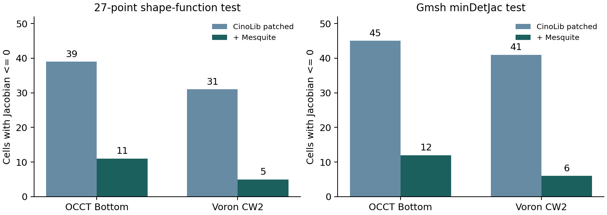

# 무료 Hex·혼합 메시 추가 조사와 직접 실행 - Round5

2026-11-04 · 메시어검토 · caelab-prep 개발 에이전트 인계용

## 1. 판정

**기존 조사에서 빠진 무료 후보가 더 있습니다. 누락됐다는 이유로 열등하다고 판단할 수 없습니다.** 기존50개 검토 항목을 보존하고18개 항목을 보완했습니다. 합계68은 독립 무료 생성기의 수가 아닙니다. 생성기·후처리·사용자 블록 도구·패키징·기존 backend의 미검토 경로를 구분했습니다. 전 세계의 모든 구현을 빠짐없이 확인했다는 주장은 하지 않습니다.

이번에는 문서 확인에서 멈추지 않고 FieldCraft, meshio++, CinoLib, HexGen, C4HexMeshing, Mesquite, SMESH Cartesian3D의7개 도구 계열을 실제 실행했습니다. **추가 시험에서 복잡 원본 CAD의 모든 품질·형상·피처 기준을 통과한 새 자동 범용 엔진은 확보하지 못했습니다.** 이는 이 입력·버전·설정에서의 결과이며, 미시험 도구 전체의 열등함이나 모든 설정에서의 불가능을 뜻하지 않습니다.

실제 개선 효과도 확인했습니다. Mesquite 후처리는 CinoLib 메시의27점 nonpositive 요소 수를 Bottom39→11, CW2 31→5로 줄였습니다. C4는 유료 최적화 프로그램 없이 빌드해 최소 매핑 입력에서64Hex 기본 유효성 검사를 통과했습니다. 이 두 사실을 복잡 CAD 전체 합격으로 확대하지 않습니다.

## 2. 추가 후보와 역할

| 후보 | 무료·공개 근거 | 역할과 이번 판단 |
|---|---|---|
| [FieldCraft](https://github.com/tangency-labs/fieldcraft) | MIT OR Apache-2.0 | 공식 Linux v0.7.0 실행. 관통공 판 23,772 Hex; 독립 검사 불합격. 원본 CAD3종은 확대 한도에서도 격자/깊이 제한. 새 자동 all-Hex 후보. 직접 STEP 입력 대신 태그 3MF/자체 CAD. 문서의 any part 표현을 보편 성공 보장으로 해석하지 않음. |
| [meshio++ octree_mesh](https://loumalouomega.github.io/meshioplusplus/octree_mesh.html) | Source MIT; base wheel MIT AND MPL-2.0; optional add-ons separately licensed | 공식18.1.0 wheel 실행. Bottom/CW2 Hex 출력 및 독립 감사. VTU writer 충돌은 native 배열의 표준 VTK 직렬화로 우회. 범용 IO만 제공하는 도구로 제외하면 누락. 새 all-Hex 경로 존재. 현재 시험의 뒤집힘/피처 실패는 불합격; 전체 라이브러리 열등 판정 아님. |
| [Medial-HexMeshing](https://github.com/Shane-Bambu/Medial-HexMeshing) | No root LICENSE at pinned commit; free reuse permission unconfirmed | 원 소스 확보. 루트 빌드 파일 없음; example.cpp는 GUI this를 쓰는 단편. native 실행 미완료. 2024 논문의 고품질/요소 절감 후보. 성능 주장은 저자 근거이며 동일 CAD 독립 성능이 아님. 무상 사용 권한을 확정하지 않음. |
| [Mesquite](https://www.sandia.gov/ccr/project/mesquite/) | LGPL-2.1-or-later (2.3.0 source headers and lgpl.txt) | 2.3.0 native 빌드 및 CinoLib2종 개선. 27점 nonpositive39→11,31→5. 여전히 종합 불합격. Hex/Pyramid/Wedge 후처리. 생성기와 분리. 경계 고정으로 경계 형상 문제를 해결하지 않음. |
| [IA-FEMesh](https://ctpr.github.io/IA-FEMesh/) | MIMX BSD-like source/binary redistribution terms; modified versions must be marked | 공식 기능/라이선스 검토. 이번 native 실행 없음. 해부학 분야의 multiblock Hex 도구. 사용자 블록 설계가 필요하며 오래된 ITK/VTK/KWWidgets 기반. |
| [LaGriT](https://lagrit.lanl.gov/) | LANL BSD-3-Clause variant | 공식 지원/라이선스 확인. 이번 native 실행 없음. 구조/비구조 quad/hex 지원. 공식 설명은 주요 알고리즘이 triangle/tet임을 명시; 임의 STEP 자동 Hex 성능 미확인. |
| [GRIDDER](https://meshing.lanl.gov/gridder/index.shtml) | BSD-3-Clause | 공식 기능/라이선스 확인. 이번 native 실행 없음. 직교 quad/hex와 단순 형상에 적합. LaGriT와 별도이지만 복잡 CAD 자동화 대체제로 제시하지 않음. |
| [Neper](https://neper.info/meshing.html) | GPL-3.0 | 공식 hex 옵션/분야/라이선스 검토. 이번 native 실행 없음. 다결정/미세구조용 raster hex. 특정 분야에 유용; 임의 산업 STEP 자동 all-Hex와 구분. |
| [TexGen](https://texgen.sourceforge.io/index.php/Main_Page) | GPL-2.0 (official repository) | 공식 기능/라이선스 검토. 이번 native 실행 없음. 직물/섬유 복합재의 voxel Hex 경로. 섬유 경계 해상도와 solver mesh 역할 별도 확인 필요. |
| [MyMesh](https://github.com/BU-SMBL/mymesh) | MIT | 원 소스 확보. VoxelMesh/Extrude/Revolve 등 실제 함수 확인; 이번 native 실행 없음. 2026 JOSS 도구. implicit/image/voxel 및 sweep 기능을 일반 STEP 자동Hex로 확대하지 않음. |
| [Dual Sheet Meshing](https://kenshi84.github.io/) | Survey reports BSD-3; current Bitbucket license bytes not independently retrieved | 저자 페이지→Bitbucket 코드 링크 및 원 논문 확인. native 실행 없음. 사용자가 dual sheet를 설계하는 독립 계열. 3D 자동 sheet 설계를 해결한 도구로 해석하면 안 됨. |
| [GIBBON](https://www.gibboncode.org/) | AGPL-3.0 (current root LICENSE); external tools have separate licenses | 공식 코드/혼합 demo 확인. 이번 MATLAB/Octave native 실행 없음. 현재 demo는 regularHex+TetGen과 quad2tri(b) 인터페이스, mergeVertices. 일반 표준 FE 정합 전이 보장 근거가 아님; 실행 환경 비용 별도. |
| [FEBio Studio](https://github.com/febiosoftware/FEBioStudio) | Source MIT; website binaries under custom free license | 공식 기능/소스 라이선스 확인. 이번 native 실행 없음. 일부 primitive/편집/Hex 자산 후보. 공식 매뉴얼도 강력한 범용 mesh generator를 목표로 하지 않음을 명시. |
| [classy_blocks](https://github.com/damogranlabs/classy_blocks) | MIT; OpenFOAM backend separately licensed | 공식 기능/라이선스 검토. 이번 native 실행 없음. blockMesh 사전 작성/블록 최적화 보조. 같은 backend를 새 독립 엔진으로 중복 계산하지 않음. |
| [gmsh_scripts](https://github.com/romanzes637/gmsh_scripts) | Root LICENSE.txt reproduces GPL-2.0-or-later with Gmsh exception; wrapper-specific attribution requires review | 공식 API/예제 검토. 이번 native 실행 없음. Gmsh 기반 구조/비구조·Hex/Tet multiblock 스크립트. 독립 커널 아님. |
| [Element-Saving Hexahedral 3-Refinement Templates](https://github.com/CMU-CBML/Element-Saving-Hexahedral-3-Refinement-Templates) | MIT | 공식 저장소/논문 연결 확인. 이번 native 실행 없음. 2026 적응 격자의 요소 수 절감 템플릿. CAD 분류·경계 피팅·완성 생성기는 별도. |
| [Hexi](https://sourceforge.net/projects/hexi/) | Multiple bundled OSS licenses; per-component review required | 2025 배포물/문서 확인. 이번 Windows/Linux binary 실행 없음. Feature-Preserving-Octree-Hex-Meshing을 주 코드로 패키징한 배포. 기존 C021과 알고리즘 중복, 설치/Windows 접근성 가치 별도. |
| [SMESH Body Fitting / Cartesian3D](https://docs.salome-platform.org/latest/gui/SMESH/cartesian_algo.html) | SMESH LGPL; dependency terms separately apply | 공식9.16 문서와 별도로 native9.9.0.0 경로를 실제3원본Brep에서 실행. Hex+Wedge+polyhedron 출력; 독립FE전체합격아님. 내부 Hex+경계 polyhedron/다른 요소. 기존 C003의 별도 경로; 표준 Hex/Pyr/Tet만 나오는 새 무료 엔진으로 계산하지 않음. |

기존 후보 CinoLib·C4·HexGen도 재실행 대상으로 끌어올렸습니다. 기존 Gmsh·SMESH·Magix3D·GMDS·HexBox·AlgoHex·MCHex·automesh 등의 상세 결과는 이전 통합본을 보존했습니다. 같은 알고리즘의 GUI·wrapper·배포판을 새 커널 수로 부풀리지 않습니다.

## 3. 직접 실행 환경과 비교 범위

Linux x86-64, cgroup 물리 메모리8GiB·CPU quota8, 새 작업 폴더에서만 설치·빌드·실행했습니다. 과거 실험의2GiB 주소공간 제한을 새 실행에는 적용하지 않았습니다. 병행 작업·도구별 스레드·입력 표현·요소 수가 달라 이번 벽시계 시간은 참고치이며 성능 순위가 아닙니다. 프로세스 메모리 샘플이0 또는 비현실적인 값인 기록은 측정 불충분으로 취급합니다.

원본 CAD는 이전 Round4의 OCCT Bottom(323면), Voron Dragon(544면), Voron CW2 Mainbody(458면)에서 만든 공통 OBJ/삼각면을 좌표·연결성 변경 없이 사용했습니다. 파일 SHA와 입력 provenance를 보관했습니다. Voron 두 입력의 기존 CAD 결함 정보도 유지합니다. DriveLink Housing은 공통 폐곡면 입력을 확보하지 못했으므로 이 삼각면 기반 시험에서 입력 차단이며 생성기 실패로 세지 않습니다.

FieldCraft는 STEP를 직접 읽지 않아 Gmsh face entity별 삼각형을 face-tagged3MF로 직렬화했습니다. 태그는 영속 원 CAD face ID 계약을 검증한 것이 아닙니다. 실제 CAD 곡면 query를 삼각면 입력이 대체하지 못합니다. 관통공 판은 별도의40×20×10mm, R4 원통공 기준 시험으로 복잡 원본 CAD 성공률에 합산하지 않습니다.

독립 검사는 이전의 동결된 Round4 audit4.3을 읽기 전용으로 재사용했습니다.27개 Hex shape-function Jacobian 표본과 Gmsh4.15.2 minDetJac/minSICN, 공유 face·경계 incidence, 원 CAD의 trimmed-face 거리·체적·명시 피처를 확인했습니다. min normalized J≥0.1, minSICN≥0.05, 체적오차≤1%, 표본 CAD 거리≤0.01mm는 이 프로젝트의 연구 기준입니다. Verdict SJ와 같은 수치로 혼용하지 않습니다. 표본 통과도 전 요소 내부 Jacobian/교차/솔버 정확도의 수학적 증명은 아닙니다.

## 4. 동일 원본 CAD의 독립 수치

표의 nonpositive는 영 또는 음의 Jacobian을 갖는 요소 수입니다.27점 표본과 Gmsh의 검사 지점·최솟값 추정이 달라 값이 다를 수 있습니다. native exit0 또는 native 자체 통계만으로 합격시키지 않았습니다.

| 도구·형상 | Hex 수 | nonpositive27 / Gmsh | minSICN | CAD 체적오차 | 최대 표본 경계거리(mm) | 종합 |
|---|---:|---:|---:|---:|---:|---|
| CinoLib 수정 / occt_bottom | 41,070 | 39 / 45 | 0.0002 | 1.770% | 1.8004 | 불합격 |
| CinoLib 수정 / voron_dragon | 132,058 | 63 / 77 | 0.0006 | 3.498% | 0.7273 | 불합격 |
| CinoLib 수정 / voron_cw2_mainbody | 81,705 | 31 / 41 | 0.0005 | 1.093% | 0.6917 | 불합격 |
| CinoLib+Mesquite / occt_bottom | 41,070 | 11 / 12 | 0.0019 | 1.770% | 1.8004 | 불합격 |
| CinoLib+Mesquite / voron_cw2_mainbody | 81,705 | 5 / 6 | 0.0015 | 1.093% | 0.6917 | 불합격 |
| meshio++ / occt_bottom | 136,664 | 1,213 / 1,259 | -0.6444 | 0.152% | 0.5034 | 불합격 |
| meshio++ / voron_cw2_mainbody | 109,132 | 2,880 / 2,931 | -0.8378 | 0.301% | 0.2128 | 불합격 |

CinoLib 원본 projector는 smoothing accumulator의 `vec3d p`를 초기화하지 않았고, 기본 생성자도 초기화하지 않습니다. native projector를 그대로 호출한3종 결과는 각각1547/5065/2650개 비유한 정점을 가졌습니다. 새 clone에0 초기화 한 줄을 적용하고 upstream의 `SERIALIZE_PARALLEL_FOR`를 사용해 in-place 병렬 갱신의 비결정성을 피했습니다. 수정 후 정점은 유한해졌지만 위 독립 검사에서 역전·피처·형상 문제가 남았습니다. raw voxel 결과와 수정 전후 결과를 모두 보존했습니다. 이것은 CinoLib의 모든 다른 알고리즘 경로에 대한 판정이 아닙니다.

Mesquite2.3.0은 CMake의 오래된 Tribits 의존 문제를 피하고 배포본의 configure/make 경로로 빌드했습니다. 입력을 호환되는 VTK4.2로 직렬화한 후 경계 절점을 고정하고 UntangleWrapper·ShapeImprover를 호출했습니다. 연결성은 같고, native 파일의 소수 출력으로 생긴 경계 좌표 변화는 최대5e-8mm입니다. native free-element 평가가 no inverted라고 해도 전체 요소 독립 검사에는 위 역전이 남습니다. 경계 고정 후처리로 CAD 경계 오차를 없앴다고 주장하지 않습니다.

meshio++18.1.0의 native VTU writer는 정상적으로 읽은 HexGen mesh에서도 충돌했습니다. 같은 native 메시의 좌표·연결성을 NPZ와 표준 ASCII VTK로 내보내어 메시 생성과 저장 실패를 분리했습니다. Bottom/CW2는 원 코드의 실제 Hex 출력이며 메싱 알고리즘은 바꾸지 않았습니다. Dragon 첫 출력은 writer 충돌로 독립 감사가 완료되지 않았으므로 통과·실패 성능 수치를 만들지 않았습니다. native가 경고한 feature chain 누락과 역전도 로그에 남아 있습니다.

## 5. FieldCraft의 실제 한도와 별도 기준판

공식 Linux v0.7.0 release를 실행했습니다. 배포 tar SHA256은 공식 SHA256SUMS와 일치합니다. 소스 default branch와 같은 version 문자열이라도 파일 형식은 달랐으므로, 실제 binary의 tag v0.7.0 commit `e9ccf10692a08ea4c6037442c6213e1f68d344b8`를 별도 고정했습니다. 배포본은 MCMESH01/fieldcraft1이고 이후 HEAD는 MCMESH02를 쓰므로 혼용하지 않습니다. 서명까지 검증했다고 주장하지 않습니다.

| 원본 CAD | 확대 재시험 설정 | native 결과 |
|---|---|---|
| Bottom | size4mm, depth5, max2,000,000, attempts2, sweeps60 | native 추정 벽0.6199mm.3층 기준0.2066mm 필요. 균형·정합 closure 후2M 한도 초과 |
| Dragon | size2mm, depth5, max2,000,000 | native 추정 면폭0.0002mm.8~9 refinement levels 필요로 depth5에서 차단 |
| CW2 | size2.5mm, depth5, max2,000,000 | native 추정 면폭0.0431mm. refinement 후658,717 또는693,122 grid cells였으나 closure 후2M 한도 초과 |

위 wall/patch 폭은 FieldCraft의 삼각면 추정치이며 공인 CAD 최소 두께가 아닙니다. 초기에 사용한 depth2·600k 제한만으로 결론내지 않고 depth5·2M으로 재시험했습니다. 이 한도 초과는 더 큰 장비/다른 크기/블록 분할에서의 불가능 판정이 아닙니다. 다만 현재 동일 원형상 기준에서 바로 붙여 쓸 범용 성공은 없었습니다.

별도 관통공 판의 octree 출력은 23,772Hex/26,508절점입니다.27점/Gmsh nonpositive는 모두0이지만 min normalized J=0.006486, minSICN=0.004156, 체적오차=3.544%, 최대 표본 경계거리=1.4038mm여서 기준 불합격입니다. 구조 auto는 태그 삼각면에서 free-form 면/holed linking face를 지원하지 못해 거부했습니다. 저자 corpus의 더 좋은 수치를 이번 독립 결과로 대체하지 않았습니다.

## 6. HexGen·C4: 준비된 매핑과 원 CAD 자동화를 분리

HexGen의4 native 실행 파일을 모두 빌드했습니다. 패치는 include 대소문자, 잘못된 MSVC/Boost flag, Windows 문자열 함수·경로 함수, std filesystem, 별도 cpp에 둔 inline 정의의 링크 문제를 다룹니다. 소스 변경 diff와 실패 로그를 보존했습니다. 새 자동 segmentation은 upstream rockerarm과 공통 Bottom에서 SIGSEGV, polycube는 upstream에서 bad_cast로 종료했습니다. 이것만으로 모든 플랫폼과 원 알고리즘을 열등 판정하지 않습니다.

저자가 제공한 수동 분할과 이미 작성된 hex block 구조를 ParametricMapping에 넣으면3456Hex를1.4초에 생성했습니다. 이어 저자 예제의 lap10→pillow1→smooth200(0.1)→opt50(0.01)를 실행해5696Hex를 얻었습니다.27점 역전은77/3456에서14/5696, Gmsh nonpositive는17개로 남았습니다. 원 CAD 거리·단위·수동 작업 시간을 검증하지 않았으며 full automatic 복잡 CAD 성공으로 세지 않습니다. sharp feature OFF인 해당 recipe의 결과이며 전 설정 최적값을 구한 것이 아닙니다.

C4HexMeshing은 Eigen·GMP·Clp로 빌드했습니다. Gurobi·Bonmin 없이 heuristic quantizer를 사용했습니다. `.hexex`에 Tet와 seamless map이 이미 있어야 하므로 일반 STEP 입력이 아닙니다. 현재 CLI는 추출 뒤 실제 Hex smoothing을 호출하며 README의 제한 설명만으로 후처리 존재를 단정하지 않았습니다. 준비 매핑3종은 default variant0(Flexible Singularities),target10,000Hex,collapse=true,untangling100,600초 한도로 실행했습니다. variant1(고정 singularity)과 모든 최적 설정을 탐색한 비교는 아닙니다. 최소 매핑 입력에서는64Hex,27점 normalized J=1, 기본 topology/quality 통과를 확인했습니다. 이것은64개짜리 canary일 뿐입니다.

| C4 준비 매핑 입력 | 실행 시간/종료 | 출력·독립 검사 상태 |
|---|---|---|
| minimal | 0.13s / returncode0 | 64Hex; basic=pass |
| fancy_ring | 600.06s / 시간 한도 도달 | 독립 감사 없음 |
| fandisk_algohex | 600.06s / 시간 한도 도달 | 독립 감사 없음 |
| rockerarm | 606.68s / 시간 한도 도달 | 독립 감사 없음 |

시간 초과/후보 실패는 해당 옵션과 한도에서의 상태입니다. native 전처리나 mapping이 진행됐다는 이유로 최종 Hex 출력을 만들어낸 것으로 기록하지 않았습니다.

## 7. 혼합 메시의 빠진 경로와 제품 연결 판단

SMESH Body Fitting/Cartesian3D는 내부 Hex와 경계 polyhedron/다른 요소를 만드는 무료 경로입니다. Viscous Layers도 지원하지만 shared/internal face 제약이 있습니다. Hex 우세일 수 있다는 사실과 OpenRadioss가 받을 표준 Hex/Pyr/Wedge/Tet만으로 정합 전환됐다는 사실은 다릅니다. 기존 SMESH 후보의 별도 경로로 남기고 native 표준요소화·잔여체적·슬리버·피처 보존을 검증해야 합니다.

추가 native 실행에서는 기존에 고정한 standalone SMESH9.9.0.0/OCCT8의 Cartesian3D를 원본Brep에 직접 적용했습니다. 치유나defeature 없이 spacing4/2/2.5mm, sizeThreshold4, implementEdges/createFaces=true, 경계층 없이 실행했습니다. nativecomputed=true였지만 Voron2종의 기존 CAD 유효성 결함은 그대로false입니다.

| 원본 CAD | 벽시계 참고 | Hex / Wedge / Polyhedron | 총 volume 셀 | 판정 |
|---|---:|---:|---:|---|
| Bottom |2.24s|3702 /28 /2234|5964|빠른 혼합 출력, 표준 FE 전체 검증 전|
| Dragon |8.66s|3270 /31 /3410|6711|CAD invalid, poly 경계 포함|
| CW2 |3.64s|773 /19 /1128|1920|CAD invalid, poly 경계 포함|

native.raw에 polygon을 포함한 모든 volume face 연결성을 보존했습니다. 표준Hex/Pyr/Wedge/Tet만을 요구하는 경로에서는 Polyhedron2234/3410/1128개를 누락시키거나 임의BRICK으로 내보낼 수 없습니다. 이 추가 실행은 앞의 삼각면 기반 자동Hex들과 입력/셀 형식이 달라 시간 우위로 순위를 매기지 않습니다. poly_geometry_audit는 별도 유한 CAD 거리·face incidence 진단이며 표준FE Jacobian/체적/겹침/전이 정합 전체감사의 통과 판정은 아닙니다. 원 native face 연결성을 그대로 쓴 최대 표본 경계거리/경계 edge-incidence≠2는 Bottom3.5807mm/56, Dragon1.7794mm/110, CW22.1789mm/38입니다. coplanar polygon의 collinear 분할을 정규화한 검사는 아니므로 이 숫자만으로 모든 CFD poly 사용을 무효 판정하지 않습니다. 표준FE 정합 출력은 확보되지 않았습니다.

GIBBON 혼합 demo는 Hex core의 quad를 삼각화한 뒤 TetGen core와 절점을 병합합니다. 단순 절점 병합만으로 quad-두-triangle 연결을 표준 체적요소 정합으로 인정하면 안 됩니다. Pyr 전이·정합 interface 또는 명시적인 solver 제약이 실제로 있는지 확인해야 합니다. MATLAB/외부 TetGen 비용과 라이선스도 toolbox 자체의 무료성과 구분합니다.

우선 개발 순서는 기존 실증된 Gmsh·SMESH·분할/sweep 경로의 CAD 연계 및 품질 gates 유지, Mesquite/HexOpt 같은 후처리의 제한된 adapter 평가, FieldCraft·meshio++·C4 등의 연구 worker 분리입니다. IA-FEMesh·FEBio Studio·classy_blocks는 사용자 블록/편집 흐름의 구현 자산 후보로 검토할 가치가 있습니다. 자동 커널 전체를 대체할 후보라는 뜻은 아닙니다.

새 native 출력은 어느 것도 기본 solver export의 확대 승인 근거로 쓰지 않습니다. 이전에 확인한 반복 절점 BRICK/Pyramid의 질량·관성·시간 간격 문제는 이번에 해결하지 않았습니다. native exit0와 solver exit0를 형상·수치 정확도의 증명으로 취급하지 않습니다.

## 8. 재현·인계 자료

`CANDIDATE_CATALOG.csv/json`에 기존50+추가18 항목과 역할/라이선스/실행 단계를 기록했습니다. `EVIDENCE_SUMMARY.json`은 raw 로그·감사 파일의 위치와 SHA를 제공합니다. `INDEPENDENT_RESULT_TABLE.json`은 원 CAD 정책 검사8행(실부품7행+별도기준판1행)이며, 준비 입력의 HexGen/C4 품질은 `PREPARED_INPUT_QUALITY_TABLE.json`으로 분리했습니다. `RESULT_TABLE_SCOPES.json`에 각 표의 분모와 한계를 명시했습니다. evidence_round5의 source inventory, 빌드 명령, 이식 diff, 실행 설정, native 출력과 실패 로그를 함께 전달합니다. 3개 복잡 형상의 공통 OBJ·authoritative original.brep·metadata는 common_inputs에 보존했습니다. 원배포 STEP 전체/전체 소스 git clone/설치 wheel은 중복 배포하지 않고 원 실험 위치·해시·공식 저장소 pin을 보관합니다.

이번 추가 실행은 Linux입니다. 기존 초기 Windows 보고서의 기록은 그대로 보존하며 이 새 실행을 Windows 실증으로 승격하지 않습니다. 개발 에이전트는 이 문서와 이전 통합본을 함께 읽고, 구현 완료/문서상 가능/입력 차단/자원 한도/실행 실패/독립 감사 불합격을 구분해야 합니다.

## 9. 주요 1차 출처

- [FieldCraft](https://github.com/tangency-labs/fieldcraft)
- [meshio++ octree_mesh](https://loumalouomega.github.io/meshioplusplus/octree_mesh.html)
- [Medial-HexMeshing](https://github.com/Shane-Bambu/Medial-HexMeshing)
- [Mesquite](https://www.sandia.gov/ccr/project/mesquite/)
- [IA-FEMesh](https://ctpr.github.io/IA-FEMesh/)
- [LaGriT](https://lagrit.lanl.gov/)
- [GRIDDER](https://meshing.lanl.gov/gridder/index.shtml)
- [Neper](https://neper.info/meshing.html)
- [TexGen](https://texgen.sourceforge.io/index.php/Main_Page)
- [MyMesh](https://github.com/BU-SMBL/mymesh)
- [Dual Sheet Meshing](https://kenshi84.github.io/)
- [GIBBON](https://www.gibboncode.org/)
- [FEBio Studio](https://github.com/febiosoftware/FEBioStudio)
- [classy_blocks](https://github.com/damogranlabs/classy_blocks)
- [gmsh_scripts](https://github.com/romanzes637/gmsh_scripts)
- [Element-Saving Hexahedral 3-Refinement Templates](https://github.com/CMU-CBML/Element-Saving-Hexahedral-3-Refinement-Templates)
- [Hexi](https://sourceforge.net/projects/hexi/)
- [SMESH Body Fitting / Cartesian3D](https://docs.salome-platform.org/latest/gui/SMESH/cartesian_algo.html)
- [CinoLib](https://github.com/mlivesu/cinolib)
- [HexGen / Hex2Spline](https://github.com/CMU-CBML/HexGen_Hex2Spline)
- [C4HexMeshing](https://github.com/HendrikBrueckler/C4HexMeshing)
- [FieldCraft 실제 실행 tag](https://github.com/tangency-labs/fieldcraft/tree/v0.7.0)
- [FieldCraft 저자 corpus](https://github.com/tangency-labs/fieldcraft/blob/main/docs/meshing/corpus.md) - 저자 자료, 이번 독립 시험과 별도
- [LaGriT 공식 라이선스](https://lagrit.lanl.gov/licensing.shtml)
- [Hex-Mesh Generation and Processing survey](https://doi.org/10.1145/3554920) - 계열·공개 구현 누락 점검용
