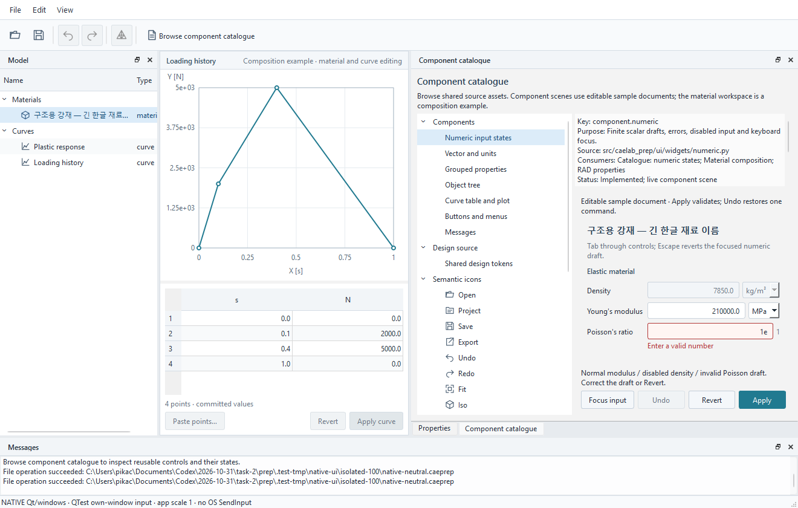
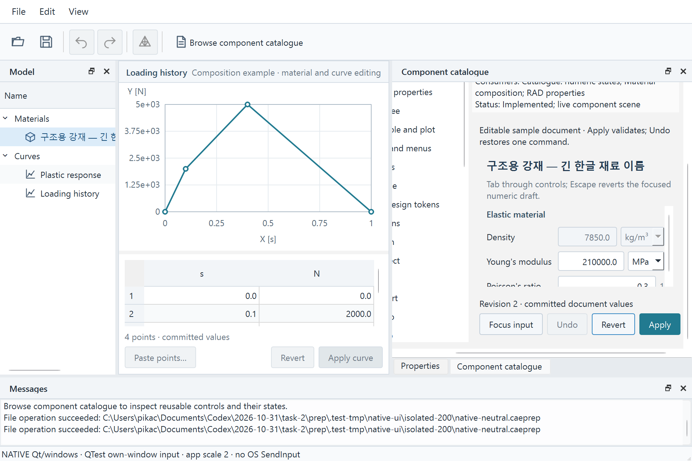
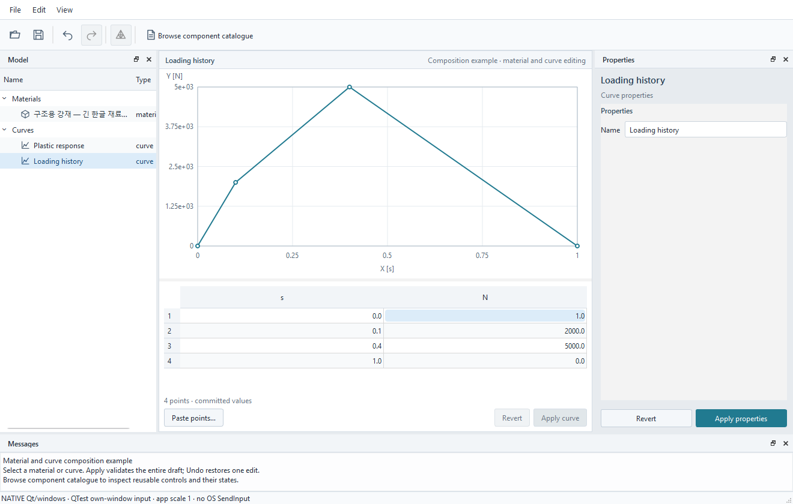
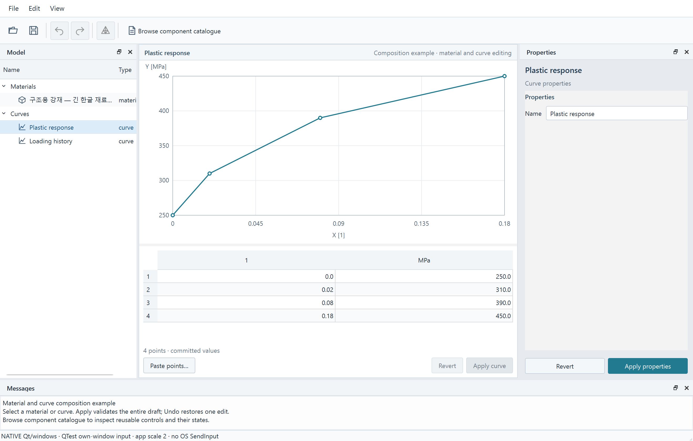
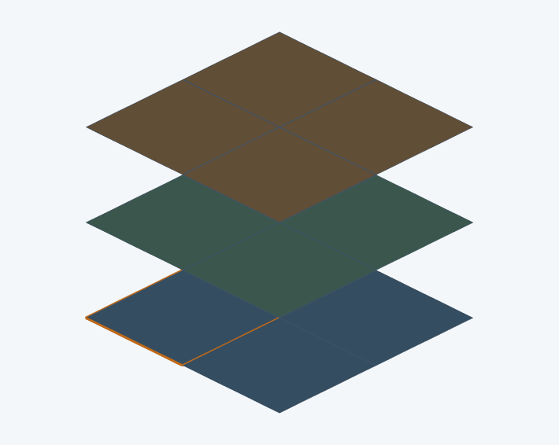
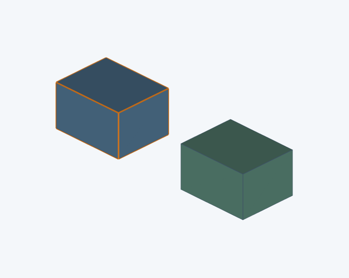

# Windows 실행 검증 — 2026-10-31

P1–P3/A의 공용 부품과 실제 Prep 편집 흐름을 검증했다. 구현팀과 별도인 검증 담당, 하나의 리뷰팀 안의 요구사항 비판·구현 옹호·코드/회귀 검토자가 소스·원요구·실제 실행 화면을 대조했다. 각 [리뷰 근거](reviews/20261031-requirements-critic.md)에 판정과 반론을 남긴다. 최종 커밋의 CI 통과는 별도 병합 조건이다.

## 환경과 방법

- Windows 11 build 26200, Python 3.13.5, PySide6/Qt 6.9.1, VTK 9.4.2. Windows QPA(`platformName=windows`), 노출된 HWND와 활성 창, 실제 Segoe UI/Malgun Gothic 글꼴을 확인했다.
- 입력 desktop은 읽기 전용으로 확인한 `Default`였다. 승인된 평가 프로세스가 만든 창만 앞으로 가져오고 QTest 마우스·키 이벤트를 보냈다. 입력마다 창 활성·노출·화면 안의 frame과 입력 대상의 실제 표시 영역을 검사했다. 잠금 화면/다른 앱을 조작하지 않았다. OS SendInput이나 사람의 수동 입력을 수행했다는 뜻은 아니다.
- `QT_SCALE_FACTOR=1/1.5/2`로 실제 애플리케이션 DPR 1/1.5/2를 확인했다. OS 모니터 DPI 설정이나 다른 모니터로의 이동 시험은 수행하지 않았다. 관측한 모니터는 2560×1440, 100% 때 사용 가능 영역 2560×1392였다.
- 이미지는 자체 `QWidget.grab()` 캡처다. 전체 데스크톱 캡처가 아니다. 네이티브 GPU 자식 창은 위젯 캡처에 검게 나올 수 있어 실제 `vtkWin32OpenGLRenderWindow`의 framebuffer를 따로 저장했다. 이들을 합성하지 않았다.
- 각 최종 실행은 명시적 INI 파일과 fallback 비활성 설정을 사용했다. 각 실행 전후 실제 NativeFormat 설정을 읽어 비교해 **변경 없음**을 확인했다. 종료 때 활성 worker는 0이었다.

## 확인한 사용자 동작

| 범위 | 실제 실행 결과 |
|---|---|
| RAD 편집과 선택 | 다중 파트 셸에서 트리→PART 속성·강조, 재료 E 키보드 변경→Undo/Redo→저장, 실제 VTK 셀 클릭→정본 ID·개정 검증·강조. 별도 솔리드 입력에서도 같은 열기 경로→PART 선택→속성·2개 hex 표시 확인 |
| 중립 문서 | 표시명/typed 참조 콤보 선택→Apply→저장·재열기. 기존 곡선 셀을 클릭/F2로 편집→Apply curve→실제 표/plot 값 변경→툴바 Undo로 복원 |
| 카탈로그 | 툴바로 열기, 의미·출처·소스·소비 장면 설명과 실제 부품 상태 확인. 960×640의 좁은 통합 dock에서 스크롤로 입력·Revert·Apply·Undo의 전체 영역을 드러낸 뒤 실제 입력·클릭·복원 |
| 닫기 | 실제 Save/Discard/Cancel 모달 버튼. invalid 초안 Cancel/Save는 창·초안·문서 개정 보존, valid Save는 비동기 저장 후 닫고 재열어 E=198000 확인, invalid Discard는 검증 없이 닫음. 저장 실패 주입 회귀는 자동 검사에서 확인 |
| 도킹과 복원 | 실제 titlebar double click으로 float, bottom에 되돌려 놓은 뒤 실제 drag로 bottom(8)→left(1), 최종 이동 결과의 API 대체 없음. 별도 Python 프로세스에서 저장된 dock 상태·창 크기·문서 경로 복원. 중간 double click redock 시도는 실패했으며, 뒤의 실제 drag 경로는 도킹 영역 변경/이동 증거다. floating→docked 입력 성공을 주장하지 않음 |
| 파일 보존 | Windows 파일 API 경로로 `.caeprep` 저장·재열기·RAD 출력. 네이티브 파일 대화상자 타이핑 검증을 주장하지 않음. 원문·INCLUDE·지원 필드·CLI·실패 원자성은 관련 자동 회귀와 함께 확인 |

100/150/200%에서 셸·중립 참조·숫자 상태·카탈로그·닫기·VTK·도킹을 확인했고 각 배율의 저장 배치는 새 프로세스에서 복원했다. 솔리드와 곡선 셀 편집은 100%에서 한 번 확인했으며 모든 장면×상태×배율 조합을 실행했다고 주장하지 않는다.

200%에서 1320×840 큰 창은 현재 물리 화면에 들어가지 않는다. 실제 입력은 화면에 들어가는 960×640 창에서 수행했다. 큰 RAD 위젯 캡처는 정확한 크기이며 화면 밖 부분까지 포함한다. 첫 큰 Gallery 카탈로그 캡처는 Windows가 **1282×711**로 제한했으므로 정확한 1320×840 결과로 세지 않는다. 이후 원래 재료/곡선 조합 화면만 별도 native 프로세스에서 크기를 고정해 **1320×840 / 2640×1680 pixels, DPR2**로 캡처하고 독립 검토자가 표/plot/입력 배치를 확인했다. 이것은 화면보다 큰 실제 위젯 배치 렌더이며 전체가 화면 안에 들어오거나 입력 가능했다는 주장이 아니다. 두 결과를 manifest의 실제 크기로 구분한다.

## 발견한 문제와 수정

리뷰팀은 초기 native 960×640 화면에서 카탈로그 오른쪽 입력/버튼이 창 밖으로 잘리는 결함을 찾아냈다. 공용 `CatalogueWidget`을 QScrollArea로 감싸 실제 스크롤로 접근하도록 고쳤다. 최종 실행은 단순 `isVisible()` 대신 모든 상위 viewport 안에 입력 전체가 들어오는지 확인한 후 조작했다. 긴 텍스트는 스크롤/말줄임으로 접근하며 좁은 창에 모든 항목을 동시에 펼쳐 표시하지 않는다.

초기 검증 도구는 `setDefaultFormat(IniFormat)`이 `QSettings(org, app)`에도 적용된다고 잘못 가정했다. 이 생성자는 NativeFormat을 사용해 초기 실행들이 실제 앱의 네 가지 **창 크기/도킹 설정**을 읽고 썼을 수 있다. 이전 값의 백업이 없어 알 수 없는 값으로 복원하거나 지우지 않았다. 작업 문서/모델 내용에는 해당 설정을 쓰지 않는다. 이후 pytest와 평가 도구 모두 명시적 임시 INI 생성자로 수정했으며 전후 실제 설정 값이 같음을 확인했다. 초기 100/150 실행의 ‘격리’ 주장은 최종 실행으로 대체한다.

초기 통합 100% 실행은 9개 중 8개가 통과했고 곡선 셀의 `mouseDClick` 단독 입력에서 delegate를 찾지 못했다. 실제 선택 클릭+F2로 여는 표준 입력으로 평가 도구를 고친 뒤 **곡선 단계만** 다시 실행해 Apply/plot/Undo를 확인했다. 초기 실패 manifest를 통과로 바꿔 쓰지 않았다.

Qt 자동 검사 종료의 SIGSEGV 때문에 테스트 창을 명시 정리한 `c23149e`의 push/PR CI는 Qt41 정상 통과·exit0이었다. 이후 `0952d66`은 push 네 job이 통과했지만 [PR Qt job](https://github.com/pikachu444/caelab-prep/actions/runs/41174601977/job/124459446444)이 새 좁은 카탈로그 검사 정리 중 DeferredDelete에서 exit139로 실패했다. 단순 재실행으로 통과 처리하지 않았다. 해당 장면의 정리 전 객체 그래프는 Python 소유·부모 없는 Gallery 1개와 그 자식인 Qt 소유 메뉴 6개/내부 combo popup 6개였다. 이전 fixture는 13개를 각각 닫고 삭제 예약했다. 이제 Python 소유 root만 정리하고 자식은 [Qt의 객체 소유권](https://doc.qt.io/qt-6/objecttrees.html)에 맡긴다. **원래 13개 모두 삭제됐는지 검사는 유지**한다. 일반 QObject 부모/자식이 항상 이중 삭제된다는 주장은 아니다. 영향받은 Qt42는 로컬 9.77s/exit0, 남은 widget/worker0, 실제 설정 전후 동일이다. Linux 실패 해소는 수정 뒤 정확한 새 SHA의 push/PR CI로 별도 확인해야 한다. 제품 소스/네이티브 입력 경로는 이 정리 수정에서 바꾸지 않았다.

## 재현과 증거

평가 도구는 제품 실행 의존성이 아니다. GUI 의존성이 설치된 허용된 Windows 데스크톱에서만 실행한다. 새 배율/검증마다 새 OUT 경로를 사용하고, restore만 해당 OUT을 다시 쓴다.

```powershell
python scripts/evaluation/verify_native_windows.py --scale 1 --phase exercise --output OUT100
python scripts/evaluation/verify_native_windows.py --scale 1 --phase curve --output OUTCURVE100
python scripts/evaluation/verify_native_windows.py --scale 1 --phase restore --output OUT100
# scale 1.5와 2도 exercise → 별도 프로세스 restore
python scripts/evaluation/verify_native_windows.py --scale 2 --phase layout --output OUTLAYOUT200
```

| 실행 기록 | 판정 |
|---|---|
| [100% 초기 통합](native-windows/100-initial.json) + [곡선 보완](native-windows/100-curve.json) | 8개 통과 + 초기 곡선 도구 실패를 별도 실제 입력 통과로 해소 |
| [100% 새 프로세스 복원](native-windows/100-restore.json) | 통과 |
| [150%](native-windows/150-exercise.json) / [복원](native-windows/150-restore.json) | 각각 7개 / 1개 통과 |
| [200%](native-windows/200-exercise.json) / [복원](native-windows/200-restore.json) | 각각 7개 / 1개 통과; 큰 Gallery 크기 제한은 위 설명 참고 |
| [200% 정확한 조합 화면 크기 보완](native-windows/200-exact-layout.json) | 1320×840 native 위젯 배치 캡처 통과, 실제 입력 시험과 분리 |

최종 로컬 8개 관련 suite는 **100 passed, 1 skipped / 12.38s**, process exit0, 남은 top-level widget/worker 모두0, 실제 NativeFormat 설정 전후 동일이다. skip은 Windows의 대소문자 충돌 파일명 검사다. CI는 Linux/Windows core59, Qt42와 기존 CAD job을 포함한다. 설치형 배포·B/C·Workbench 연동·새 solver 카드/Engine·모든 기능/환경 조합은 이번 완료 범위에 포함하지 않는다.












