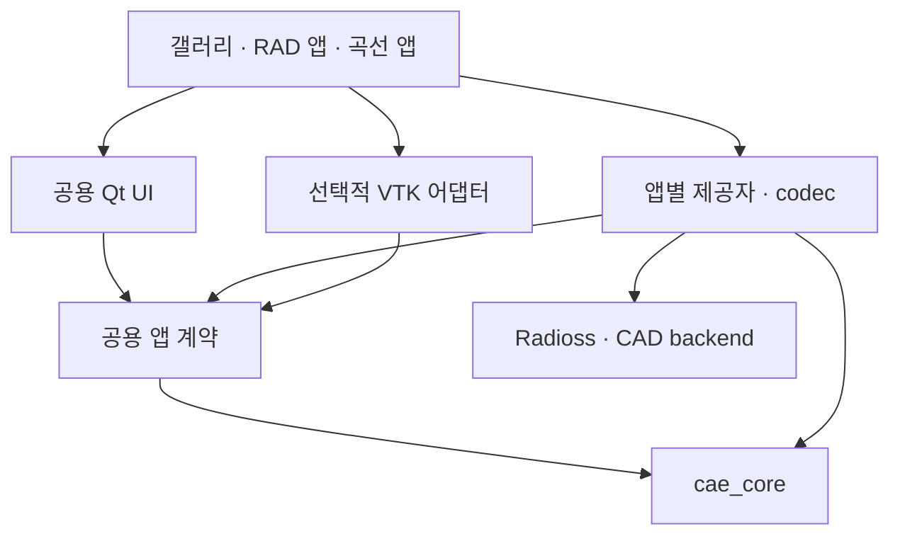

# 공용 CAE 자산·기반 실행 계획

계획 기준일: 2026-10-29. 상태: **설계·작업 계획**. 이 문서의 목표 경로·계약·갤러리는 구현 완료 목록이 아니다. 현재 실행 코드와 파일 계약은 [ARCHITECTURE](../ARCHITECTURE.md), 실행 방법과 지원 범위는 [README](../README.md)를 따른다.

이 문서는 공용 자산의 설계와 기존 P0–P9/A/B 범위를 유지한다. 구현자가 바로 시작하고 종료할 작업 순서는 [단계별 작업서](execution-stages.md), Workbench 소비자와 두 저장소의 변경 책임은 [재사용 계획](workbench-reuse-plan.md)을 따른다. 첫 CAD 흐름 C는 P6a/P7a로 분리해 앞당긴다.

## 1. 목적과 이번 계획의 범위

CAELab Prep에 여러 공학 프로그램이 사용하는 공용 GUI 자산과 CAE 개발 기반을 축적한다. OpenRadioss/OpenCourant는 첫 적용 대상이고 현재 RAD 편집기는 첫 소비자다. 실행형 갤러리도 같은 공용 코드를 사용하는 정식 산출물이다.

이번 작업은 계획을 구체화하는 문서 작업이다. GUI 변경, 갤러리 구현, 의존성 설치·교체, 솔버 지원 확대는 수행하지 않는다. 후속 구현은 아래 작업 단위로 나누어 진행한다.

목표는 다음 세 가지를 함께 확보하는 것이다.

1. **외관 자산:** 정보 밀도, 글자·아이콘·간격·상태 표현을 제어할 공통 규칙과 리소스.
2. **실행 가능한 공학용 부품:** 트리·속성·단위·벡터·표·곡선·선택·뷰포트·도킹을 실제 값과 연결하는 컴포넌트.
3. **공용 앱 기반:** 문서·명령·선택·저장·작업·자동화의 작은 계약과 구현. 솔버·CAD 규칙은 적용 모듈에 유지한다.

Abaqus와 COMSOL은 외관·정보 밀도·화면 구성·상호작용의 참조다. 해당 제품의 모든 물리 모델·솔버·CAD 기능을 복제하는 과제로 확대하지 않는다. 공용 자산 구축은 두 번째 앱을 기다리지 않고 시작하며, 실제 다른 사용처의 연결은 재사용 품질을 확인하는 후속 작업으로 둔다.

## 2. 확인한 출발점

| 확인 대상 | 확인한 사실 | 계획에 반영할 점 |
|---|---|---|
| README의 `native-editor.png` | 현재 자체 Qt/VTK RAD 편집기. 두 셸과 소수 속성을 표시하는 초기 실행 화면 | 구현 기록으로 유지한다. 목표 외관이나 갤러리의 대표 장면으로 고정하지 않는다 |
| BeidPrep 1.0.1 | Windows에서 열기·3D·저장·재열기 수행. GUI 재료 수정은 미완료, 저장 조건 변화 발견 | 외관 참고와 모델 보존 검증을 구분한다. 상세는 [시험 기록](beidprep-evaluation.md) |
| BeidPrep 2.0 / Naksha | 이 계획에서 실제 실행 검증한 제품이 아님. Naksha의 과거 확인은 공개 화면·영상 조사 | 공개 자료의 외관 참고와 성능·기능 실측을 혼동하지 않는다 |
| `ui/theme.py` | 자체 SVG 경로와 단일 스타일 문자열. 트리 최소 높이 26px, 입력 상하 padding 등 | 기존 크기를 공용 표준으로 복제하지 않고 참조 화면과 비교해 토큰을 정한다 |
| `ui/main_window.py` | Action·도킹·트리·폼·입력 초안·파일 작업·종료 확인을 함께 소유 | 화면 부품과 문서 수명 주기를 나누되 기존 편집 보존 장치를 함께 옮긴다 |
| `cae_core/document.py` | Qt·솔버를 모르는 문서·자원·명령·선택·저장 기준점. 현재 명령은 한 자원 상태의 Undo/Redo | 기존 코어를 확장 출발점으로 사용한다. 모든 CAE 의미나 다중 자원 트랜잭션이 이미 있는 것으로 보지 않는다 |
| `application/session.py` | RAD 카드·INCLUDE·메시 투영·`.caeprep` 저장을 다루는 현재 PrepSession | 공용 세션의 작은 계약과 RAD 구현을 분리한다. 일반적인 클래스 이름만으로 공용화됐다고 판단하지 않는다 |
| `ui/viewport.py` | VTK 메시 표시·카메라·원본 ID 역매핑·단일 절점/요소 선택 | 렌더러와 공용 뷰포트 프레임을 구분하고 선택·원 ID 보존을 유지한다 |

현재 구조의 문제는 여백만이 아니다. RAD 카드 분류와 공용 트리, 필드 파싱과 속성 위젯, 파일 형식과 문서 수명 주기가 결합돼 있다. 화면 밀도를 바꾸는 작업과 이 책임을 나누는 작업을 함께 계획한다.

## 3. 참조 화면과 디자인 결정

참조 제품은 Abaqus·COMSOL에 한정하지 않는다. **HyperMesh·midas NFX·MIDAS MeshFree·Naksha·BeidPrep**를 함께 비교하고 관찰한 패턴을 공용 부품·데이터 계약으로 연결한다. 제품별 근거·확인 수준·채택할 설계 문제는 [참조 제품 비교](gui-reference-matrix.md)에 둔다. 단순히 제품 이름을 추가하거나 제품마다 GUI 구현을 복제하지 않는다.

### 두 가지 화면 프로필

| 프로필 | 참조하는 구성 | 공용 부품으로 구현할 부분 |
|---|---|---|
| Abaqus 계열 | 메뉴·다중 툴바, 모듈/대상 문맥 표시줄, 모델 트리, 세로 도구 그룹, 뷰포트, 작업 지시·메시지 | 같은 Action·도구 그룹·트리·속성·선택·도킹·뷰포트 프레임을 압축형 배치로 조합 |
| COMSOL 계열 | 문맥별 명령 탭/그룹, Model Builder, 선택 노드의 Settings, Graphics 로컬 도구, Messages/Progress/Log | 같은 부품과 편집 세션을 트리–설정–그래픽 배치로 조합. 명령 탭/그룹은 Action 정의를 재사용 |

두 프로필은 별도의 GUI 구현 두 벌이 아니다. 명칭은 첫 기계 전처리 배치와 설정 중심 배치의 가칭이며, 위 여러 제품에서 영역별 패턴을 비교한다. P0에서 목표 화면과 채택/보류 이유를 고정한 뒤 첫 조합을 완성하고 두 번째 조합으로 재사용을 확인한다. 레이아웃·명령 그룹·표현 설정은 바꾸되 편집기·문서·명령은 공유한다. 정교한 리본 동작은 Qt 위젯 조합과 외부 부품의 비용을 비교한 뒤 범위를 정하며, 이를 이유로 속성·트리·앱 기반 개발 전체를 막지 않는다.

### 외관 규칙의 구체화

| 자산 | 첫 구현에서 정의할 내용 | 확인할 장면 |
|---|---|---|
| 밀도·글꼴 | 본문/제목/표 숫자 글꼴, 행·입력·툴바 높이, 들여쓰기, 패딩, 그룹 간격 | 같은 화면 크기에서 긴 트리·여러 속성·표가 함께 있는 장면 |
| 상태·색 | 기본·hover·선택·포커스·비활성·입력 오류·경고, 선택/미선택 형상의 대비 | 키보드 포커스, 선택 행, 잘못된 숫자, 비활성 명령 |
| 아이콘 | 의미별 키, 벡터 원본, 트리/툴바/명령 그룹별 크기와 상태 | 작은 트리 아이콘과 도구 아이콘을 실제 표시 크기로 비교 |
| 패널·도킹 | 제목·구분선·로컬 도구, 접기/숨기기, 최소 크기, 배치 저장 | 창 축소, 도킹 이동, 메시지 접기, 프로필 전환·재시작 |

아이콘의 초기 묶음은 문서/이력, 형상/부품, 메시/요소, 재료/단면, 하중/구속, 접촉/집합, 보기/선택, 곡선/결과, 작업/상태다. 서로 다른 객체를 모두 같은 문서 아이콘으로 표시하지 않는다. 지원하지 않는 명령을 아이콘 수를 늘리기 위해 활성화하지 않는다. 외부 아이콘은 해당 리소스의 허용 조건을 확인하고 자체 CAE 도형과 일관되게 조정한다.

갤러리 카탈로그의 등록 정보에는 자산의 의미 키·용도·원본 경로·사용 부품/장면·구현 상태·출처/허용 조건을 둔다. 리소스와 실제 사용 코드를 함께 관리하며 이를 위한 별도 데이터베이스나 새 제작 도구부터 만들지 않는다.

압축형 공학 UI를 기본으로 설계하되 글자 크기·고배율 가독성을 보존한다. 최종 행 높이·패널 폭은 현재 CSS 값을 일괄 축소해서 결정하지 않는다. 먼저 참조 자료의 해상도·배율·주요 영역과 자체 실행 화면을 비교해 초기 토큰을 정한다. 첫 비교 환경은 Windows 1920×1080/100%, 2560×1440/150%로 잡고 작은 창과 200% 배율에서 글자 잘림·클릭 영역도 확인한다. 이는 후속 확인 계획이며 아직 실행한 결과가 아니다.

## 4. 목표 모듈과 의존 방향

아래 경로는 후속 구현의 목표 책임을 설명하는 가칭이다. 한 번에 파일을 모두 이동하지 않고, 현재 import와 CLI를 유지하는 호환 경로를 거쳐 분리한다.

| 목표 영역 | 책임 | 현재 코드에서 가져올 것 |
|---|---|---|
| `cae_core/` | 문서·자원·변경·명령·저장 기준점·참조 | 기존 `document.py` 유지·확장. 솔버/Qt/VTK import 금지 |
| `application/contracts.py` | 세션·속성·선택·표시 조회의 공용 계약과 자료형 | 현재 세션의 소비자 요구를 작은 인터페이스로 정리 |
| `persistence/` | 원자적 파일 교체·manifest/version·자원 payload 묶기의 공용 컨테이너 기반 | 현재 세션 ZIP 처리에서 실제 재사용되는 절차를 분리. RAD 의미는 앱별 codec에 유지 |
| `ui/design/` | 토큰·스타일·아이콘 레지스트리 | `theme.py`의 시각 자산 |
| `ui/widgets/` | 트리·속성·단위/벡터·표/곡선·선택·메시지 부품 | 메인 창의 도킹 안쪽 편집기·상태 표시 |
| `ui/shell/` | Action 연결, 명령 그룹, 편집 초안·열기/저장/닫기의 UI 조정, 도킹·프로필 | 문서 수명 주기는 앱 세션에 두고 메인 창의 사용자 상호작용을 분리 |
| `ui/widgets/viewport_frame.py` / 렌더러 어댑터 | 중립 뷰포트 프레임과 구체 VTK 구현을 별도로 제공 | `MeshViewport`의 표시·pick·카메라를 분리. 앱 조립 지점에서 렌더러를 주입 |
| `applications/radioss/` | RAD 세션·표시 제공자·저장 codec·앱 조립 | 현재 PrepSession과 RAD 전용 라벨/카드 분류. `radioss/deck.py`는 형식 구현으로 유지 |
| `adapters/` | Gmsh 등 외부 엔진/프로세스 연결 | 기존 Gmsh worker의 경계 보존 |
| `gallery/` | 부품 목록·상태 장면·조합 화면·독립 실행 | 신규 소비자. 공용 모듈이 gallery를 import하지 않음 |
| 별도 예제 앱 | 같은 계약을 쓰는 작은 재료/곡선 편집 앱 | 재사용 확인용 신규 소비자. RAD 구현을 import하지 않음 |

화살표는 import 의존 방향이다. 실제 값은 앱이 소유한 문서/자원에 한 번만 보관한다. 트리·속성·그래프·렌더러의 표현 자료는 그 문서의 조회 결과이며 별도 편집 원본을 소유하지 않는다. Qt 모델/뷰와 delegate는 표현 계층에서 사용하고 코어를 QObject로 만들지 않는다.

공용 위젯·앱 셸·계약 모듈은 VTK나 RAD 구현을 import하지 않는다. 앱 조립 지점이 구체 렌더러를 생성해 중립 프레임에 주입한다. `__init__`에서 구체 렌더러를 일괄 import하지 않는다. 기본 부품 갤러리와 곡선 앱은 VTK 없이 Qt 기반으로 실행하고 메시 장면만 VTK를 선택적으로 사용하는 구성을 목표로 한다. 현재 `gui` 설치 옵션에는 VTK가 포함돼 있으므로 후속 구현에서 설치 옵션·지연 import를 분리하고 기존 `.[gui]` 사용법은 호환한다.

문서 교체·명령 직렬화·저장·dirty·실제 파일 결과는 애플리케이션 세션이 소유한다. GUI 컨트롤러는 입력 초안·파일 대화상자·저장/취소 확인과 세션 호출을 조정하고, 셸은 그 컨트롤러와 Action/패널을 조립한다. CLI·자동화는 GUI 컨트롤러를 거치지 않고 같은 세션 규칙을 사용한다.

상태는 다음과 같이 구분한다.

| 상태 | 소유 위치 | 저장·변경 원칙 |
|---|---|---|
| 영속 문서 | 앱의 문서/자원 | 확정 값·객체 관계·집합 정의. 명령·Undo·dirty·작업 파일 대상 |
| 세션 | 문서 세션 | 현재 선택·가능 동작·진행 작업. 선택 변경 자체는 모델 dirty를 만들지 않음 |
| 편집 초안 | 편집 컨트롤러 | 아직 적용하지 않은 숫자·표 입력. 문서가 바뀌어도 조용히 소실시키지 않음 |
| 사용자 환경 | 앱/프로필별 설정 | 도킹 배치·최근 파일·표시 선호. 모델 파일과 별도로 관리 |
| 파생 표시 | 렌더러/뷰 캐시 | VTK 투영·검색 인덱스 등. 문서/자원 개정에 맞춰 갱신하며 정본으로 저장하지 않음 |

복잡한 다중 파트·혼합 자유도·집합/접촉·해석 케이스·대용량 자료의 구조는 [모델·데이터 설계](cae-model-data-design.md)를 따른다. 파트 원형/배치·FE component·source를 구분하고, 고정 6자유도나 part별 전체 메시 사본을 전제로 설계하지 않는다. 참조·필드·배열 소유 경계는 P1부터 정한다. 첫 CAD 채택에 필요한 최소 자원/배열·복합 명령은 P6a에서 앞당기고, 전체 모델링 명령·관계·규모 확인은 P6b/c의 묶음 B에서 완료한다.

## 5. 먼저 정할 공용 계약

첫 단계는 아래 최소 계약을 구현 가능한 자료형·호출 예로 확정하는 것이다. 임의 솔버의 전체 물리를 기술하는 범용 스키마부터 만들지 않는다.

| 계약 | 전달할 정보/동작 | 소유 경계 |
|---|---|---|
| 문서 세션 | 문서 이름·ID·개정·dirty·가능 동작 조회, 변경 구독, Undo/Redo, 저장 요청 | 앱이 문서·수명 주기를 소유. RAD 파일/INCLUDE 해석은 RAD 구현 |
| 트리·속성 제공자 | 객체 참조, 표시 이름·부모·아이콘·상태, 속성의 그룹·종류·값·단위 문맥·허용값·읽기 전용·오류 | 솔버가 의미·규칙을 제공. 위젯은 내부 키를 라벨로 추측하지 않음 |
| 편집 명령 | 대상 참조·기대 개정·필드·값·단위 문맥, 성공 변경/검증 오류 반환 | 최종 검증·모델 변경·Undo는 세션/코어의 같은 경로 |
| 선택·표시 | 활성 객체 참조, 선택 엔티티 집합, 관련 형상 강조, 원본 ID와 표시 인덱스의 매핑 | 공용 서비스가 상태를 동기화. 재료→부품 등 의미 연결은 제공자가 계산. 렌더러는 후보 pick을 전달하고 승인된 선택을 강조 |

초기 계약에는 파일 작업의 최소 상태·오류·완료 결과와 세션 이벤트 전달도 포함한다. 진행률·외부 프로세스 취소 등 전체 작업 체계의 확대는 P8에서 다루되, P3의 비동기 열기·저장을 그때까지 임시 별도 경로로 만들지 않는다.

Action 정의는 ID·표시 이름·아이콘·단축키·문맥·활성/체크 상태와 실행 연결을 가진다. 메뉴·툴바·명령 탭·우클릭은 같은 정의를 사용한다. 지원 여부는 앱의 가능 동작에서 정하고, 갤러리에서만 동작하는 도구를 RAD 기능으로 표시하지 않는다.

상세 계약을 정할 때 다음 조건을 명시한다.

- **편집 중 값:** 입력 초안은 확정 값과 분리한다. scalar는 유효한 값만 확정하고 잘못된 값은 이동/저장을 막아 해당 입력과 오류를 유지한다. Escape/취소로 초안을 명시적으로 폐기할 수 있고 닫기의 변경 폐기 동작도 유지한다. 벡터·표 붙여넣기는 전체 검증 후 한 명령으로 적용한다. 곡선 드래그는 미리보기 후 놓을 때 한 명령, Escape로 취소한다. 선택 전환·Undo·저장·닫기의 초안 처리에 같은 규칙을 적용한다. 다른 호출자가 문서를 바꾸면 현재 개정을 다시 확인하고 초안을 조용히 덮어쓰지 않는다.
- **단위:** 현재 RAD는 덱/카드 단위 문맥을 보존한다. 알 수 없는 단위를 SI로 추측하지 않는다. 초기 RAD 연결은 현재 값·문맥 보존을 우선한다. 명시적으로 알려진 단위의 갤러리/곡선 자료에서 변환 표시를 먼저 확인하고, 적용할 때 원 단위로 되돌리는 책임을 제공자에 둔다.
- **명령 단위:** 한 번의 벡터 입력·곡선 표 붙여넣기·곡선 드래그는 하나의 Undo 작업으로 처리한다. 현재 한 자원 snapshot 경로를 우선 활용한다. 여러 자원을 동시에 바꾸는 명령은 rollback·참조 검사 정책을 정한 뒤 추가한다.
- **곡선 의미:** `FUNCT`의 축을 무조건 응력–변형률로 표시하지 않는다. 실제 사용 관계·축 이름·단위가 확인되면 제공자가 전달하고, 미확인 자료는 일반 X/Y와 확인된 단위 문맥만 표시한다. 초기 RAD 연결은 기존 점의 편집을 다루며 새 행·새 카드 생성은 해당 명령이 구현된 뒤 제공한다.
- **객체 참조:** UI 행 번호·VTK 배열 인덱스를 정본 ID로 쓰지 않는다. 현재 정수 절점/요소 ID와 자원 참조를 호환한다. 새 카드 생성·삭제를 도입하기 전에는 삽입/삭제·재열기 후에도 유지되는 카드 정체성 정책을 정한다.
- **pick 유효성:** 활성 재료/조건 객체와 절점/요소 선택을 하나의 ID 목록으로 강제하지 않는다. pick은 문서와 투영 자원 개정을 포함하며, 문서 교체·재메시 이후의 오래된 pick은 거부한다. 관련 형상 표시를 지원하지 않는 객체에 임의 연결을 만들지 않는다.
- **저장:** `.caeprep`의 현재 RAD v1 원문+patch 계약과 native export를 보존한다. 공용층은 저장 인터페이스·실패/dirty 처리뿐 아니라 원자적 파일 교체·manifest/version·자원 payload 묶기의 재사용 기반을 제공한다. RAD 원문·patch·INCLUDE 의미와 실제 payload codec은 적용 모듈에 둔다. 갤러리 배치는 모델 파일과 별도로 저장한다.
- **곡선 파일:** CSV는 데이터 교환 형식이다. 단위·재료 속성·곡선 관계를 보존하는 작업 문서는 공용 컨테이너와 별도 재료/곡선 codec으로 저장한다. RAD 전용 `.caeprep` v1의 의미를 조용히 바꾸지 않는다. 작업 문서 payload에는 값·단위 문맥·축 메타데이터·재료/곡선 참조와 자체 버전을 포함한다.
- **작업:** 파일·메시 작업의 진행·취소 요청·실패·결과 파일을 공통 자료로 전달한다. UI는 완료되지 않은 작업을 성공으로 표시하지 않는다. 초기부터 세션별 변경 직렬화와 이벤트의 UI 스레드 전달을 유지하고, 백그라운드 결과는 대상 문서가 여전히 유효한지 확인한 뒤 채택한다. 저장 완료는 실제 저장한 상태를 기준점으로 삼고 이후의 변경을 저장된 것으로 표시하지 않는다. VTK/Qt 조작은 UI 스레드에서 수행하고 무거운 작업은 기존 worker 경계를 사용한다.
- **자동화:** GUI·스크립트·추후 MCP는 같은 조회/명령 경로를 사용한다. 이 단계에서 MCP 서버나 열린 GUI 접속 기능을 구현했다고 주장하지 않는다.

## 6. 외부 자산의 채택 순서

현재 실행 기반인 Qt Widgets/PySide6·VTK·Gmsh는 유지한다. 새 의존성은 필요한 한 역할을 실제 장면에서 비교하고 채택한다. 예제 코드 복사와 독립 라이브러리 사용, 호스트 전체 확장은 구분한다.

| 후보 | 맡길 역할 | 계획상 결정 / 채택 조건 |
|---|---|---|
| Qt 모델/뷰·delegate·QDockWidget | 트리·표·속성 편집·기본 도킹 | 기본 경로. 제공자와 모델을 연결하고 편집/선택 상태 보존 확인 |
| Qt ADS + PySide6 바인딩 | 자동 숨김·복잡한 도킹 | 비교 후보. Windows wheel·Qt/Shiboken 조합·라이선스·배치 복원을 확인한 뒤 도킹 backend로 선택. 실패해도 기본 도킹으로 진행 |
| pyqtgraph | 실제 곡선 표시·곡선 편집의 그래프 부분 | 우선 비교 후보. 표 데이터/Undo를 라이브러리에 소유시키지 않고 공용 곡선 모델을 투영. ParameterTree 전체 도입은 공용 속성 계약과 충돌 여부를 별도 확인 |
| Pint | 명시된 물리량·단위 검사/변환 | 알려진 단위 장면에서 검증할 후보. RAD의 단위 누락이나 솔버 규칙을 대신 추정하지 않음 |
| superqt | 검색형 콤보·범위/수량 입력 중 필요한 위젯 | 실제 장면에서 표준 Qt보다 이득이 있는 부품만 채택 |
| QtAwesome 등 | 범용 문서/상태 아이콘 | 리소스별 허용 조건과 스타일 일치를 확인. CAE 전용 의미는 자체 벡터로 보완 |
| FEBioStudio·BARAM·SALOME·ParaView·SMTK | 실제 CAE 설계·기능 기반 비교 | 현재 앱을 통째로 포크하는 결정과 구분. 필요한 컴포넌트의 결합·라이선스·이식 비용을 확인한 뒤 제한적으로 재사용 |

현재 프로젝트는 Python 3.11 이상과 조건별 PySide6 범위를 지원한다. 조사 당시 pyqtgraph/Pint 개발 브랜치의 Python 요구는 3.12 이상이고, Qt ADS 바인딩 저장소의 `.pyside-version`은 6.12.0이었다. 이는 안정 릴리스 전체의 요구조건을 뜻하지 않는다. `latest`를 일괄 설치하지 않고 **호환되는 릴리스 조합**을 찾아 Windows·갤러리·기존 RAD 앱에서 확인한다. 기존 지원 범위 변경이 필요하면 이유와 호환 경로를 함께 문서화한다. 이번 계획에서 `pyproject.toml`을 변경하지 않는다.

## 7. 갤러리 장면과 자료

갤러리는 두 층을 가진다. 부품 화면에서 상태와 입력을 확인하고, 조합 화면에서 정보 밀도·비례·작업 연계를 확인한다. 공용 패키지가 갤러리 자료나 tests를 실행 의존성으로 사용하지 않게 한다.

| 장면 | 자료와 기능 | 실제로 확인할 작업 |
|---|---|---|
| 부품 목록 | 아이콘·버튼·메뉴·트리·속성·단위/벡터·표·메시지의 상태 목록 | 긴 이름·한글·지수 표기·입력 오류·비활성·키보드 포커스 |
| 재료/곡선 편집 | 탄성 상수·단위·벡터와 두 종류 이상의 곡선 자료, 표·그래프 | 값 수정·붙여넣기·단위 표시·검증 오류·Undo·저장/재열기 |
| Abaqus 계열 조합 | 여러 부품·재료·집합과 메시, 문맥 도구·그룹형 속성·선택·작업 지시 | 트리 선택→속성 변경→뷰포트 피드백→Undo. 도킹/창 크기 변경 |
| COMSOL 계열 조합 | 같은 문서·제공자를 다른 배치/명령 그룹으로 표시 | 프로필 전환 후 값·선택 유지, 선택 노드의 설정 표시, 배치 복원 |
| 첫 RAD 적용 | 실제 사용자 RAD와 현재 소형 보존 시험 입력 | 기존 지원 필드 편집→저장→새 세션 재열기→RAD export. 미지원 원문 보존 |

조합 장면에는 여러 계층, 긴 이름, 펼침/접힘, 여러 속성 그룹, 표와 곡선을 포함한다. 현재 8절점/2셸 자료는 빠른 기능 확인에 남기고 대표 외관 장면은 다중 부품 셸/솔리드 자료로 구성한다. 형상이 다른 두 자료와 실제 사용자 파일 로딩 경로를 사용해 특정 모델 이름·개수에 맞춘 화면을 피한다. 필요한 자료는 재배포 가능한 소형 파일 또는 생성기로 제공한다.

갤러리 샘플도 실제 편집 가능한 자원과 명령을 사용한다. 샘플 결과·계산하지 않은 장면은 그 용도를 표시하고 실제 솔버 계산 결과처럼 보고하지 않는다. 작동하지 않는 메뉴를 채워 정보 밀도를 꾸미지 않는다.

## 8. 현재 코드의 이행 순서

| 현재 위치 | 첫 분리 작업 | 반드시 보존할 동작 |
|---|---|---|
| `theme.py` | 토큰·아이콘·스타일 생성 분리 | 기존 앱에서도 같은 리소스 사용. 실제 크기·배율·선택 상태 확인 |
| `_action`, 메뉴·툴바 | Action 자료와 실행 연결 분리 | 현재 단축키·Undo/Redo·활성 상태, 한 명령의 중복 실행 방지 |
| `_refresh_tree` | 제공자 + Qt 모델/뷰로 분리 | 현재처럼 전체 clear/expand를 반복하지 않고 펼침·스크롤·선택·검색 보존 |
| `_refresh_fields`·초안 메서드 | 속성 제공자와 공용 편집기로 분리 | 미완료 입력·포커스·커서·오류·개정 충돌과 저장 전 편집 처리 |
| `_before_replace`·파일 작업·`closeEvent` | 문서 컨트롤러와 작업 표시 분리 | dirty 문서의 저장/취소, 저장 실패 시 창 유지, 비동기 열기/저장 오류 처리 |
| `PrepSession` | 공용 계약을 구현하는 RAD 제공자·codec으로 역할 분리 | 기존 GUI/CLI 호출 호환, 원문/INCLUDE·단위·patch·저장/출력 계약 |
| `MeshViewport` | 공용 프레임과 VTK/RAD 투영 연결 분리 | 원본 ID 역매핑, 문서 개정, 승인된 선택만 강조, 렌더러 종료 |
| QSettings·도킹 복원 | 안정적인 dock ID와 앱/프로필/배치 버전 키 | 프로필 간 배치 덮어쓰기 방지, 유실된 배치의 기본값 복구 |

각 분리는 한 사용자 작업이 끝까지 동작하는 작은 변경으로 연결한다. 모든 이름을 먼저 바꾸거나, UI를 새로 만들고 나중에 세션을 붙이는 일괄 재작성은 하지 않는다. 기존 실행 경로를 새 부품의 첫 소비자로 유지한다.

## 9. 작업 단위와 선행 관계

| 작업 | 구체적 산출물 | 선행 작업 | 끝났다고 판단할 증거 |
|---|---|---|---|
| P0. 참조·자산·호환 조사 | 여러 참조 제품의 패턴·영역/상태 목록, 자산 원본·라이선스/버전/결합, 필요한 후보 실행 비교, 완료 범위/자료/환경 고정 | 현재 코드/공식 참조 | A1의 선택과 계약 고정. 미확인 외부 자산을 재사용 완료로 표시하지 않으며 필수 의존성이면 해결 후 고정 |
| P1. 최소 계약 | 세션·속성·선택·변경 자료형과 RAD 연결, typed 참조/native scope·필드/자유도 문맥·배열 소유, 저장/초안·최소 작업/이벤트·직렬화 | P0의 현재 구조 조사 | 같은 계약으로 RAD와 비-RAD 자료를 조회·편집하고 다중 파트/필드를 고정 6자유도에 강제하지 않는 경계가 명확함 |
| P2. 외관·기초 부품 | 토큰·아이콘·Action·트리·속성/단위/벡터·기본 표/plot의 공용 구현과 부품 갤러리 | P0; 값 연결은 P1 | 전체 상태를 실제 위젯으로 보고 입력 수정/오류/변경 통지가 동작. 한 자원 묶음 편집이 한 Undo로 연결 |
| P3. 첫 조합·RAD 연결 | Abaqus 계열 앱 셸·도킹·선택·뷰포트 프레임, 기본 재료/곡선 조합, 공용 저장 절차와 RAD/최소 재료·곡선 codec, 기존 RAD 앱의 공용 부품 사용 | P1·P2; 그래프 후보 비교는 P0 | Windows 소스 실행에서 같은 부품 사용·기존 점 수정·Undo·저장·외관 비교. 중립 재료/곡선 장면도 자체 작업 문서 저장/재열기 |
| P4. 곡선·저장 재사용 | 고급 표/곡선 조작·CSV 교환·독립 재료/곡선 앱, P3 컨테이너/codec 재사용 확대 | P3 | 한 번의 표/곡선 편집을 Undo 한 번으로 복원. 비-RAD 앱이 RAD 구현 없이 작업 문서 저장/재열기. RAD 새 행/카드는 별도 명령 지원 후 제공 |
| P5. 두 번째 화면 프로필 | COMSOL 계열 명령 그룹·트리/설정/그래픽 배치, 프로필별 배치 저장 | P3; 곡선 장면은 P4 | 같은 편집 부품·문서에서 배치만 바뀜. 재시작·선택·초안 처리 확인 |
| P6a. 최소 자원·배열·채택 기반 | typed 참조·geometry/mesh 자원·배열 소유·생성/삭제/다중 자원 명령·최소 codec | P1; 화면 연결은 P3 부품 재사용 | 첫 CAD 후보를 하나의 원자적 명령으로 채택/Undo/저장·재열기. B 전체와 100만 요소 확인은 선행하지 않음 |
| P6b/c. 공용 모델링·규모 기반 | 파트/배치/component/source·공유 메시, 조건 정의와 케이스 활성, 혼합 자유도·좌표, 참조/집합·복합 변경·대용량 인덱스/배열/저장 | P6a·P3; 범위는 모델·데이터 설계로 고정 | [묶음 B](cae-model-data-design.md)의 기능·관계·저장·native 범위와 고정 규모/응답 예산 통과 |
| P7a. 첫 CAD/메시 흐름 | Gmsh 생성 설정·국부 크기·품질·후보 채택·영역/재료 관계, 신규 RAD 생성 provider/ID 할당 | P6a·P3 및 기존 Gmsh 어댑터. B 전체는 불필요 | [작업서의 묶음 C](execution-stages.md): CAD→tri/tet→품질→조건→재열기→고정한 native 출력/Starter 읽기 |
| P7b/c. 메시 확장·형상 변경 | 셸 준비/중립면·두께, quad/sweep hex·hybrid, 재메시·형상 교체·조건 재연결을 각각 별도 범위로 개발 | C; 조립/대용량 운영은 B 결과 재사용 | 각 작업서의 지원 형상·수정·저장/native·실제 환경 조건 통과. 엔진 도입 판정만으로 기능 완료 처리하지 않음 |
| P8. 작업·자동화 경계 | 공용 작업 상태/취소/로그, in-process API와 CLI, 이후 열린 GUI 소유자에 연결하는 IPC/MCP | 기본 작업은 P3, CAD 작업은 P7, IPC/MCP는 세션/작업 계약 이후 | 작업 실패/취소·산출물과 문서 채택을 구분. 독립 호출과 GUI가 같은 명령 경로 사용. Workbench JobManager 중복 없음 |
| P9. 배포·사용 자산 | 공용 패키지·갤러리·첫 Windows 앱의 실행 묶음, 최소 예제·사용법 | 첫 묶음은 P3, 후속 기능은 해당 작업 완료 후 점진 배포 | VTK가 필요 없는 장면과 메시 장면의 의존성이 분리됨. 새 Windows에서 실행·외관·파일 흐름 확인 |

P0의 참조·자산 정리와 P1의 계약 초안은 병행할 수 있다. P2의 외관 작업은 계약 확정 전체를 기다릴 필요가 없지만 실제 값 연결은 P1을 따른다. P4·P5는 공통 P3 이후 병행할 수 있다. P6a→P7a의 첫 CAD 흐름은 P6b/c의 B 전체를 기다리지 않고 병행한다. 이들은 A의 완료 조건을 소급해 늘리지 않는 별도 묶음 C다. P9의 첫 배포와 Workbench의 첫 소비도 전체 모델링·MCP 완성까지 미루지 않는다. 실제 실행 순서·단계별 입력/산출물/지정 확인과 종료 규칙은 [단계별 작업서](execution-stages.md), 소비자별 책임은 [Workbench 재사용 계획](workbench-reuse-plan.md)에 둔다. 확인되지 않은 인력·작업량을 전제로 완료 날짜를 약속하지 않는다.

## 10. 첫 납품 단위

첫 구현 묶음은 P0–P3의 필요한 부분을 연결한 다음 결과다.

- 공용 토큰·의미별 아이콘·Action과 트리·그룹형 속성·단위/벡터 입력.
- 부품 갤러리와 정보가 충분한 **하나의 완전한 Abaqus 계열 조합 화면**.
- 별도의 재료/곡선 조합 장면. 기본 표·plot과 기존 점의 실제 편집·Undo·저장을 포함한다.
- 실제 문서/제공자에 연결한 트리 선택·값 수정·오류 표시·Undo·저장/재열기 흐름.
- 현재 RAD 앱에서 같은 부품을 사용하고 기존 원문 보존·저장 동작을 유지한 결과.
- 실제 Windows 실행 화면과 참조 비교, 재사용 코드 위치·남은 범위에 대한 짧은 설명.

첫 묶음의 저장은 두 경로를 명시적으로 확인한다. RAD/FUNCT 편집은 기존 `.caeprep` v1과 RAD codec을 유지한다. 중립 재료/곡선 장면은 P3에서 추출한 공용 저장 절차와 최소 재료/곡선 codec으로 자체 작업 문서를 저장·재열기한다. P4에서 같은 구현을 독립 앱과 CSV 교환으로 확대하므로 첫 묶음의 저장 기능이 P4 완성에 의존하지 않는다.

COMSOL 계열 조합과 완전한 표/곡선 앱은 다음 묶음(P4–P5)이다. 첫 묶음에서 독립 재료 자료를 계약 확인에 사용할 수 있지만, 그것만으로 두 번째 완성 앱의 재사용 검증을 끝냈다고 보고하지 않는다. 첫 CAD 흐름 C는 P6a/P7a로 별도 진행하고 공용 모델링 B와 메시 확장·자동화는 각 단계로 이어간다. 새로운 CAD 커널·범용 메셔·모든 솔버 카드·전체 상용 CAE 복제는 첫 납품 범위에 넣지 않는다.

### 묶음 A의 고정 완료 조건

묶음 A는 **공용 GUI·문서/명령/선택/속성/저장 계약의 첫 배포 범위(P0–P3)**다. 아래 항목을 모두 통과하면 A 완료로 기록한다. 전체 CAE 기능의 완성 여부를 이유로 A를 다시 미완료로 바꾸지 않는다.

| 조건 | 확인할 실제 결과 |
|---|---|
| A1. 범위 고정 | 구현 전에 참조 제품 비교의 채택/보류, 목표 조합 화면·상태, 지원 필드/형식·사용 자료·Windows 환경을 짧게 고정. 필수 자산과 비필수 보류를 구분 |
| A2. 실물 공유 | 토큰·아이콘·Action·트리·속성·단위/벡터·기본 표/plot·도킹·선택 연결을 갤러리와 RAD 앱이 같은 코드로 사용. 동일 부품을 앱마다 복제하지 않음 |
| A3. 두 작업 화면 | 기계 전처리 작업 공간과 재료/곡선 공간이 실제 데이터로 동작. 선택→값 수정→오류→Undo가 연결되고 미구현 도구를 작동하는 것처럼 채우지 않음 |
| A4. 실제 파일 범위 | 소형 시험 외에 다중 부품 RAD 한 개와 형상이 다른 지원 입력 한 개를 같은 열기 경로로 처리. 특정 이름·개수에 맞춘 분기 없이 현재 지원 필드와 기존 FUNCT 점 편집 |
| A5. 저장 보존 | RAD 편집→Undo/Redo→저장→프로세스 재시작·재열기→native 출력. 바뀐 값과 미편집 구속/IPLAS·미지원 원문·해결된 INCLUDE 관계 보존. 중립 재료/곡선도 RAD import 없이 자체 작업 문서로 재열기 |
| A6. 실패·초안 | 불완전 수치·잘못된 값·외부 수정·저장 실패·닫기 취소에서 확정 값/초안이 조용히 사라지지 않음. 실패한 명령의 부분 변경 없음 |
| A7. 외관·배치 | A1에서 고정한 참조 영역과 실제 Windows 화면을 비교. 긴 이름/한글·값/단위·상태·아이콘·정렬이 읽히고 잘리지 않음. 과도한 행/입력 높이·불필요한 고정 빈 패널 문제를 해결. 정한 배율·창 크기·도킹 이동·재시작 배치 복원 통과 |
| A8. 의존 경계 | 기본 부품·곡선 장면은 VTK 없이 실행, 메시 장면만 renderer 사용. 공용층이 RAD/Gallery 자료를 import하지 않으며 기존 GUI/CLI 실행 경로 유지 |

외관 A7은 문서의 체크 표시만으로 통과시키지 않는다. 고정한 장면의 실제 실행 화면을 작성자와 별도 검토자가 확인하고 발견한 불일치를 수정한다. 목표 장면/자료/지원 범위를 구현 도중 통과하기 쉽게 바꾸지 않는다.

묶음 A를 막지 않는 후속 항목은 두 번째 레이아웃 프로필, 고급 곡선 앱, 반복 instance 편집/native 전개, 일반 CAD 재메시, 모든 물리/요소, MCP·후처리와 묶음 B의 대용량 자료 구조다. A의 코드가 이 확장을 막는 참조/필드/소유 가정을 가지지 않는지는 P1/A8에서 확인한다.

### 묶음 B/C와 종료 판단

묶음 B는 [다중 파트·자유도·데이터 설계](cae-model-data-design.md)의 B1–B6과 고정 규모 예산을 통과하면 완료다. A/B의 조건을 만족하면 각각 **A 완료 / B 완료**라고 보고한다. 새 솔버·더 큰 모델·추가 화면은 다음 묶음으로 관리하며, 기존 약속을 깨는 문제는 해당 묶음의 회귀 결함으로 다룬다. 이미 통과한 범위를 무기한 “아직 완성 아님”으로 평가하지 않는다.

첫 CAD/메시 묶음 C는 [단계별 작업서](execution-stages.md)의 생성·품질·원자적 채택·조건/단위·저장·실패/취소·고정 native 범위 조건을 모두 통과하면 완료다. 중립면·일반 hex·모든 형상 변경 복구는 다음 단계이며 C의 종료를 막지 않는다. C만으로 상용 전처리기 전체 또는 실무 메시 편집 전체가 완성됐다고 하지 않는다. Workbench의 위젯 소비·독립 Prep 파일 전달·RAD 실제 계산도 [별도 조건](workbench-reuse-plan.md)으로 닫는다.

공용 기반 전체를 막연한 최종 제품 하나로 판정하지 않고, 단계별로 기능·자료·환경·종료 조건이 있는 산출물로 배포한다. 검사 수·진행률 대시보드·별도의 거대한 증명 문서는 종료 판단을 대신하지 않는다.

## 11. 검토와 기록 방식

외관은 실제 실행 화면으로, 편집은 실제 값과 파일로 확인한다. 메뉴 존재·검사 개수·해시를 제품 품질의 대체 지표로 삼지 않는다.

1. 참조와 같은 해상도·배율에서 전체 화면 및 트리/속성/툴바 부분을 비교한다. 행 높이·정렬·아이콘·패널 비율·빈 영역·문자 잘림을 함께 본다.
2. 트리 선택 → 속성 입력 오류 → 수정 → 선택 피드백 → Undo → 저장 → 새 세션 재열기를 수행한다. 시험 입력 외의 자료에서도 확인한다.
3. 창 축소·도킹 이동·프로필 전환·재시작 시 배치와 모델 값이 섞이지 않는지 확인한다. 입력 중 외부 변경·닫기/저장 실패도 확인한다.
4. Qt 모델/뷰, 단위/참조 검증, Undo 경계, 저장 보존처럼 회귀 위험이 있는 동작에 검사를 둔다. 토큰 숫자나 위젯 내부 구현을 그대로 반복하는 검사는 만들지 않는다.
5. Windows 실제 실행, Linux 개발 확인, headless 검사, 미확인을 구분한다. 기존 README 이미지는 실행 기록으로 남기며 대표 이미지는 실제 새 갤러리/앱이 만들어진 뒤 교체한다.

각 작업 PR에는 바뀐 공용 부품·실제 소비자·수행한 확인·남은 범위를 간단히 적는다. 별도의 거대한 증명 문서나 새 승인 절차를 추가하지 않는다.

## 12. 아직 확정하지 않은 항목과 처리 위치

| 항목 | 처리할 작업과 판단 기준 |
|---|---|
| 이미 만든 공용 GUI 저장소의 정확한 위치·소유 자산 | P0에서 확인. 이 계획은 해당 저장소나 진행 중 갤러리의 실물을 확인했다고 주장하지 않음. 원본을 이 저장소에 축적하는 방향으로 중복·의존 관계 정리 |
| 도킹 backend·리본 부품 | P0에서 Qt 기본 기능과 후보를 실제 Windows 조합으로 비교. UI의 교체 경계를 유지 |
| pyqtgraph/Pint 등의 채택 릴리스 | Python/PySide/VTK 지원 조합·라이선스·배포 크기 확인 후 결정 |
| 다중 자원 명령·생성/삭제 ID | P1에서 계약을 고정하고 P6a에서 C에 필요한 원자적 채택을 구현. 전체 관계/규모는 P6b/c의 B에서 확인. 이름만 공용인 전역 FE 모델을 먼저 만들지 않음 |
| CAD 교체·재메시 후 조건 연결 | 첫 후보 채택 C와 일반 재메시/형상 교체를 분리. 후자는 B의 참조/배열 기반과 연결하며 미해결 조건을 자동 복구했다고 하지 않음 |
| MCP 서버·열린 GUI 연결 | 공용 조회/명령/작업 API 이후 구현 범위를 정함. 기존 Workbench JobManager 책임 유지 |

## 13. 근거와 참고할 자산

- [현재 구조](../ARCHITECTURE.md), [개발 기준](../DESIGN.md), [BeidPrep 실제 시험](beidprep-evaluation.md), [현재 외부 기반](../THIRD_PARTY.md).
- [참조 제품 비교](gui-reference-matrix.md), [다중 파트·자유도·대용량 데이터 설계](cae-model-data-design.md).
- [Abaqus 2025 주 화면 구성](https://docs.software.vt.edu/abaqusv2025/English/SIMACAEGSARefMap/simagsa-c-absmaincaewindow.htm): 모듈 문맥·트리·도구상자·뷰포트·작업 지시의 구성 참고.
- [COMSOL Desktop 소개](https://www.comsol.com/support/learning-center/article/Introduction-to-the-desktop-34131), [레이아웃 사용자화](https://www.comsol.com/support/learning-center/article/Personalize-the-desktop-34391): 트리·설정·그래픽·명령 그룹·도킹의 구성 참고.
- [Qt 모델/뷰](https://doc.qt.io/qt-6/model-view-programming.html): 데이터와 표현·delegate 분리의 기본 경로.
- [Qt ADS](https://github.com/githubuser0xFFFF/Qt-Advanced-Docking-System), [PySide6 바인딩](https://github.com/mborgerson/pyside6_qtads), [바인딩 개발 버전 파일](https://github.com/mborgerson/pyside6_qtads/blob/main/.pyside-version).
- [pyqtgraph](https://github.com/pyqtgraph/pyqtgraph), [ParameterTree](https://pyqtgraph.readthedocs.io/en/latest/api_reference/parametertree/index.html), [Pint](https://github.com/hgrecco/pint), [superqt](https://github.com/pyapp-kit/superqt), [QtAwesome](https://github.com/spyder-ide/qtawesome).
- [FEBioStudio](https://github.com/febiosoftware/FEBioStudio), [BARAM](https://github.com/nextfoam/baram): 실제 공학 앱의 명령·속성·곡선·작업 구현 참고. 직접 편입은 의존성과 해당 소스의 라이선스를 확인한 뒤 결정.

공식 문서·개발 브랜치·안정 릴리스는 버전이 다를 수 있다. 링크가 있다는 사실을 설치·실행·배포 호환성 확인으로 대신하지 않는다.

