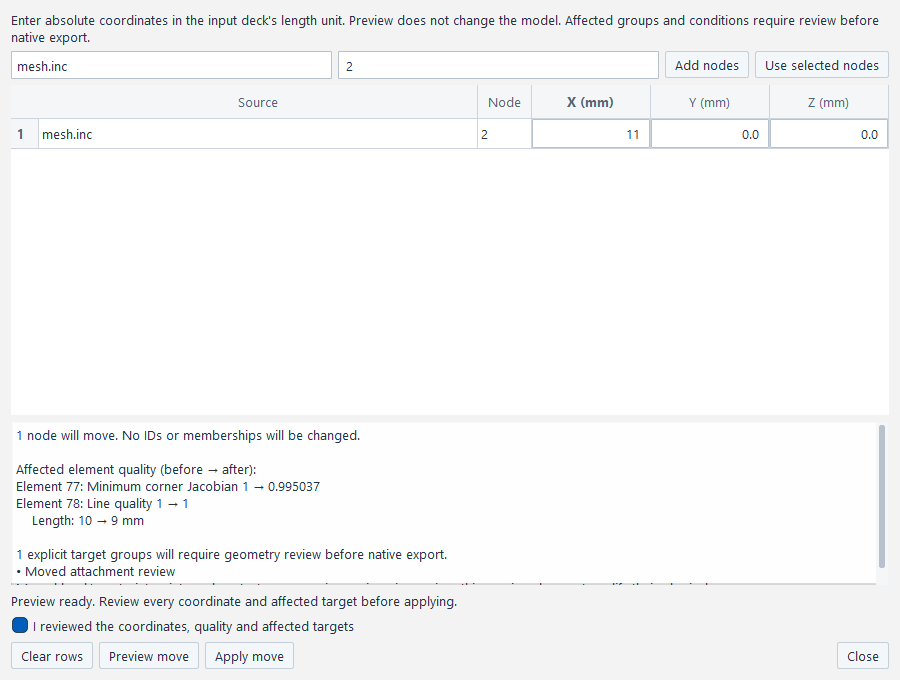
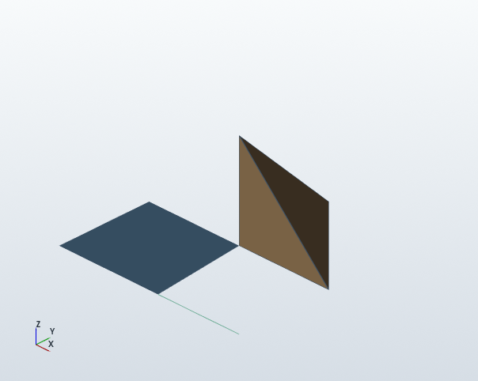

# CAELab Prep 설치와 사용

RAD를 편집하고 작업문서를 저장하거나 솔버 입력을 내보내는 절차입니다. PowerShell 명령은 저장소 최상위 폴더에서 실행합니다. 출력은 사용자 원본과 다른 새 폴더를 선택하세요.

<a id="install-windows"></a>

## Windows에 설치하기

Python 3.11 이상을 사용합니다. GUI에는 PySide6와 VTK, CAD·MSH 가져오기에는 Gmsh SDK가 필요합니다. `gui`와 `cad` 옵션으로 설치합니다. 솔버 EXE, FreeCAD, OCP, pytest는 기본 앱 실행의 필수 의존성이 아닙니다.

```powershell
git clone https://github.com/pikachu444/caelab-prep.git
cd caelab-prep
python --version
python -m venv .venv
.\.venv\Scripts\python.exe -m pip install -e ".[gui,cad]"
.\.venv\Scripts\python.exe -m pip check
.\.venv\Scripts\caelab-prep.exe --help
.\.venv\Scripts\caelab-prep.exe gui
```

`.venv`가 이미 있으면 가상환경 생성 명령을 반복하지 마세요. 기존 환경을 사용하거나 새 이름으로 만들고 실행 경로도 바꿉니다. 가상환경 활성화나 PowerShell 실행 정책 변경은 필요하지 않습니다. `caelab-prep.exe`는 Python console entry point이며 설치형 배포 패키지가 아닙니다.

2026-11-02 Windows 확인 조합은 Python 3.13.5, PySide6/Qt 6.9.1, VTK 9.4.2, Gmsh 4.15.2입니다. 같은 라이브러리 조합을 설치하려면 위 설치 명령을 다음으로 대체합니다. 전체 의존성 lockfile이나 모든 Python 버전의 검증을 뜻하지는 않습니다.

```powershell
.\.venv\Scripts\python.exe -m pip install -e ".[gui,cad]" PySide6==6.9.1 vtk==9.4.2
```

GUI 없는 CLI는 `python -m pip install -e .`로 설치합니다. Qt 갤러리만 쓰려면 `.[widgets]`, MCP adapter는 `.[mcp]`, 개발 검사는 `.[dev]`를 선택합니다. `gui --no-3d`는 VTK viewer만 끄며 문서 편집을 유지합니다.

설정까지 분리해 실행하려면 `gui --settings-file "임시 폴더/prep.ini"` 또는 `gallery --settings-file "임시 폴더/gallery.ini"`를 사용합니다. 지정한 INI에 창 배치를 읽고 저장하며 기본 사용자 설정을 읽거나 쓰지 않습니다. 각 작업 공간에는 별도 파일을 지정하세요. 옵션을 생략하면 기존 사용자 설정을 사용합니다. 이 옵션은 작업문서·출력 위치를 바꾸지 않으며, 이전 portable 후보 `46cea514`에는 포함되지 않습니다.

## Linux에서 실행하기

```sh
python3 -m venv .venv
.venv/bin/python -m pip install -e ".[gui,cad]"
.venv/bin/caelab-prep gui
```

Qt XCB와 OpenGL 런타임, 한글 글꼴이 필요합니다. Ubuntu 의존성과 X11 실행 환경은 [CI의 `native-render` 설정](../.github/workflows/prep-tests.yml)을 확인하세요. offscreen 실행은 문서·입력 검사이며 데스크톱 3D 표시 확인과 구분합니다.

## RAD를 편집하고 저장하기

기본 native 창에서 다음 순서로 작업합니다. 프로그램별 표현에서는 명령 배치가 다를 수 있습니다.

1. **File → Open Radioss deck…**에서 root RAD를 엽니다. INCLUDE 파일도 원래 상대 경로에서 읽을 수 있어야 합니다. `.caeprep`는 **Open project…**로 엽니다.
2. 트리에서 PART, 재료, 단면 또는 조건을 선택하고 Inspector의 지원 필드를 수정합니다. 미해석 원문 카드는 보존되지만 모든 필드를 편집할 수 있는 것은 아닙니다.
3. 필드의 Enter 또는 편집 창의 **Apply**로 확정합니다. **Undo/Redo**로 확정된 변경을 되돌리거나 다시 적용합니다. 잘못된 숫자나 미확정 초안은 저장 전에 수정하거나 명시적으로 취소합니다.
4. **File → Save project as…**에서 새 `.caeprep` 경로를 선택합니다.
5. 창을 닫고 저장한 문서를 다시 열어 값과 참조를 확인합니다.

`.caeprep`는 편집 원문·문서 상태·관계를 보존합니다. RAD 내보내기는 솔버용 파일을 별도로 작성합니다. 현재 RAD 작업문서는 v6으로 저장하고 v1–v5도 읽습니다. 이전 v5 앱은 v6 문서를 열지 못하므로 기존 작업문서를 보존하고 새 이름으로 저장하세요. 중립 재료/곡선 문서와 RAD 문서는 같은 확장자를 사용하지만 codec이 다르므로 해당 작업 공간에서 여세요.

```powershell
.\.venv\Scripts\caelab-prep.exe gui examples/rad/shell_panels_0000.rad
.\.venv\Scripts\caelab-prep.exe gui prep-demo/edited.caeprep
```

### MODEL·FORM·TEXT 작업 공간

기본 CourantPrep 창과 `compare --rad`의 BeidPrep 표현은 MODEL 옆에 FORM/TEXT를 배치합니다. **File / Edit / Model / Mesh / Conditions / View** 메뉴와 상단 기능 아이콘은 같은 명령을 사용합니다. 재료·shell/solid 단면 생성, 복사·삭제·할당은 **Model**에서 선택합니다. 아이콘이 좁은 창에서 접혀도 메뉴로 접근할 수 있습니다. 첫 실행은 최대화하며 이후에는 저장된 창 크기와 도킹 배치를 복원합니다.

MODEL은 실제 카드 분류와 native header를 표시합니다. 생성된 CAD part 이름의 내부 UUID 접미사는 화면에서만 숨기며 원문 이름과 객체 참조는 유지합니다. 3D에 실제 표시되는 PART에는 가시성 체크와 읽기 전용 색 칩이 나타납니다. 이 표시는 현재 viewport 상태이며 문서의 물성색이나 영구 설정이 아닙니다. `--no-3d`에서는 이 표시가 없습니다.

FORM은 기존 지원 속성을 편집합니다. TEXT에서 **Edit supported values**를 누르면 같은 카드 전체의 native 원문을 열고, 지원되는 고정 폭 값만 수정할 수 있습니다. 숫자는 입력 덱 단위이며 FORM에서 선택한 표시 단위로 해석하지 않습니다. **Apply TEXT** 한 번은 한 Undo이고, **Cancel TEXT**는 원래 문서 값을 유지합니다. TEXT 편집 중에는 FORM을 잠그며 선택 변경·저장·내보내기 전에 Apply 또는 Cancel을 요구합니다. 모델이 외부에서 변경되면 오래된 TEXT 적용을 거부하고 초안을 유지합니다.

TEXT 지원 범위는 읽을 수 있는 MAT LAW1/ELAST/LAW36/PLAS_TAB의 밀도·E·ν, shell/beam/truss PROP의 기존 지원 수치, PART 재료·속성 참조, 기존 FUNCT 점 값, INIVEL/TRA 속도, BCS의 지원 boolean, INTER의 지원 friction입니다. 구조·header와 카드 자체의 ID·제목·comment·행 수 및 나머지 필드는 보존합니다. 집합 멤버 추가나 curve 행 추가 등은 기존 FORM/전용 편집기를 이용합니다. 기존 writer가 보호 영역을 보존하지 못하는 FUNCT 행 뒤 suffix·마지막 개행 누락, 비표준 BCS 정렬/padding 등의 레이아웃은 TEXT 읽기 전용입니다. 잘못된 숫자나 지원 밖 변경은 오류를 표시하고 초안을 남깁니다. 긴 읽기 전용 미리보기의 생략 안내는 편집 정본에 포함되지 않습니다.

## 새 모델에 CAD·메시와 조건 연결하기

명시한 planar quad/sweep hex8 recipe는 **Mesh → CAD / mesh candidate… → Source type: Structured quad / sweep hex recipe**에서 생성합니다. recipe JSON과 후보 폴더를 선택하고 **Generate candidate**로 준비합니다. 원본 파일과 문서는 바꾸지 않으며 실행 중 **Cancel generation**으로 중지할 수 있습니다. 전체 후보의 scaled Jacobian·edge aspect·면적/체적과 단위를 검토하고 재료·quad의 shell 또는 hex의 solid 단면을 고른 뒤 **Adopt candidate**로 한 번에 채택합니다. 길이 단위는 recipe에서 읽으며 문서 단위와 같아야 합니다.

quad와 hex 밑면의 분할 수는 JSON을 선택한 뒤 **Load recipe divisions**로 읽어 각 patch의 **Edge 1–2 / Edge 2–3**에서 편집할 수 있습니다. hex의 **Sweep layers**는 recipe의 sweep vector를 따라 나눈 공통 분할 수입니다. 값은 전역 X/Y가 아닌 recipe의 순서 있는 모서리 방향에 대한 분할 수이며 정수 1..10000과 전체 생성 예산을 적용합니다. 두 patch의 공유 변 분할 수는 같아야 합니다. 입력을 바꾸면 이전 품질 결과와 Adopt가 무효화되므로 **Generate candidate**로 새 결과를 검사합니다. 수정한 recipe는 새 후보 폴더에 보관하고 원본 JSON은 수정하지 않습니다. 원본이 외부에서 바뀌면 다시 불러와야 합니다.

예를 들어 아래 JSON을 새 파일로 저장해 사용할 수 있습니다. 좌표·단위·patch 구성과 hex의 sweep vector는 JSON에서 편집합니다. `.caeprep`에 recipe를 동봉해 재생성하는 기능과 임의 곡면·holes·일반 patch assembly는 후속입니다. 채택된 native 메시·관계는 기존 작업문서로 저장하고 재열 수 있습니다. 3D를 끈 실행에서는 patch 이름과 수치만 확인하며 실제 Windows/VTK 품질 확인과 구분합니다.

```json
{"mode":"quad","unit":"mm","corners":[[0,0,0],[40,0,0],[40,20,0],[0,20,0]],"divisions":[8,4]}
```

개발 API는 `application.structured_mesh.generate_structured_mesh(recipe, output_dir, recipe_path=original_json)`와 후보의 `to_native_mesh()`, 기존 `session.adopt_mesh_candidate()`를 사용합니다. 파일 입력은 `recipe_path`로 원본을 지정하면 내용/hash를 검증하고 기존 원본 덮어쓰기 보호에 포함합니다. dict만 전달하면 후보 폴더에 recipe snapshot을 생성합니다. quad/hex 분할 수 편집은 `read_recipe_input(original_json)`이 돌려준 출처를 `source_recipe=`로 전달합니다. 원본과 같은 mode를 유지하고 차이를 divisions와 hex의 공통 layers로 제한하며 snapshot과 원본 둘 다 채택·저장 이후 덮어쓰기에서 보호합니다. 아래 CAD/독립 MSH 경로의 허용 요소 family를 quad/hex까지 넓힌 것은 아닙니다.

<a id="recipe-geometry-fork"></a>

단일 patch 입력을 불러온 뒤 **Edit single-patch geometry…**에서 source 순서의 corner1–4 XYZ와 hex의 sweep vector를 편집할 수 있습니다. 기존 `VectorEdit`의 단위를 유지하며 mode·unit·corner 순서나 topology는 바꾸지 않습니다. 현재 divisions/layers 값도 함께 사용합니다. 두 patch 입력은 기존 분할 수 편집을 유지하고 geometry editor는 비활성입니다.

형상 draft를 바꾸면 이전 후보·품질·교체 검토를 폐기하고 Generate를 막습니다. **Save as new recipe…**로 새 파일을 선택해 입력을 검증·저장한 뒤 Generate로 새 후보를 만듭니다. 원본 hash·유한 수치·평면/convex 순서·양의 sweep·예산과 직렬화1MiB 제한을 검사하며 기존 파일은 덮어쓰지 않습니다. 취소/실패는 draft를 보존합니다. Escape로 마지막 저장 형상에 돌아가도 옛 품질 판정은 복구하지 않으므로 새 후보 생성이 필요합니다.

이 작업은 원본을 수정하지 않고 **새 입력으로 분기**합니다. 새 후보에는 원본과의 geometry 편집 이력을 기록하거나 기존 `source_recipe`의 동일 geometry 관계로 가장하지 않습니다. 파일 저장은 문서 Undo 밖의 자산이며 실제 채택은 기존 mesh+recipe archive의 한 Undo를 사용합니다. 이미 편집한 native 메시·조건을 자동 변경하거나 대응시키지 않습니다. 두 patch의 공유 vertex·patch 구성 변경·일반 곡면/sweep는 후속입니다. 개발 helper `fork_geometry_recipe(base, source_digest, new_path, corners=..., vector=...)`는 같은 경계를 사용합니다. 실제 지원 범위와 미확인은 [현재 상태](../CURRENT_STATE.md#recipe-geometry-fork-progress)를 따릅니다.

<a id="project-recipes"></a>

이후에 채택하는 structured 후보는 **그 채택에 사용한 recipe 원문**과 선택적 원본 `source_recipe`를 작업문서에도 보관합니다. 문서를 재열고 같은 메시 창의 structured 모드에서 **Open project recipe…**를 누르면 보관 입력을 선택해 새 하위 폴더로 꺼내고 분할 수를 불러옵니다. **Generate candidate**를 다시 실행해 현재 생성기와 품질 검사를 거친 새 후보를 만듭니다. 기존 문서는 바뀌지 않습니다. 보관 입력은 채택 당시의 기록이며 이후 절점 이동·삭제·PART 변경을 역으로 복원하지 않습니다. 선택 도중 문서를 바꾸거나 재열면 다시 선택해야 합니다.

실제 생성 입력은 추출된 `recipe.json`입니다. 편집 전 원본이 있으면 `source_recipe.json`도 따로 보존합니다. 두 파일은 역할별 정확한 bytes/hash를 유지하고 각각1MiB로 제한합니다. 추출은 기존 폴더를 덮어쓰지 않으며 I/O 실패 때 일부 새 파일이 남을 수 있지만 창의 기존 입력은 바꾸지 않습니다. 이 기능을 모르는 이전 v6 앱에서 재저장하면 native 내용은 유지해도 recipe 첨부는 사라집니다. 예전 문서에 첨부가 없다면 외부 recipe가 필요합니다. 과거 MSH·SDK 보고서·Passed 판정은 동봉하거나 재사용하지 않습니다.

개발 API의 `structured_mesh_recipes()`는 archive UUID·채택 mesh UUID·mode/단위·원문 역할과 조회 시 문서 ID/epoch/revision을 반환합니다. `export_structured_recipe(archive_id, new_directory, expected_document_id=..., expected_document_epoch=..., expected_revision=...)`로 그 조회에 묶어 추출할 수 있습니다. 반환된 `recipe_path`를 기존 `read_recipe_input`·`generate_structured_mesh(..., recipe_path=...)`에 전달합니다. 실제 확인과 남은 플랫폼·좌표/patch 편집 범위는 [현재 상태](../CURRENT_STATE.md#recipe-archive-progress)를 따릅니다.

같은 GUI/API에서 `mode: "hex"`인 명시 planar source의 직선/경사 sweep hex8도 채택할 수 있습니다. 예를 들어 위 quad JSON의 `"mode"`를 `"hex"`로 바꾸고 `"vector":[0,0,10],"layers":4`를 추가합니다. GUI의 solid 단면 또는 `session.create_solid_property()`가 만든 명시 `Isolid=1` 속성과 재료 ID로 채택하면 BRICK/GRBRIC을 작성하고 한 번의 Undo와 기존 작업문서 저장·재열기를 사용합니다. 상속/기타 Isolid 값을 자동 치환하지 않습니다. `describe()["capabilities"]["mesh_adoption_sources"]`가 출처별 family를 구분합니다. 27점 Jacobian 검사는 기하 품질 검사이며 solver 적분점 수를 뜻하지 않습니다. Starter 읽기는 기존 PR34의 225/525요소 입력에서 확인한 범위이며, 이번 divisions/layers 편집 출력(360/720요소)의 Starter는 실행하지 않았습니다. Engine·해석 응답·물성의 타당성·Windows/frozen GUI도 미확인입니다. 비틀림·곡면·일반 CAD 분할·임의 외부 hex는 지원하지 않습니다.

1. **File → New model…**에서 이름과 질량·길이·시간 단위를 명시합니다. 단위 없는 입력에 임의 단위를 추정하지 않습니다.
2. 재료와 요소 family에 맞는 shell 또는 solid 단면을 만듭니다.
3. CAD는 **Mesh → CAD / mesh candidate…**에서 입력과 후보 폴더, 요소 크기를 선택합니다. 현재 Gmsh 경로는 tri3/tet4 후보를 지원합니다. CAD 없는 MSH는 **Mesh → Import mesh…**에서 소스 길이 단위를 직접 지정합니다.
4. 후보의 품질·그룹·파트와 오류를 확인합니다. 재료와 단면을 지정한 뒤 **Adopt candidate**로 확정합니다. 후보 생성만으로 모델 문서가 바뀌지 않습니다.
5. 곡선·집합을 만들고 BCS, CLOAD, INIVEL/TRA 또는 지원 TYPE7 조건을 연결합니다. 해석 케이스에서 활성 조건·종료 시간·출력 간격을 저장합니다.
6. `.caeprep`와 후보 자산 폴더를 함께 보관합니다. 작업문서에 native 메시가 있어도 재메시에 필요한 CAD/XAO/MSH 원자산이 모두 동봉되는 것은 아닙니다.

채택한 후보의 캡처 자산과 후보에 기록된 원본 CAD/MSH 경로는 게시 시점부터 작업문서 저장·native 출력의 덮어쓰기에서 보호하며, 작업문서를 재열어도 보호를 유지합니다. 저장할 때는 입력 파일과 다른 새 경로를 선택합니다. 후보가 사용한 CAD 버전은 보관된 캡처 자산을 기준으로 확인합니다.

MSH는 2.2/4.1 ASCII에 한정합니다. binary·partition·periodic·data·parametric MSH와 미지원 요소 family는 거부합니다. 문서와 소스 길이 단위가 다르면 자동 환산하지 않습니다. 일반 warped quad, 임의 all-hex, 자동 중립면과 모든 접촉 프로파일은 지원 완료 범위가 아닙니다.

<a id="cad-replacement"></a>

### 참조된 CAD 메시 교체

기존 CAD에서 채택한 PART를 크기 변경 후보로 교체하려면 같은 창에서 새 후보를 생성하거나 엽니다. 재료·단면을 선택하고 **Replace parts**에서 교체할 기존 PART를 고른 뒤 **Review replacement**를 누릅니다. 이 단계에서는 모델이 바뀌지 않습니다. 전후 절점·요소 수, stale이 될 그룹·표면과 영향 조건을 읽고 검토 체크를 한 뒤 **Apply replacement**로 확정합니다. 후보·크기·입력 경로·단위·재료·단면·PART 또는 문서가 바뀌면 검토를 다시 해야 합니다. 취소와 닫기는 검토 상태를 폐기합니다.

교체는 기존 root에 CAD 후보 채택으로 만든 PART와 소유가 확인되는 요소에 한정합니다. 알려진 native 참조 범위·같은 길이 단위·후보 전체 품질을 요구하며, 외부 INCLUDE의 요소 소유나 미확인 참조·변환 범위를 추정하지 않습니다. 다른 요소의 BEAM 방향점으로 쓰는 절점과 잔존 절점의 이동 좌표는 보존합니다. 새 후보의 PART·절점 번호를 기존 번호로 자동 대응하지 않습니다.

새 메시와 영향 그룹의 stale 표시는 한 번의 Undo로 되돌립니다. 원 그룹·조건 선언은 유지하고, 영향 대상이 있으면 기존 **Replace prepared mesh / reconnect targets…**의 재연결 탭을 엽니다. 옛 멤버마다 현재 typed 대상 또는 명시 Drop을 검토해야 하며 모두 해소하기 전 native 출력은 차단됩니다. 전체 old main의 일시 소실은 stale로 남길 수 있지만, 최종 TYPE7 표면·secondary 연결과 BCS/CLOAD/INIVEL 성분·빈 최종 집합 검사는 유지합니다. 새 경계 절점의 자동 추가·물리 영역 복원·CLOAD의 절점당 계수 보정은 하지 않습니다. 재연결 후 실제 경계와 하중 분포를 확인해야 합니다.

개발 API는 `plan_cad_mesh_replacement(native, replace_part_ids=..., material_id=..., property_id=...)`와 `apply_cad_mesh_replacement(plan_id)`·`cancel_cad_mesh_replacement(plan_id)`입니다. plan은 문서·자원 상태에 묶인 봉인된 사본이며 Apply에서 자산도 다시 검증합니다. 기존 `adopt_mesh_candidate`의 참조된 직접 교체 거절은 유지합니다. 보관된 plate/cylinder의 1.5→1.2 후보 교체와 별도 2D TYPE7의 확인 범위·미확인은 [현재 상태](../CURRENT_STATE.md#cad-replacement-progress)를 따릅니다. Windows/VTK·frozen·solver 응답이나 전체 N18의 완료를 뜻하지 않습니다.

<a id="meshing-criteria"></a>

### Meshing criteria와 출력 최소-edge 검사 (Python API)

독립 criteria JSON은 활성 작업문서와 별도로 저장합니다. 다음은 STEP의 mm 정규화 좌표에서 target=1.5, minimum=.25를 실행하는 예입니다. GUI/CLI의 criteria 선택기는 아직 연결하지 않았습니다.

```python
from pathlib import Path
from caelab_prep.adapters.gmsh_backend import GmshBackend
from caelab_prep.application.mesh_candidates import read_mesh_candidate
from caelab_prep.application.meshing_criteria import MeshingCriteria

source = Path("part.step")
MeshingCriteria("mm", 1.5, .25).save("part.criteria.json")
criteria = MeshingCriteria.load("part.criteria.json")
result = GmshBackend().generate(source, "candidates", **criteria.gmsh_kwargs(source_path=source))
candidate = read_mesh_candidate(result)
report = criteria.audit_minimum_edges(candidate.nodes, candidate.cells, coordinate_length_unit="mm")
print(report["passed"], report["cleanup_candidate_ids"])
```

STEP/STP/IGES/IGS 실행 criteria는 mm여야 합니다. BREP/BRP/XAO에는 `gmsh_kwargs(source_path=source, declared_coordinate_length_unit="cm")`처럼 실제 좌표 단위를 명시하고 같은 단위의 profile을 사용합니다. Worker는 복구된 XAO의 내장 단위와 기대 단위가 충돌하면 생성 전에 거부합니다. 이 선언은 metadata를 재명명하거나 좌표를 환산하지 않습니다. 출력 감사의 `coordinate_length_unit`도 실제 출력 좌표 단위이며 원 CAD의 표시 단위를 뜻하지 않습니다.

SDK `Mesh.MeshSizeMin/Max`는 sizing 입력입니다. 모든 출력 edge의 하한/상한 보장이 아니므로 감사 결과를 별도로 확인합니다. 현재 감사는 전체 inventory의 line2/tri3/quad4/tet4/hex8 위상 edge를 측정하며, point annotation은 명시적으로 건너뜁니다. 고차·미지원 family가 하나라도 있으면 전체 감사는 통과하지 않습니다. 짧은 edge의 요소 ID만 cleanup 후보로 반환하고 mesh·문서·원본은 변경하지 않습니다. Warpage/AR/J 판정이나 자동 collapse/swap 완료를 뜻하지 않습니다.

`washer_rim_divisions`, `washer_width`, `washer_layers`, `fillet_suppression_threshold`는 profile에 보존되지만 non-null 실행 요청은 명시 거부합니다. Washer는 hole 주위 mesh ring, fillet suppression은 B-Rep 변경 없는 meshing tangent-edge 억제라는 후속 의미이며 아직 생성/억제하지 않습니다.

<a id="geometry-features"></a>

### 메시 없는 CAD 기하 검사 (Python API)

```python
from caelab_prep.adapters.gmsh_backend import GmshBackend
from caelab_prep.application.geometry_inspection import read_geometry_inspection

result = GmshBackend().inspect_geometry("part.step", "geometry-evidence",
                                       expected_coordinate_length_unit="mm")
inspection = read_geometry_inspection(result)
inspection.verify_assets()
raw_surfaces = inspection.to_dict()["surfaces"]
```

Gmsh 4.15.2의 CAD analytic 속성·curve loops·원시 face normal·volume-use를 원본 캡처와 XAO/metadata에 연결합니다. 메시를 생성하지 않으며 MeshCandidate·채택·문서 수정 경로가 아닙니다. Reader는 세 자산의 해시와 identity/위상 참조를 검사하며, 반환 사본을 바꿔도 보관된 evidence는 바뀌지 않습니다.

Curve/loop tag는 해당 inspection 안에서만 유효합니다. Loop의 outer/inner 역할·방향, raw normal의 재료 외향 여부, UV 중점의 경계 여유는 확인하지 않았습니다. `trim_count=1`도 `sampling_status=unverified`이며 원통 면을 hole이나 fillet로 확정하지 않습니다. 별도 가져오기 사이에서 UUID/tag를 자동 대응시키지 않습니다.

### 제한된 원통 홀 후보 (Python API)

```python
from caelab_prep.adapters.gmsh_backend import GmshBackend
from caelab_prep.application.geometry_inspection import read_geometry_inspection
from caelab_prep.application.geometry_features import recognize_cylindrical_holes

result = GmshBackend().inspect_geometry("part.step", "hole-evidence",
    expected_coordinate_length_unit="mm", probe_cylinder_material_side=True)
inspection = read_geometry_inspection(result)
candidates = recognize_cylindrical_holes(inspection, length_tolerance=1e-6)
print(candidates["features"], candidates["unclassified"])
```

첫 지원 형상군은 좌표축과 나란한 완전 원통이며, 경계가 두 완전 원과 반복 seam이고 한 volume에 속해야 합니다. 국소 offset의 원시 volume membership·수치 여유와 실제 좌표의 반경 잔차를 worker/reader의 같은 순수 계획으로 검증합니다. 다른 boundary가 지원 평면/원통이 아니거나 여유·좌표 단위·trim 근거가 부족하면 `indeterminate`로 남깁니다. 원시 face normal에 volume sign을 다시 곱하지 않습니다.

각 끝의 같은 volume 평면에서 하나의 원형 disk 또는 원 하나가 뚫린 직사각 cap을 확인합니다. 두 opening이면 `through_hole_candidate`, 한 opening과 disk이면 `blind_hole_candidate`, 두 disk이면 enclosed cavity로 미분류합니다. 외부 원통은 재료 측 witness로 제외합니다. `length_tolerance`는 실제 좌표 단위의 길이이며 위 예는 mm입니다.

이는 검토할 후보입니다. 전체 공극의 외부 연결·CAD 설계 이력·임의 축/일반 polygon/복잡 trim·fillet 인식은 보장하지 않습니다. Washer ring·fillet 억제·mesh 생성/채택은 연결하지 않았으며 후보 판독은 B-Rep·mesh·활성 문서를 변경하지 않습니다. 자산이 바뀌면 다시 검사해야 합니다.

### 제한된 원통 blend 후보 (Python API)

```python
from caelab_prep.application.geometry_features import recognize_cylindrical_blends

result = GmshBackend().inspect_geometry("part.step", "blend-evidence",
    expected_coordinate_length_unit="mm", probe_cylindrical_blends=True)
inspection = read_geometry_inspection(result)
blends = recognize_cylindrical_blends(inspection, length_tolerance=1e-6,
    angular_tolerance=1e-6, radius_threshold=1.)
```

첫 범위는 mm 단위의 축 정렬된 1/4 원통과 같은 volume의 직사각형 평면 지지면 두 개입니다. 실제 shared-vertex cycle·generatrix·끝 호·지지면과 샘플의 유한 패치 내부를 검사합니다. 원통과 지지면 각각의 안전한 두 offset에서 얻은 원시 volume membership으로 재료 외향 법선을 정합니다. Reader는 동일 계획·실제 저장 좌표의 signed residual·계산된 수치 여유와 membership-derived sign을 다시 검사합니다. 공유 직선의 중점에서 **부호 있는** 두 법선의 내적이 `cos(angular_tolerance)` 이상인지를 판정하므로 기하학적으로 접하지만 재료 방향이 반대인 cusp를 제외합니다. Raw face normal과 volume sign의 곱은 사용하지 않습니다.

`radius_threshold`는 mm이며 등호를 포함합니다. `None`은 반경 필터를 사용하지 않습니다. 길이·각도 허용오차의 첫 지원 하한은 각각 `1e-6 mm`·`1e-6 rad`이고 각도는 `pi/2` 미만이어야 합니다. 더 작은 길이 허용오차·다른 단위·불명확한 여유·재료 관측 누락은 후보를 만들지 않습니다. 원추/토러스의 참조 반경을 일정한 fillet 반경으로 대체하지 않으며 이 형상들은 아직 미지원입니다. 결과는 `cylindrical_blend_candidate`와 두 접선 edge의 근거이며 CAD 설계 이력이나 자동 억제 완료를 뜻하지 않습니다. B-Rep·volume·문서·mesh 변경은 0입니다.

### 공용 창에서 후보 검토하기

8개 표현의 **Mesh → Inspect geometry features…**에서 CAD와 evidence 폴더를 선택한 뒤 **Inspect geometry**를 실행합니다. 활성 모델 없이도 열 수 있습니다. **Open inspection…**은 기존 geometry metadata를 읽으며 SDK를 다시 실행하지 않습니다. STEP/IGES는 mm 정규화 좌표를 사용하고, 저장된 XAO에는 알려진 mm 단위가 필요합니다.

행을 선택하거나 wireframe의 표식을 클릭하면 같은 후보의 반경·길이·축·끝 cap 또는 재료 방향의 접선 증거를 확인합니다. 표시용 선분의 선택은 활성 모델 선택과 분리됩니다. View에는 지원 직선 CAD edge, hole의 완전 원형 경계 또는 blend의 부분 호와 축을 표시합니다. **Maximum blend radius**는 선택적 반경 필터입니다. 허용오차·반경을 바꾸면 저장된 자료를 재판독하며 SDK를 다시 조회하지 않습니다. Escape는 마지막 성공 값과 표시로 복귀합니다. 입력 변경·실패·잘못된 값은 이전 후보와 표식을 지웁니다. **Cancel inspection**과 창 닫기는 진행 중 worker를 중지한 뒤 결과를 폐기합니다. 이 창은 mm 전용이며 저장 자료의 unknown 단위를 자동 환산하지 않습니다.

검사 evidence와 이 창의 후보 표시는 작업문서의 메시·조건을 편집하거나 채택하지 않습니다. 현재 인식 지원 형상군은 위 Python API와 같으며, 일반 fillet/원추·Flange·washer ring 생성·접선 edge 억제·일반 batch/cleanup은 후속입니다. Hole의 64분할 원과 blend의 16분할 부분 호는 표시 선분이며 Washer Quad/Tria 요소가 아닙니다. Windows OS·VTK 실제 확인은 [현재 상태](../CURRENT_STATE.md#remaining-work)를 따릅니다.

<a id="prepared-tet10"></a>

### 준비된 straight Tet10

준비된 **직선 Tet10 메시**는 별도 opt-in 경로를 사용합니다. **New solid section… → Element formulation → Straight Tet10 (LAW1)**으로 단면을 만들고, **Import mesh… → Element profile → Straight Tet10 solids (explicit)**에서 실제 MSH를 검사합니다. 기존 선형 프로필은 Tet10 채택을 계속 차단합니다. LAW1 재료와 명시 Tet10 단면을 선택해 채택하면 별도 PART, 한 Undo, 기존 v6 저장·재열기와 두 행 `/TETRA10` RAD 출력을 사용합니다. 원 MSH와 캡처본의 덮어쓰기를 막으며, 검토 후 문서를 재열었으면 다시 검사해야 합니다.

이 프로필은 모든 물리 요소가 10절점 Tet10인 입력에 한정합니다. 부모의 Verdict corner-scaled J≥.5·6-edge AR≤4와 직선 midpoint·공유 edge·전체 요소의 양의 Jacobian 충분조건을 원좌표 및 native 반올림 좌표에서 모두 확인합니다. Tri6/Line3는 정확한 절점 역할을 검사한 경계 annotation이며 물리 shell/beam 또는 접촉면으로 출력하지 않습니다. 소스 집합의 명시 멤버를 보존하고 midside를 하중/구속 집합에 자동 추가하지 않습니다. Tet4 혼합, 곡선 Tet10, 해당 메시의 일반 node move/merge·assembly 병합·solid contact는 이 경로의 지원 범위가 아닙니다.

개발 API는 `import_standalone_mesh(..., element_profile="straight_tet10")`, `session.create_solid_property(..., element_family="tetra10")`, 기존 `session.adopt_mesh_candidate()`를 사용합니다. 표준 MSH에는 신뢰할 길이·질량·시간 단위가 없으므로 소스 길이 단위와 문서의 작업 단위를 명시해야 합니다. CalcX 변환·실행은 Workbench 소유이며 Prep에 별도 중복 변환기를 만들지 않습니다.

고정 L의 87절점/36 Tet10은 한 Undo·v6·새 Python 재열기·RAD 재해석과 첫 Windows Starter에서 총질량 `2.34e-8 Mg`를 확인했습니다. 첫 reader 확인은 Engine 파일 부재 경고1을 남겼습니다. 후속 케이스 내보내기 누락을 `04d9233`에서 수정한 뒤, 같은 메시의 명시 all87 집합·YZ 구속·초기 Vx2.5를 저장·새 프로세스 재열기·선택 케이스의 Starter/Engine 출력으로 확인했습니다. 각 한 번의 실제 실행은 오류0·경고0, Engine 44 cycles 정상 종료이며 초기 KE `7.3125e-8 N·mm`가 기준과 일치했습니다. 제품 Engine 원문과 관측용 `/TFILE/4` 추가본은 구분합니다. T01은 생성됐지만 Windows에 기존 converter/reader가 없어 시간별 운동량·에너지 유지·최종 표본시간의 전체 응답 판정은 미확인입니다. 실제 VTK 렌더/픽·OS 입력·frozen 확인도 남습니다. Qt offscreen 조작·미리보기 10슬롯 데이터와 VTK cell의 edge 순서 검사는 이 실제 화면 확인을 대신하지 않습니다. 폐표면 자동생성의 [F1 품질 미달](mesher-feasibility-roadmap.md#2026-11-03-폐삼각표면-auto-tet-f1)도 별도로 유지합니다.

main에 병합된 **Mesh → Move nodes to coordinates…**에서는 소스와 절점 ID를 선택하고 입력 덱 길이 단위의 절대좌표를 입력합니다. **Preview move**에서 품질과 영향 대상을 확인하고 검토 체크 후 **Apply move**로 확정합니다. ID·연결·집합 멤버를 보존해도 하중 작용점과 접촉 간격은 달라질 수 있습니다. 영향 집합은 **Replace prepared mesh / reconnect targets…**에서 명시적으로 검토하기 전까지 native 출력을 막습니다. 다중 자원에서는 집합별 실제 변경 자원에 검토 상태를 연결합니다. API의 하중 진단은 시간함수 평가 전 계수이며 실제 시각의 힘·모멘트나 작용점 모멘트를 계산한 결과가 아닙니다. 일반 메시 편집 전체의 완료본은 아닙니다.

<a id="group-member-review"></a>

집합의 기존 편집 작업에서 절점 ID 또는 출처가 있는 요소 멤버를 바꾸고 **Preview change…**를 선택하면 현재/제안 멤버·추가/제거·연결된 조건의 대상 변화를 볼 수 있습니다. 지원 가능한 제안은 **Apply reviewed membership** 한 번으로 적용하며 Undo/Redo·저장·native 출력은 기존 문서 경로를 사용합니다. **Cancel**은 모델과 편집 초안을 유지합니다. 검토 중 모델이 바뀌면 적용을 차단하므로 검토를 취소하고 집합 편집을 다시 여세요.

이 검토는 닫힌 native 참조 범위에 한정됩니다. 지원 밖 카드(예: LAW36)가 포함되거나 기존 geometry review가 남아 있으면 새 preview를 만들 수 없습니다. 기존 직접 **Apply**와 inspector 편집은 유지되며 새 영향 검토를 거친 것으로 계산하지 않습니다. 명시 요소 집합의 멤버 변경이 절점 하중을 자동 재배정하지 않습니다. 하중 표시는 시간함수 평가 전 계수이고, 접촉은 secondary/main 대상별로 구분합니다. 초기속도 중복과 원문 위치를 보여도 INCLUDE 간 실행 순서·유효 초기상태·운동량을 계산한 결과는 아닙니다. 기하를 바꾸지 않아 새 mesh generation/stale을 만들지 않으며, part 소유 변경·병합·삭제·법선 반전·재메시는 이 기능의 범위가 아닙니다.

<a id="node-merge"></a>

**Mesh → Merge nodes with tolerance…**에서 **Remove node**와 **Keep node**의 출처·native ID를 지정하거나 각각 **Use selected**로 현재 절점 하나를 가져온 뒤 **Add pair**를 누릅니다. 여러 pair를 추가할 수 있으며 선택 순서나 최근접 위치로 대응을 추정하지 않습니다. keeper 좌표는 바꾸지 않습니다. **Tolerance**는 빈칸에서 입력 덱 길이 단위로 직접 지정합니다. 예제의 거리나 다른 프로그램의 기본값을 권장 공차로 사용하지 않습니다.

표의 각 행을 선택해 실제 PART 사용과 source/contact 경계 허용을 검토합니다. BEAM 방향점으로 사용하는 절점은 기계적 끝점과 구분합니다. **Preview merge**는 연결·방향절점·품질과 조건의 변경 전후 대상을 표시하며 문서를 바꾸지 않습니다. 검토 체크 후 **Apply merge** 한 번이 한 Undo입니다. pair·공차·허용을 바꾸면 검토를 다시 해야 합니다. 모델이 바뀌면 창을 닫고 현재 절점을 다시 선택하세요. **Close/Escape**는 미적용 초안만 버립니다.

조건의 제안 대응은 미리보기이며 실제 Apply에서 원 집합·조건을 자동 변경하지 않습니다. 영향 그룹이 있으면 native 출력을 막으므로 기존 **Replace prepared mesh / reconnect targets…**에서 각 원 멤버를 현재 대상으로 명시 연결하세요. 최종 재연결은 BCS·CLOAD·INIVEL의 기계 필드와 TYPE7의 역할·secondary 기계적 연결을 검사합니다. BCS의 비활성 회전 경고와 무지지 절점은 구분하며, 실제 구속 충분성·접촉력은 별도로 확인합니다. 기존 native replacement가 보존할 수 없는 카드 layout(예: 변경 카드 안의 file directive)은 현재 merge plan에서 거부합니다. 닫힌 참조 범위·알려진 단위·품질·기계 필드의 기존 제한도 유지합니다. BEAM 기본 frame으로 조용히 전환되는 병합은 거부하지만, 다른 방향점 재배선이나 TRUSS 연결의 물리적 동등성을 보장하지 않습니다. Windows/frozen·solver와 전체 P7b의 확인 범위는 [현재 상태](../CURRENT_STATE.md#remaining-work)를 따릅니다.

같은 절점으로 모이는 node-group 링크를 집합 하나로 줄이려면 모든 old ID의 링크를 추가한 뒤 **Allow repeated node targets to form one set**을 직접 체크하고 **Preview final mapping**을 누르세요. **Reconnection review**는 보존된 옛 링크 수·현재 카드 선언·최종 집합, 하중의 미평가 곡선 배수 합과 속도 벡터/좌표계·교집합을 보여 줍니다. 예를 들어 옛 링크 2개가 현재 절점 1개로 모이고 절점별 배수가 3이면 합은 6→3이며 힘의 보존을 뜻하지 않습니다. 현재 mapping은 merge 투영과 달라도 최종 mapping으로 다시 계산합니다. 검토 체크 후 같은 **Apply reconnection**으로 한 번 적용하고 Undo/Redo·저장·재열기는 기존 문서를 사용합니다.

반복 대상의 집합 축약은 절점 그룹만 지원합니다. 중복이 없는 기존 절점/요소/표면·PART 재연결의 직접 Apply는 유지합니다. 새 링크·입력·허용·그룹·문서 변경과 Close는 이전 preview를 무효화합니다. 남은 stale 속도 그룹은 최종 대상이 알려지지 않았으므로 교집합 목록이 비어도 겹침이 없다고 판단하지 마세요. 곡선/시간 스케일·작용점 모멘트·INCLUDE 실행 순서·유효 초기상태·운동량은 평가하지 않으며 조건값을 자동 합산/평균/분배하지 않습니다.

<a id="mesh-target-drop"></a>

### 옛 집합 멤버의 명시적 제거

같은 재연결 창의 **Drop selected old member**는 선택한 옛 ID를 최종 집합에서 제거합니다. 메시의 절점·요소나 PART 자체는 삭제하지 않습니다. 절점·요소·SURF/PART 집합을 지원하며, 모든 옛 멤버에 현재 대응 또는 명시적 Drop을 지정해야 합니다. 대응을 비워 둔 것만으로 제거하지 않습니다. **Clear selected decision**은 해당 결정을 미정으로 되돌립니다. 최종 집합에는 유효한 현재 멤버를 하나 이상 유지해야 합니다.

제거가 있으면 **Preview final mapping**에서 제거할 옛 ID·현재 선언·최종 집합과 영향 조건을 읽은 뒤 **Mapping reviewed → Apply reconnection**으로 확정합니다. 제거 수와 반복 대응 축약 수는 별도로 표시하며, 후자는 기존 절점 그룹의 명시 허용을 계속 요구합니다. 원 조건 선언값은 보존해도 대상 수·하중 계수 합·속도 교집합이 달라질 수 있습니다. 최종 BCS/TYPE7/CLOAD/INIVEL의 기존 유효성 검사는 유지합니다. 한 번의 Apply·Undo/Redo·v6 저장과 재열기는 같은 문서 경로를 사용하며, 다른 stale 그룹과 native 출력 차단은 남습니다. API에서는 `plan_mesh_reconnection`의 각 그룹에 `drop_members: [old_id, ...]`를 명시하고 sealed plan을 적용합니다. 직접 `reconnect_mesh_targets`는 Drop을 거부합니다.

<a id="shell-normal-flip"></a>

### 선택 셸의 법선 반전

8개 표현의 **Mesh → Reverse shell normals…**에서 현재 요소를 **Add selected elements**로 목록에 추가합니다. 모델에서 다른 요소를 선택해 계속 추가할 수 있고, 같은 source·native ID의 중복은 한 행으로 유지합니다. **Remove selected rows**는 선택한 행을 제거하고 이전 검토를 무효화합니다. Source file·Element ID·Type을 확인한 뒤 **Preview reversal**에서 현재/제안 연결 순서·품질·영향 집합과 조건을 읽고, 검토 체크 후 **Apply reversal**로 한 번 적용합니다. **Close/Escape**는 미적용 목록을 취소합니다. 문서·초안·활성 작업이 바뀌면 오래된 검토를 적용할 수 없습니다.

현재 지원은 닫힌 native 참조 범위의 SH3N과 평면 SHELL입니다. 실제 PART·SHELL/TYPE1 속성·기존 정식화와 품질 검사를 재사용하며, 압력·초기 shell 상태·적층 등 미지원 raw 카드는 preview 전에 거부합니다. 비셸 요소가 섞인 목록을 조용히 걸러 적용하지 않습니다. 좌표·ID·PART·두께와 저장된 각도 값은 보존하고 연결 순서를 반전합니다. 법선과 면내 로컬 축이 함께 바뀌므로 물리 응답은 별도로 검토해야 합니다. 지원 TYPE7은 양면 접촉이며 main/secondary 역할·gap·마찰 값을 유지합니다.

영향 집합은 기존 geometry review/stale로 남아, **Replace prepared mesh / reconnect targets…**에서 현재 대상을 명시적으로 확인하기 전까지 native 출력을 막습니다. 하중·구속·속도·접촉의 값을 자동 보정하지 않습니다. 적용·Undo/Redo·v6 저장과 재열기는 같은 작업문서 계약을 사용합니다. RAD `PrepSession`의 `plan_shell_normal_flip`·`apply_shell_normal_flip`·`cancel_shell_normal_flip`도 같은 source-qualified 경로입니다. 실제 Windows/VTK·solver와 전체 P7b의 확인 범위는 [현재 상태](../CURRENT_STATE.md#remaining-work)를 따릅니다.

존재하는 절점 ID라도 기계 요소에 붙지 않으면 BCS 또는 TYPE7 secondary의 최종 대상으로 적용할 수 없습니다. 잘못된 대응은 검토/Apply 전에 거절하고 원 선언·stale·입력 링크를 유지합니다. TYPE7은 각 역할을 따로 검사하므로 main의 검토가 남아 있어도 새 secondary 오류를 숨기지 않습니다. 미검토 역할은 계속 pending이며 native 출력을 막습니다. TYPE7의 기존 `condition_support=not-applicable`은 노드 DOF 상태 표기이고 역할/attachment 검사는 별도로 수행합니다. 명시 링크 Drop과 요소 삭제는 아직 이 경로에 연결하지 않았습니다.

<a id="element-deletion"></a>

### 요소 삭제와 새 고립 절점 처리

8개 표현의 **Mesh → Delete elements…**에서 현재 요소를 **Add selected elements**로 목록에 모읍니다. 같은 source·native ID의 중복은 한 행이며 **Remove selected rows**는 목록에서만 제거합니다. Source file·Element ID·Type을 확인하고 **Newly orphaned nodes**에서 **Keep newly orphaned nodes** 또는 **Delete only newly orphaned nodes**를 직접 선택하세요. 기본 선택은 미정이며, 이미 고립돼 있던 절점은 두 정책 모두 보존합니다. BEAM의 orientation 전용 참조도 새 고립 여부 계산에 포함합니다.

**Preview deletion**은 삭제할 요소/연결·새 고립 절점과 삭제 여부·삭제 요소의 기존 품질·집합과 조건의 생존 대상 제안을 보여 줍니다. 살아남은 요소의 연결을 바꾸거나 품질 개선을 주장하지 않습니다. 조건의 기계 성분을 지지하지 못하거나 TYPE7 secondary가 무지지이면 Apply를 막습니다. 빈 최종 집합이나 마지막 main shell을 제거하는 제안은 현재 거부하며, 조건·집합을 함께 삭제하거나 전체 고립 절점을 자동 정리하지 않습니다. 지원 밖 raw 카드와 보존할 수 없는 file directive/layout도 거부합니다.

검토 체크 후 **Apply deletion** 한 번은 한 Undo입니다. 정책·목록·문서 변경은 이전 preview를 무효화하며 **Close/Escape**는 미적용 목록을 취소합니다. 실제 삭제는 요소와 명시 정책의 새 고립 절점에만 적용합니다. 기존 PART 카드·집합 멤버·조건 선언은 보존하고 영향 집합은 stale로 남깁니다. 저장·재열기 뒤에도 native 출력 차단은 유지됩니다. **Replace prepared mesh / reconnect targets…**에서 생존 대상의 명시 mapping과 삭제된 멤버의 [Drop](#mesh-target-drop)을 검토해야 복구됩니다. 삭제 후에도 존재하는 절점이 DOF 지지를 잃을 수 있으므로 최종 재연결에서 기존 성분 검사를 다시 수행합니다.

질량·운동량·운동에너지와 TYPE7 main segment·면적·gap/stiffness의 계산 근거가 달라질 수 있습니다. 표시한 CLOAD 합계는 미평가 곡선 배수이며 실제 힘·모멘트나 응답 보존이 아닙니다. API의 `plan_element_deletion(references, orphan_policy="keep" | "delete_new")`·`apply_element_deletion`·`cancel_element_deletion`도 기존 sealed candidate/CAS·v6·Undo 경로를 사용합니다. 실제 OS/VTK·frozen·solver와 전체 P7b의 미확인 범위는 [현재 상태](../CURRENT_STATE.md#remaining-work)를 따릅니다.

<a id="element-part-ownership"></a>

### 요소의 PART 소유 이동

8개 표현의 **Mesh → Move elements to PART…**에서 요소를 **Add selected elements**로 모으고 **Target for all listed elements**의 PART를 직접 선택합니다. 대상은 native PART ID·이름·source와 UUID 참조로 구별합니다. 기본 선택은 미정이며, 선택한 대상은 목록 전체에 적용됩니다. 같은 요소의 중복은 한 행이고 이미 해당 PART에 속한 요소는 검토문에 **Already in chosen PART, unchanged**로 표시합니다. **Remove selected rows**는 미적용 목록에서만 제거합니다.

**Preview ownership**은 각 변경 요소의 기존/제안 PART·MAT·PROP native ID와 이름·source, 조건과 접촉 대상의 변화를 보여 줍니다. 현재 요소가 있는 PART와 비어 있던 기존 PART 모두 참조 유일성·선언된 속성 family를 확인한 뒤, 실제 native trial의 이동 요소에서 기존 기계 프로필 검사로 정식화를 검증합니다. PROP 이름이나 기존 요소의 존재만으로 승인하지 않습니다. 모든 MAT 수치값·PROP 필드와 solver 수용을 인증한 결과는 아닙니다. 중복 PART ID·잘못된 assignment 원문도 목록을 읽을 수 있고, Preview에서 진단과 함께 Apply를 차단합니다.

검토 체크 후 **Apply ownership** 한 번이 한 Undo입니다. native 요소 ID와 source resource, 좌표·연결·BEAM orientation·원문 행 suffix를 유지하며 source resource의 요소 행을 새 PART 헤더 블록으로 옮깁니다. 블록을 다시 구성하면 그 native 카드 블록 UUID는 바뀔 수 있습니다. 저장된 셸 각도·요소별 두께 override를 보존하므로 대상 PROP 두께를 무조건 덮어썼다고 표시하지 않습니다. PART의 MAT/PROP를 편집하는 기존 **Assign material / section…**과 다른 명령이며, 이 소유 이동은 두 PART의 MAT/PROP 선언 자체를 바꾸지 않습니다.

원 집합·조건 선언은 보존하고 old/new PART의 실제 요소와 유입 source를 포함해 영향 집합을 stale로 남깁니다. PART ID가 같아도 main surface의 segment가 늘거나 줄 수 있습니다. 기존 **Replace prepared mesh / reconnect targets…**에서 현재 대상의 명시 mapping/필요한 [Drop](#mesh-target-drop)을 검토하기 전까지 native 출력을 막습니다. 빈 최종 집합·마지막 main support 제거, 보존할 수 없는 directive/layout와 지원 밖 native profile은 거부합니다. 대상 선택·목록·문서 변경은 preview를 무효화하며 **Close/Escape**는 미적용 초안만 취소합니다. 저장·재열기·한 Undo는 기존 v6 경로를 사용합니다.

재료·단면과 접촉 segment가 달라지면 형상과 하중 대상 수·계수가 같아도 질량·강성·운동량·운동에너지와 물리 응답이 달라질 수 있습니다. API의 `plan_part_reassignment([{"element": scoped_ref, "part": scoped_part_ref}, ...])`·`apply_part_reassignment`·`cancel_part_reassignment`는 같은 검토/CAS 경로를 사용합니다. 실제 OS/VTK·frozen·solver와 N18 전체의 판정은 [현재 상태](../CURRENT_STATE.md#remaining-work)에서 구분합니다.

<a id="node-move-images"></a>

### 실제 Windows 화면으로 좌표 이동 확인하기

아래는 현재 main에 통합된 절대좌표 이동 기능의 2026-11-02 당시 개발검증자료입니다. 각 단계는 [검증 기록](native-windows-validation.md#node-move-20261102)에 적힌 서로 다른 소스 기준을 사용했습니다. 현재 HEAD나 같은 frozen 배포본 전체를 검증한 이미지가 아닙니다. 미리보기는 실제 Qt 위젯 캡처이며, 메시 이미지는 같은 실행 흐름의 VTK framebuffer입니다. 위젯 캡처에서 검게 보였던 OpenGL 영역은 사용하지 않았으며 두 이미지를 합성하지 않았습니다.



절점 ID와 절대좌표를 넣고 **Preview move**를 누르면 변경 전후 품질과 검토 대상이 나타납니다. 상세 목록은 내부 스크롤로 확인합니다. 위 화면은 beam/shell/tet 입력의 node 2를 X=10에서 11 mm로 이동하는 예입니다.



**Apply move → Save project → 별도 프로세스 재열기** 후 표시한 메시입니다. 화면뿐 아니라 절점 ID·좌표·연결도 대조했습니다. 형상 검토 대기는 재열기 후에도 남습니다. 이 그림이 재연결 조작·솔버 계산·물리 적합성을 확인한 것은 아닙니다. 실행 단계별 소스 hash와 [저장 기록](native-windows/2026-11-02-node-move/beam_shell_tet/save.json), [재열기 기록](native-windows/2026-11-02-node-move/beam_shell_tet/reopen.json)은 [Windows 확인 범위](native-windows-validation.md#node-move-20261102)를 따릅니다.

## Starter와 Engine 내보내기

**File → Export Radioss deck…**은 편집된 RAD와 해석한 의존 파일을 내보냅니다. 새 해석 입력은 **File → Export Starter and Engine…**에서 종료 시간·출력 간격과 `model_0000.rad` 경로를 지정합니다. 저장된 활성 케이스를 사용하는지 수동 설정인지 확인하세요. 출력은 `_0000.rad` Starter와 `_0001.rad` Engine으로 나뉩니다.

내보내기는 솔버 실행이 아닙니다. 검토 대기·미해석 물리 조건·미지원 요소가 출력을 막으면 해당 오류를 해결하세요. 원본 RAD나 이전 계산 폴더와 다른 새 출력 폴더를 사용합니다.

Engine 출력에는 `/BEGIN`의 입력 단위뿐 아니라 두 번째 작업 단위 행도 명시되어 있어야 합니다. 예제 `shell_panels_0000.rad`처럼 작업 단위 행이 없는 RAD는 일반 RAD 내보내기를 할 수 있지만 Engine 출력은 `invalid_units`로 거부합니다. 입력 시간 단위를 작업 시간 단위로 추정하지 않습니다. 새 모델은 **New model…**에서 명시적 단위로 시작하고, 기존 입력은 작업 단위가 명시된 덱을 준비하세요.

Prep에는 솔버 실행 경로나 Intel runtime을 설정하는 기능이 없습니다. 계산은 [CAELab Workbench](https://github.com/pikachu444/caelab-workbench/blob/main/docs/tutorials/workbench_quickstart.md#caelab-prep와-공용-입력-위젯)의 프로그램 연결과 기존 JobManager에서 설정합니다. Workbench 안내에 따라 Starter/Engine, MPI·공유 라이브러리와 실행 환경을 준비하세요. Prep를 설치했다고 솔버가 설치되거나 정상 동작이 확인된 것은 아닙니다. 실제 입력별 실행·오류·경고와 확인 범위는 [Windows 기록](native-windows-validation.md)을 확인하세요.

## CLI로 편집·저장·재열기하기

다음 예제는 저장소의 CC0 shell 입력으로 필드 변경과 파일 전달을 확인합니다. 물리 해석 결과를 검증하는 예제가 아닙니다. PowerShell에서 새 출력 폴더를 선택해 실행합니다.

```powershell
$prep = (Resolve-Path .\.venv\Scripts\caelab-prep.exe).Path
& $prep inspect examples/rad/shell_panels_0000.rad
& $prep fields examples/rad/shell_panels_0000.rad --card /MAT/LAW1/1
& $prep edit examples/rad/shell_panels_0000.rad --card /MAT/LAW1/1 --field young_modulus --value 205000 --output prep-demo/edited.caeprep
& $prep fields prep-demo/edited.caeprep --card /MAT/LAW1/1
& $prep export prep-demo/edited.caeprep --output prep-demo/export/edited_0000.rad
```

각 명령은 독립 세션을 열고 JSON을 반환합니다. 네 번째 명령은 저장한 문서를 새 프로세스로 다시 열어 변경값을 조회합니다. `--card`에는 조회 결과의 UUID 또는 중복 없는 정확한 native header를 사용합니다. 일반 CLI는 이미 열린 GUI 문서를 자동으로 변경하지 않습니다.

새 문서와 재료·solid 단면을 작성할 수도 있습니다. 수치는 Mg/mm/s 입력의 예시이며 사용할 물성은 별도로 정해야 합니다.

```powershell
& $prep new --name "User model" --mass Mg --length mm --time s --output prep-demo/model.caeprep
& $prep model prep-demo/model.caeprep material.create --describe
& $prep model prep-demo/model.caeprep material.create --set name=Steel --set native_id=41 --set density=7.85e-9 --set young_modulus=210000 --set poisson_ratio=0.3 --output prep-demo/material.caeprep
& $prep model prep-demo/material.caeprep solid_section.create --set name=Solid --set native_id=207 --output prep-demo/section.caeprep
```

CAD 메시·MSH·케이스의 정확한 인수는 도움말에서 조회합니다. `mesh` 결과의 실제 metadata 경로를 `adopt --candidate`에 전달하며 임의 UUID를 복사하지 않습니다.

```powershell
& $prep mesh --help
& $prep adopt --help
& $prep import-mesh --help
& $prep case --help
& $prep export --help
```

`export --engine`은 `--end-time`, `--output-interval`과 `_0000.rad` 출력명을 함께 사용합니다. 두 시간 값은 선언된 작업 시간 단위입니다. 저장된 케이스의 시간 단위를 사용하려면 `case <문서> export --output <경로>`로 내보냅니다.

## 갤러리와 프로그램별 표현 열기

```powershell
.\.venv\Scripts\caelab-prep.exe gallery
.\.venv\Scripts\caelab-prep.exe catalogue
.\.venv\Scripts\caelab-prep.exe compare --rad examples/rad/shell_panels_0000.rad
```

`gallery`는 중립 재료/곡선 작업 공간, `catalogue`는 공용 부품·아이콘·디자인 상태 탐색기입니다. 두 명령은 `widgets`만으로도 실행하며 VTK가 필요하지 않습니다. 곡선 CSV는 UTF-8/BOM의 두 수치 열과 선택적 `x,y` 헤더를 받습니다. Import CSV의 preview를 Apply로 확정하고 plot drag는 release 때 한 Undo로 확정합니다.

`compare`의 기본 문서는 중립 문서입니다. RAD 또는 RAD 작업문서를 열 때는 `--rad`를 지정합니다. [표현별 안내](ui-reference-variants.md)의 구현·미확인 차이를 확인하세요.

## 열린 GUI 자동화하기

**Automation → Start live control…** 또는 `gui --ipc <새 연결 파일>`로 연결합니다. `live` CLI와 MCP adapter는 그 창의 같은 문서에 요청합니다. 연결 파일에는 인증 정보가 있으므로 공유하거나 Git에 넣지 마세요. [live 제어](live-control.md)와 [MCP 클라이언트](mcp-client.md) 절차를 따릅니다.

## 실행 문제 해결하기

| 증상 | 확인할 것 |
|---|---|
| 명령을 찾지 못함 | 가상환경의 `Scripts/caelab-prep.exe`를 직접 실행합니다. 설치한 Python과 실행한 Python이 같은지 확인합니다. |
| PySide6 또는 VTK import 실패 | 해당 환경에 `.[gui]`를 설치합니다. CLI 또는 `widgets` 설치만으로 3D viewer가 추가되지는 않습니다. |
| 3D 영역이 검거나 OpenGL 초기화 실패 | 데스크톱과 드라이버를 확인하고 `gui --no-3d`로 문서 편집을 구분해 확인합니다. 위젯 캡처의 검은 영역만으로 실제 VTK 표시 실패를 단정하지 않습니다. |
| CAD/MSH worker 실패 | 같은 환경의 `.[cad]`, 입력 형식·단위·품질과 worker 오류를 확인합니다. 미지원 요소를 지워 성공 처리하지 않습니다. |
| 기존 출력 파일 때문에 거절 | 새 작업·출력 폴더를 선택하고 원본을 보존합니다. 사용자 파일을 지워 해결하지 않습니다. |
| 초안·busy·개정 충돌 | 편집을 확정하거나 취소하고 작업 종료 후 현재 문서를 다시 조회합니다. 이전 preview나 handle을 재사용하지 않습니다. |
| export 후 솔버 실패 | Prep 출력과 Workbench 실행 로그를 나누어 확인합니다. 실행파일·runtime·입력 읽기·계산·결과 판독을 따로 확인합니다. |
| Engine 출력의 `invalid_units` | `/BEGIN`의 두 번째 작업 단위 행을 확인합니다. 입력 단위만 있는 RAD에서 시간을 추정하지 않습니다. |

OCP fixture 생성용 개발 환경은 GUI 환경과 분리합니다. CI의 `cadquery-ocp==7.8.1.1.post1`은 VTK 9.3.1을 요구하므로 GUI의 VTK 9.4 이상과 강제로 맞추지 않습니다. 제품 실행에 OCP를 추가할 필요는 없습니다. 배포 조건은 [THIRD_PARTY](../THIRD_PARTY.md), 실제 확인과 미확인은 [Windows 기록](native-windows-validation.md)을 따릅니다.
